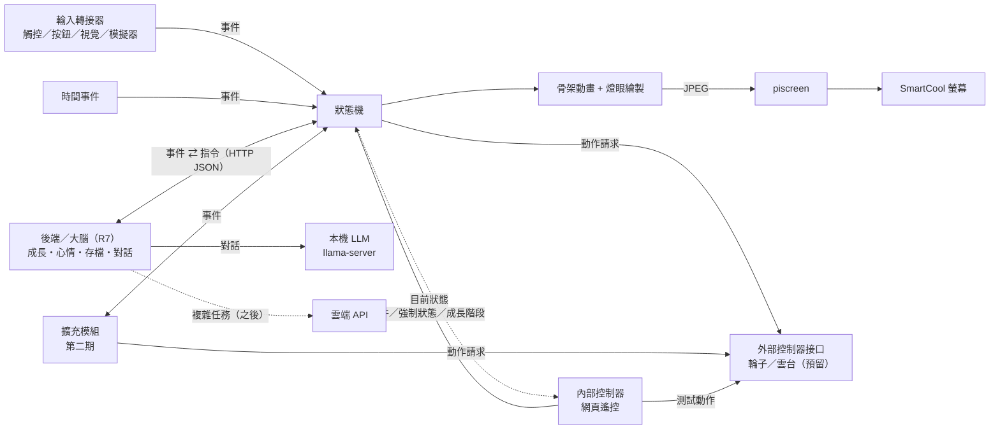

# 桌寵專案 項目書 v1.2

> 最後更新：2026-10-28　｜　狀態：第一期規劃定稿，細節持續補充
>
> v1.1：新增「外部控制器接口」（輪子、雲台，只預留）與「內部控制器：網頁遙控」；架構圖、MVP 清單同步更新。無聊狀態的表現改為左右滾動。
> v1.2：新增「後端（大腦）」章節：API、LLM 路由（本機小模型／雲端處理複雜任務）、目前測試模型 qwen3-14b（R7）；裝置可在螢幕上用對話框說話。

## 1. 專案目標
做一隻放在桌上的實體桌寵：有小螢幕顯示表情動畫，能跟人互動。先在樹莓派上做出原型（之後也會試 ESP32），再比較哪個平台比較適合承載。

### 分期範圍
- **第一期（現在做）**：純桌面電子寵物，有表情、心情、互動、成長／照顧這類養寵物的玩法。
- **第二期（之後做）**：幫忙做事的能力（提醒、通知、查資訊、連 AI 助理等）。**這期不做，只預留接口。**

## 2. 角色設定

> 本章的圖片都只是**錨定／參考圖**，用來定外型方向，不是程式實際使用的素材。實際素材之後會另外做成適合 800×480 螢幕的版本。顏色、細節以文字設定為準，圖之間的差異（例如眼睛顏色）不代表設定。

- **初始形態**：圓球狀的「種子」，金屬感的淡藍色球體，球身有分割線
- **頭頂**：兩根呆毛天線（將來第二期可以用來表示「收到訊號／有事要說」）
- **眼睛**：兩顆會發光的黃色燈眼，是主要的表情來源（亮度、大小、形狀、眨眼）
- **臉部**：額頭一顆小菱形、下方一個小三角形嘴巴
- **成長設定**：「種子」是初始形態，會有成長線。靠什麼成長（時間、互動、餵食或其他）之後再決定，程式先預留「成長值／階段」的資料結構和切換形態的接口。

### 成長階段
| 階段 | 圖 | 外型變化 |
|---|---|---|
| 1. 種子 |  | 圓球、兩根呆毛天線、黃色燈眼、小三角嘴 |
| 2. 長腳 |   | 主要變化：**長出兩隻短腳**。其他細節（側邊模組、眼睛紋路、底座等）參考圖之間不一致，以後再定 |
| 3. 長耳朵（兔耳路線） | 見下方「第三階段兔耳路線」 | 長出兔耳，分初期、中期、末期；目前有 A、B、C 三個版本的參考圖 |
| 4+ | 待定 | |

#### 第三階段兔耳路線（參考圖）
共同變化：長出兔耳，越後期耳朵越大，末期長出白色圓尾巴、四肢伸出、更像兔子。頭頂上的小東西（粉紅小兔、小球、橘色小傢伙、粉紅果子）**先忽略，尚未設定**。版本歸類依使用者給圖時的標註，空格代表還沒有圖。

| 版本 | 初期 | 中期 | 末期 |
|---|---|---|---|
| 未分版 |  | | |
| A | |  |  |
| B | |  |  |
| C |  | |   |

- **A 版**：中期側邊有星星圓形模組；末期內耳是黃色、額頭有白色十字
- **B 版**：中期身體扁圓、白色臉部、額頭有黃色標誌；末期頭上有粉紅小球
- **C 版**：白色臉部、扁圓身體；初期內耳是白色雲朵形，眼睛大圓、有睫毛；末期是趴姿，耳朵長到垂在地上、額頭有三角形標誌、表情慵懶

> 註：這些只是給美術的參考圖，版本與期別的歸類不必精確，之後由美術統整。

#### 其他耳朵系列（未來，先忽略）
- 貓耳系列：可能會有，目前不規劃

### 在螢幕上的表現重點
- 表情主要靠燈眼：眨眼、瞇眼、睜大、閉眼睡覺、眼神左右看
- 天線可以搖擺、彈動，表示開心或驚訝
- 球體可以輕微上下浮動，看起來像在呼吸
- 無聊時會在螢幕上左右**滾動**：球身（分割線）、天線、燈眼、嘴巴、額頭菱形一起跟著轉，像真的在地上滾（不打滑），滾到邊邊晃一晃、停一下再滾回來；光影與地面陰影不轉、陰影跟著球移動

## 3. 硬體與平台

### 目前手邊的硬體
- **樹莓派 3B**（PiOS，內網 IP 192.0.2.43）：第一個原型平台
- **SmartCool 5 吋 USB 螢幕**（800×480，USB ID 2A55:9990）：接在 Pi 上，接口已測好

### 螢幕接口（已測試完成）
Pi 上已經有常駐服務 `piscreend`（systemd `piscreen.service`），它會一直抓住螢幕、自動保活和救援。桌寵程式**不直接碰 USB**，只把畫面丟給它：
- 透過 Unix socket `/run/piscreen/piscreen.sock` 重複送 `[4 byte big-endian 長度][圖片 bytes]`
- 800×480 baseline JPEG 直接轉送，其他尺寸會自動縮放
- Python：`from piscreen_client import Client; Client().send(jpeg_bytes)`
- 實測螢幕可到 60 fps；Pi 3B 上桌寵實際能跑多少 fps 要在原型階段量
- 禁止：USB reset、clear_halt、GETLCD、INQUIRY；也不要頻繁重啟 piscreen 服務

畫面流程：桌寵程式繪出每一格 → 編成 JPEG → 送給 piscreen。

### 候選平台比較
| 項目 | 樹莓派 | ESP32（如 ESP32-S3） |
|---|---|---|
| 運算能力 | 高，可跑 Python、Linux、AI 功能 | 低到中，適合簡單動畫和感測 |
| 開發語言 | Python | C++（Arduino / ESP-IDF）或 MicroPython |
| 耗電 | 較高 | 很低，可用電池 |
| 開機速度 | 慢（數十秒） | 快（約 1 秒） |
| 成本 | 較高 | 較低 |
| 適合 | 語音、聯網服務、較複雜的動畫 | 輕量、省電、反應快 |

## 4. 功能規劃

### MVP（第一版，必做）
- [ ] 種子形態的骨架動畫在 SmartCool 螢幕上跑起來（呼吸、天線擺動、眨眼）
- [ ] 事件驅動狀態機，至少有待機、開心、無聊、睡覺四個狀態
- [ ] 輸入轉接器接口，加上鍵盤／網頁模擬器發事件
- [ ] 時間事件（閒置、夜晚）會切換狀態
- [ ] 成長值／階段的資料結構與切換外型接口（推進規則先不做）
- [ ] 內部控制器：網頁遙控（手機可用，發互動事件、強制切狀態、切成長階段、看目前狀態、測外部控制器）
- [ ] 外部控制器接口（輪子、雲台點頭／搖頭）：只定義接口與記錄用的假控制器，不接真的硬體
- [ ] 後端（大腦）：成長／心情／存檔 API，本機 LLM 對話（備用台詞保底），裝置以對話框顯示寵物說的話

### 後續（可選）
- [ ] 顯示時間、天氣
- [ ] 聲音／語音互動
- [ ] 動作感測（拿起、搖晃）
- [ ] 手機或網頁設定

### 第二期（只預留接口，不實作）
- [ ] 聯網通知、提醒
- [ ] 查資訊、AI 助理
- [ ] 其他幫忙做事的能力

## 5. 架構構想

- **表現層**：骨架動畫與燈眼繪製
- **狀態機**：桌寵的心情與狀態
- **輸入層**：輸入轉接器
- **平台層**：螢幕輸出與輸入驅動（Pi 用 piscreen；ESP32 之後另做）
- **能力擴充接口（第二期用）**：插件式接口，讓「做事能力」掛上來，不必改寵物本體
- **外部控制器接口（預留）**：輪子、雲台等會動的硬體，透過「動作請求」驅動
- **內部控制器（網頁遙控）**：開發與日常操作用的遙控頁面

狀態機、骨架格式和素材都寫成跟平台無關，方便之後移植和比較。

### 核心：事件驅動的狀態機
桌寵本體就是一台狀態機，拆成四層：
1. **事件**：互動（被摸、按按鈕、拿起……）、時間（閒置 N 分鐘、晚上到了）、伺服器指令、擴充模組發的事件，全部統一成事件。
2. **狀態**：待機、開心、無聊、睡覺……（清單待定）。
3. **對應表**：`(目前狀態, 事件) → 下一個狀態`，用設定檔（JSON）描述，不寫死在程式裡。
4. **表現**：每個狀態對應一組骨架動畫和眼睛表情。

範例（僅示意）：
| 目前狀態 | 事件 | 下一個狀態 |
|---|---|---|
| 待機 | 被摸 | 開心 |
| 待機 | 閒置 10 分鐘 | 無聊（左右滾動） |
| 無聊 | 閒置 10 分鐘 | 睡覺 |
| 睡覺 | 被摸 | 待機（醒來） |

好處：新增互動只要加一條對應規則；成長階段只換外型，狀態機共用；第二期的擴充模組也只是發事件、聽事件。

### 輸入接入端口
第一期不綁定任何輸入硬體，只定義**輸入轉接器（Input Adapter）接口**：每種輸入是一個獨立模組，把原始訊號轉成標準事件丟進狀態機。
- 預留類型：**觸控**、**按鈕**、**視覺辨識**（例如 Pi 相機偵測有人靠近、揮手、看著它）
- 標準事件格式範例：`{"type": "touch", "name": "pat", "source": "touch-head", "ts": ...}`
- 開發期用**鍵盤或網頁模擬器**發事件，不需要實體輸入硬體也能測狀態機
- 實際用哪種硬體之後再決定

### 裝置端／伺服器端分工
採**混合架構**：畫面在裝置上算，伺服器當「大腦」。

- **裝置端（Pi 3B）**：跑骨架動畫與繪圖、處理觸摸等即時互動，畫好的每一格轉 JPEG 送給 piscreen。沒網路、伺服器關機時也能獨立運作（待機、眨眼、睡覺）。
- **伺服器端（內網）**：成長值、心情、存檔；第二期的做事能力（AI、提醒）也放這裡。只傳**狀態與指令**給裝置（例如「進入開心狀態」「成長到第三階段」），不傳畫面。
- **備用模式**：若 Pi 3B 畫不動，可改成伺服器渲染、串流 JPEG 給裝置。piscreen 本來就收 JPEG，兩種模式可以並存。
- 內網頻寬沒有限制，不需要為了省頻寬做優化。

### 後端（大腦）
目前跑在家裡的 Windows 桌機 **R7**（`192.0.2.100`），只用 Python 標準函式庫（CPython 3.10+），程式在 repo 的 `backend/`。

**負責的事**
- 成長值、心情（開心、親密、精神），存檔（每隻寵物一個 JSON 檔，原子寫入）、最後上線時間、短期記憶（最近互動與對話）。
- 心情規則先用簡單規則：隨時間往中性值衰減、醒著精神下降、睡覺回復、互動加分；精神太低時建議裝置去睡覺。
- 成長值會累積，**升階段規則還沒決定**：門檻可設定，預設關閉。
- 對話：以「種子」的人設（可愛、短句、繁體中文）回一句話，並附帶情緒與意圖。

**API（HTTP JSON，埠 8090，只在內網）**
| 方法 | 路徑 | 用途 |
|---|---|---|
| POST | `/v1/pet/event` | 裝置回報事件（被摸、計時、狀態改變、心跳），後端更新心情/成長，可回傳指令 |
| POST | `/v1/pet/talk` | 對寵物說話，回傳 `{say, emotion, intent}` 與指令 |
| GET | `/v1/pet/<id>/state` | 讀存檔 |
| GET | `/health` | 服務與 LLM 是否可用 |

指令（後端 → 裝置）：`set_state`、`set_stage`、`say`（螢幕對話框）、`emotion`（燈眼表情）、`actuator`（點頭、搖頭、輪子）。裝置收到後一樣轉成事件，由寵物本體決定怎麼表現。

**LLM 路由**
- **本機小模型**：日常閒聊、表情反應等簡單任務，走內網的 OpenAI 相容服務（llama.cpp `llama-server`）。模型位址、名稱、逾時都寫在設定檔，之後換成 1～3B 的小模型只改設定。
- **雲端 API**：複雜任務（查資料、長文、工具呼叫等，第二期）才送雲端。目前只有路由與接口，預設關閉、沒有金鑰。
- **目前測試模型**：R7 上的 **qwen3-14b**（Qwen3 14B Q4_K_M，64K context），用 `/no_think` 關閉思考，要求只輸出 JSON，實測一句約 0.6 秒。
- **保底**：模型沒開、逾時或回覆格式不對時重試一次，再不行就用固定的備用台詞，對話一定有回應。

**降級原則**：裝置送事件在背景執行，逾時很短；後端或網路掛掉時，寵物照常待機、眨眼、睡覺，只是不會說話也不會成長。

### 動畫：自訂 2D 骨架
- 第一期**自訂簡單的 2D 骨架格式（JSON）**，自己寫輕量 runtime，不綁 Spine／DragonBones／Live2D。
- 每個零件（身體、天線、耳朵、腳、尾巴）掛一根骨頭，動畫用關鍵幀記錄旋轉、位移、縮放。
- 眼睛、嘴巴是發光燈，用程式直接畫（眨眼、瞇眼、看左右），不做貼圖。
- 成長階段只換零件貼圖和骨架，動畫邏輯共用。
- 之後若要用 Spine／DragonBones 編輯動畫，再寫轉換器匯入。

### 能力擴充接口（預留設計）
第一期只定義接口、放一個空的範例，不做真正的功能。
- **事件匯流排**：寵物本體發出事件（被摸、醒來、閒置……），擴充模組可以訂閱；擴充模組也能發事件給寵物（例如「有提醒」）。
- **動作請求**：擴充模組可以請寵物做表情、顯示一段文字或播聲音，寵物本體決定怎麼表現。
- **模組註冊**：每個能力是一個獨立模組，有名稱、啟用開關、初始化和停止。
- **通訊方式**：樹莓派可用本機 API（如 HTTP／MQTT），ESP32 可用序列埠或 Wi‑Fi／MQTT，讓兩個平台的接口格式一致。

### 外部控制器接口（預留）
之後桌寵可能裝上會動的硬體，第一期**只定義接口、不接真的硬體**：
- **輪子**：前進、後退、左轉、右轉、停止，可設定速度與持續時間。
- **雲台（兩軸）**：點頭＝上下（tilt）、搖頭＝左右（pan）、設定角度、轉動速度、回正。
- **怎麼觸發**：狀態或擴充模組不直接控制硬體，而是發「動作請求」事件（例如 `{"type":"action","name":"motion","params":{"motion":"nod"}}`），由控制器分派給對應硬體。例如進入「開心」時請雲台輕輕點一下頭。
- **目前實作**：只有記錄用的假控制器（LoggingActuator，把動作寫進 log 並顯示在網頁遙控上）和什麼都不做的 NullActuator；真的馬達／伺服機驅動之後再寫。
- **安全**：程式結束時一定呼叫停止（輪子停、雲台回正）。

### 內部控制器：網頁遙控
在還沒有實體輸入硬體之前，「內部控制器」先做成一個網頁遙控：
- 由桌寵主程式一起開（Python 內建 HTTP 伺服器，不用另外裝套件），手機瀏覽器打開 Pi 的網址就能用，介面是繁體中文。
- 功能：送互動事件（摸頭、戳、按按鈕、有人靠近、叫醒、睡覺……）、強制切換狀態、切換成長階段、測試外部控制器（點頭、搖頭、輪子前後左右停）。
- 會每秒更新顯示目前狀態、成長階段、表情、畫面 fps、最後事件、外部控制器紀錄。
- 同一組 HTTP 接口（`POST /event`、`/control`、`/actuator`，`GET /status`）也給開發時用指令測試。
- 只在家裡內網使用，沒有密碼，不對外開放。

## 6. 開發階段
1. ~~確認角色方向與硬體~~（已完成：參考圖、Pi 3B、SmartCool 螢幕接口）
2. 骨架格式與 runtime、狀態機、輸入模擬器（可在電腦上先跑）
3. 樹莓派原型（接 piscreen，量 fps）
4. ESP32 原型
5. 比較兩平台（流暢度、耗電、成本、開發難度），選定平台
6. 外殼與完整版

## 7. 平台評估指標
- 動畫流暢度（FPS）
- 待機與運作耗電
- 開機時間
- 硬體成本
- 開發與維護難度

## 8. 待決定事項
- 階段內的「初期／中期／末期」是不是每個階段都有？
- 什麼條件決定走哪條耳朵系列（兔耳、未來的貓耳……）？
- 成長線的推進方式（時間、互動或其他）和各階段的形態？
- 要不要電池、可攜？
