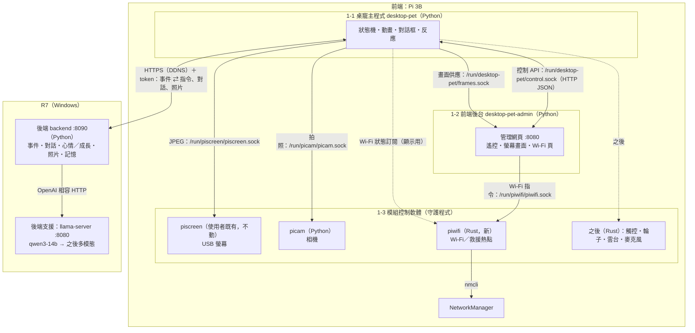
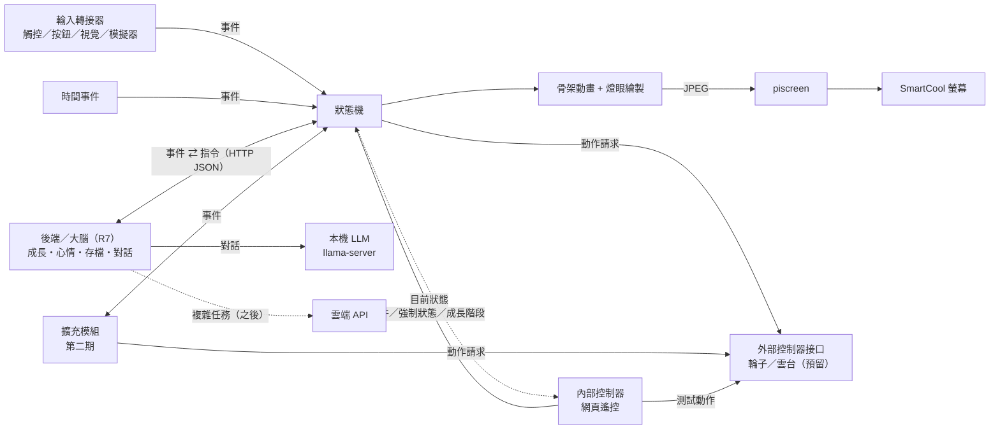
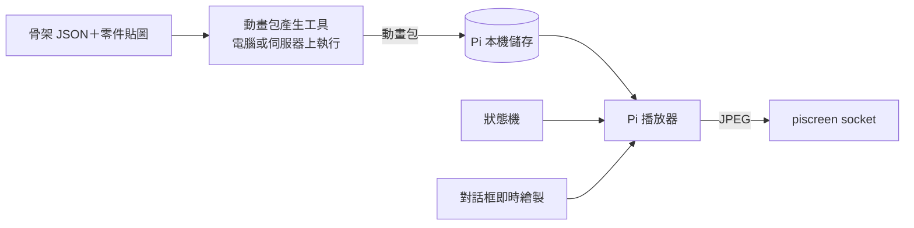

# 桌寵專案 項目書 v2.7

> 最後更新：2026-10-28　｜　狀態：第一期規劃定稿，細節持續補充
>
> v1.1：新增「外部控制器接口」（輪子、雲台，只預留）與「內部控制器：網頁遙控」；架構圖、MVP 清單同步更新。無聊狀態的表現改為左右滾動。
> v1.2：新增「後端（大腦）」章節：API、LLM 路由（本機小模型／雲端處理複雜任務）、目前測試模型 qwen3-14b（R7）；裝置可在螢幕上用對話框說話。
> v1.3：新增「裝置端效能與多核心」：Pi 3B 實測 fps 與瓶頸，繪圖／編碼拆成多行程流水線的規格與驗收標準。
> v1.4：裝置端改成「預錄動畫為主」：骨架改當離線產生動畫包的工具，Pi 只播事先算好的 JPEG 幀，對話框即時疊上去；多核心流水線降為備案。
> v1.5：預錄動畫播放實作完成並在 Pi 3B 實測（見「裝置端：預錄動畫播放」的「實作結果」）；補上表情片段、切換點規則、動畫包不進 git 等實作細節。
> v1.6：補齊「目前進度」「部署與維運」「安全」「測試與驗收」「風險」章節；MVP 勾選實際完成項；狀態清單定稿為第一期四個；待決定事項更新。
> v1.7：網頁遙控新增「Wi‑Fi 設定」：掃描與連線、自動記錄連過的網路、斷線自動依序重試、都連不上時開設定熱點。
> v1.8：Wi‑Fi 設定已實作並部署（見該節「實作備註」）：在桌寵程式內跑、polkit 規則開權限、熱點需關 PMF、多一個手動開關熱點的 API。
> v1.9：新增第一個能力模組「拍照傳給後端」（camera.snapshot），觸發方式只留接口、之後再決定。
> v2.0：後端設好 `api_token`（裝置用 token 檔帶上，`/health` 對外只回基本資訊）；拍照模組實作完成並在 Pi 實測（見該節「實作備註」）。
> v2.1：新增「週邊常駐服務原則」：每個週邊由一個專門的常駐程式獨占、負責對接；新增相機常駐服務 picam，拍照改成多個觸發共用同一張照片、分送給每個請求者（取代冷卻與「相機忙碌」）。
> v2.2：網頁遙控新增「螢幕畫面同步」：送到螢幕的每張畫面同步一份到網頁，方便遠端調整。
> v2.7：新增「後端控制網頁」（只限內網，另開 listener，網際網路連不到）、「前後端連線安全：API 金鑰」（每台裝置一把、綁 pet_id、全部 `/v1/*` 都要、速率限制與鎖定、不中斷遷移）、「14. 專案公開前的檢查」；v2.6 的六個問題已決定。控制網頁與金鑰是規格，尚未實作。
> v2.6：定下整體架構（見「整體架構」）：三層（前端／後端／後端支援）；前端拆成桌寵主程式、前端後台（獨立程式）、各模組守護程式（一個程式獨占一個模組，可給別的專案用）；新的常駐守護程式改用 Rust，先做 Wi‑Fi 的 piwifi；附遷移步驟。v2.5 的多模態與記憶規格**擱置**，問題暫緩。
> v2.5：新增「後端：多模態模型」與「後端：記憶系統」規格（**待核准，尚未實作**）：R7 現況調查、提議以 Qwen3-VL-8B 取代 qwen3-14b（含 A/B 與回退）、三層記憶（短期對話、長期事實、日記）存在後端 SQLite。
> v2.4：裝置端（Pi `desktop-pet.service`）與後端（R7 工作排程器）改成開機／登入自動啟動，見「部署與維運」。
> v2.3：picam 相機常駐服務、camera.snapshot 改成 picam client、camcast 改成訂閱 client、螢幕畫面同步都已實作並在 Pi 實測（見各節「實作備註」）。

## 1. 專案目標
做一隻放在桌上的實體桌寵：有小螢幕顯示表情動畫，能跟人互動。先在樹莓派上做出原型（之後也會試 ESP32），再比較哪個平台比較適合承載。

### 分期範圍
- **第一期（現在做）**：純桌面電子寵物，有表情、心情、互動、成長／照顧這類養寵物的玩法。
- **第二期（之後做）**：幫忙做事的能力（提醒、通知、查資訊、連 AI 助理等）。**這期不做，只預留接口。**

## 2. 角色設定

> 本章的圖片都只是**錨定／參考圖**，用來定外型方向，不是程式實際使用的素材。實際素材之後會另外做成適合 800×480 螢幕的版本。顏色、細節以文字設定為準，圖之間的差異（例如眼睛顏色）不代表設定。

> 參考圖已從公開 repo 移除，外型以下方文字設定為準。

- **初始形態**：圓球狀的「種子」，金屬感的淡藍色球體，球身有分割線
- **頭頂**：兩根呆毛天線（將來第二期可以用來表示「收到訊號／有事要說」）
- **眼睛**：兩顆會發光的黃色燈眼，是主要的表情來源（亮度、大小、形狀、眨眼）
- **臉部**：額頭一顆小菱形、下方一個小三角形嘴巴
- **成長設定**：「種子」是初始形態，會有成長線。靠什麼成長（時間、互動、餵食或其他）之後再決定，程式先預留「成長值／階段」的資料結構和切換形態的接口。

### 成長階段
| 階段 | 圖 | 外型變化 |
|---|---|---|
| 1. 種子 | （參考圖未公開） | 圓球、兩根呆毛天線、黃色燈眼、小三角嘴 |
| 2. 長腳 | （參考圖未公開） | 主要變化：**長出兩隻短腳**。其他細節（側邊模組、眼睛紋路、底座等）參考圖之間不一致，以後再定 |
| 3. 長耳朵（兔耳路線） | 見下方「第三階段兔耳路線」 | 長出兔耳，分初期、中期、末期；目前有 A、B、C 三個版本的參考圖 |
| 4+ | 待定 | |

#### 第三階段兔耳路線（參考圖）
共同變化：長出兔耳，越後期耳朵越大，末期長出白色圓尾巴、四肢伸出、更像兔子。頭頂上的小東西（粉紅小兔、小球、橘色小傢伙、粉紅果子）**先忽略，尚未設定**。版本歸類依使用者給圖時的標註，空格代表還沒有圖。

| 版本 | 初期 | 中期 | 末期 |
|---|---|---|---|
| 未分版 | （參考圖未公開） | | |
| A | | （參考圖未公開） | （參考圖未公開） |
| B | | （參考圖未公開） | （參考圖未公開） |
| C | （參考圖未公開） | | （參考圖未公開） |

- **A 版**：中期側邊有星星圓形模組；末期內耳是黃色、額頭有白色十字
- **B 版**：中期身體扁圓、白色臉部、額頭有黃色標誌；末期頭上有粉紅小球
- **C 版**：白色臉部、扁圓身體；初期內耳是白色雲朵形，眼睛大圓、有睫毛；末期是趴姿，耳朵長到垂在地上、額頭有三角形標誌、表情慵懶

> 註：這些只是給美術的參考圖，版本與期別的歸類不必精確，之後由美術統整。

#### 其他耳朵系列（未來，先忽略）
- 貓耳系列：可能會有，目前不規劃

### 在螢幕上的表現重點
- 表情主要靠燈眼：眨眼、瞇眼、睜大、閉眼睡覺、眼神左右看
- 天線可以搖擺、彈動，表示開心或驚訝
- 球體可以輕微上下浮動，看起來像在呼吸
- 無聊時會在螢幕上左右**滾動**：球身（分割線）、天線、燈眼、嘴巴、額頭菱形一起跟著轉，像真的在地上滾（不打滑），滾到邊邊晃一晃、停一下再滾回來；光影與地面陰影不轉、陰影跟著球移動

## 3. 硬體與平台

### 目前手邊的硬體
- **樹莓派 3B**（PiOS，內網 IP 192.0.2.43）：第一個原型平台
- **SmartCool 5 吋 USB 螢幕**（800×480，USB ID 2A55:9990）：接在 Pi 上，接口已測好

### 螢幕接口（已測試完成）
Pi 上已經有常駐服務 `piscreend`（systemd `piscreen.service`），它會一直抓住螢幕、自動保活和救援。桌寵程式**不直接碰 USB**，只把畫面丟給它：
- 透過 Unix socket `/run/piscreen/piscreen.sock` 重複送 `[4 byte big-endian 長度][圖片 bytes]`
- 800×480 baseline JPEG 直接轉送，其他尺寸會自動縮放
- Python：`from piscreen_client import Client; Client().send(jpeg_bytes)`
- 實測螢幕可到 60 fps；Pi 3B 上即時繪圖版實測只有 10~14 fps，因此改成播放預錄動畫（見「裝置端：預錄動畫播放」）
- 禁止：USB reset、clear_halt、GETLCD、INQUIRY；也不要頻繁重啟 piscreen 服務

畫面流程：桌寵程式繪出每一格 → 編成 JPEG → 送給 piscreen。

### 候選平台比較
| 項目 | 樹莓派 | ESP32（如 ESP32-S3） |
|---|---|---|
| 運算能力 | 高，可跑 Python、Linux、AI 功能 | 低到中，適合簡單動畫和感測 |
| 開發語言 | Python | C++（Arduino / ESP-IDF）或 MicroPython |
| 耗電 | 較高 | 很低，可用電池 |
| 開機速度 | 慢（數十秒） | 快（約 1 秒） |
| 成本 | 較高 | 較低 |
| 適合 | 語音、聯網服務、較複雜的動畫 | 輕量、省電、反應快 |

## 4. 功能規劃

### MVP（第一版，必做）
- [x] 種子形態的骨架動畫在 SmartCool 螢幕上跑起來（呼吸、天線擺動、眨眼）
- [x] 事件驅動狀態機，至少有待機、開心、無聊、睡覺四個狀態
- [x] 輸入轉接器接口，加上鍵盤／網頁模擬器發事件
- [x] 時間事件（閒置、夜晚）會切換狀態
- [x] 成長值／階段的資料結構與切換外型接口（推進規則先不做）
- [x] 內部控制器：網頁遙控（手機可用，發互動事件、強制切狀態、切成長階段、看目前狀態、測外部控制器）
- [x] 外部控制器接口（輪子、雲台點頭／搖頭）：只定義接口與記錄用的假控制器，不接真的硬體
- [x] 後端（大腦）：成長／心情／存檔 API，本機 LLM 對話（備用台詞保底），裝置以對話框顯示寵物說的話

### 後續（可選）
- [ ] 顯示時間、天氣
- [ ] 聲音／語音互動
- [ ] 動作感測（拿起、搖晃）
- [ ] 手機或網頁設定

### 第二期（只預留接口，不實作）
- [ ] 聯網通知、提醒
- [ ] 查資訊、AI 助理
- [ ] 其他幫忙做事的能力

## 5. 架構構想
### 整體架構（v2.6：三層、前端拆成獨立程式）
> v2.6 定下整體架構。本節優先於後面各節裡「在桌寵程式裡跑」的描述。
> 下面的「狀態機」圖是「桌寵主程式」內部的邏輯；網頁遙控、Wi‑Fi、螢幕畫面同步會依「遷移步驟」逐步搬出主程式。
> 本節是規格，**尚未實作**。

**三層**
1. **前端（Pi 3B）**，分三部分：
   - **1-1 桌寵主程式** `desktop-pet`：狀態機、動畫播放、對話框、反應，跟後端溝通（事件、對話、上傳照片）。**只做寵物本身**，不開網頁、不管 Wi‑Fi。
   - **1-2 前端後台** `desktop-pet-admin`：管理網頁（遙控、螢幕畫面同步、Wi‑Fi 設定頁，之後的記憶頁），是**獨立程式**。
     - 網頁掛掉不影響寵物。
     - 主程式重啟時，網頁和 Wi‑Fi 救援照常可用。
   - **1-3 各模組控制軟體**（守護程式）：**一個程式獨占一個模組**，其他程式一律透過它的 socket 使用該模組。
     - 螢幕 → piscreen
     - 相機 → picam
     - Wi‑Fi → **piwifi**（新）
     - 之後：觸控、輪子、雲台、麥克風
2. **後端（R7）** `backend`：事件、對話、心情／成長、照片、記憶（v2.5，擱置中）。
3. **後端支援（模型，R7）**：llama-server（目前 qwen3-14b），之後是多模態模型（v2.5，擱置中）。後端以 OpenAI 相容 HTTP 呼叫，模型本身不存任何狀態。

**元件表**
| 元件 | 層 | 語言 | 獨占的硬體 | socket／埠 | systemd unit（R7 為排程） | 開機啟動 |
|---|---|---|---|---|---|---|
| desktop-pet（桌寵主程式） | 1-1 | Python | 無（螢幕、相機都當 client） | `/run/desktop-pet/control.sock`、`/run/desktop-pet/frames.sock` | `desktop-pet.service`（已有） | 是 |
| desktop-pet-admin（前端後台） | 1-2 | Python | 無 | `0.0.0.0:8080`（網頁） | `desktop-pet-admin.service`（新） | 是 |
| piscreen | 1-3 | Python（使用者既有，**不動**） | USB 螢幕 | `/run/piscreen/piscreen.sock` | `piscreen.service` | 是 |
| picam | 1-3 | Python | 相機 | `/run/picam/picam.sock` | `picam.service`（已有） | 是 |
| piwifi | 1-3 | **Rust** | Wi‑Fi（wlan0，經 NetworkManager）、救援熱點 `PetRescue-AP` | `/run/piwifi/piwifi.sock` | `piwifi.service`（新） | 是 |
| pitouch／piwheels／pigimbal／pimic | 1-3 | Rust（預定） | 觸控／輪子／雲台／麥克風 | `/run/<名稱>/<名稱>.sock` | `<名稱>.service` | 是（有硬體才裝） |
| camcast（測試工具） | 工具 | Python | 無（picam 預覽 client） | — | 無，手動 `~/camcast/start.sh` | 否 |
| backend（後端） | 2 | Python | R7 上的 `backend/data/` | `0.0.0.0:8090`（DDNS 對外） | 工作排程器 `DesktopPet Backend` | 登入時 |
| llama-server | 3 | C++（llama.cpp） | R7 顯示卡 | `127.0.0.1:8080` | 無，桌面 `Start-Qwen3.bat` 手動 | 否（v2.5 待決定） |
| 多模態模型（v2.5） | 3 | C++（llama.cpp） | R7 顯示卡 | 同上 | 同上 | 擱置中 |

**主程式 ↔ 前端後台的接口**
- 兩條 Unix socket，放在 `/run/desktop-pet/`：
  - systemd 的 `RuntimeDirectory=desktop-pet`、`RuntimeDirectoryPreserve=yes`，權限 0750，群組 @USER@。
  - 主程式建立 socket；後台連不上就每 2 秒重試。
  - 不開 TCP 埠，內網其他機器碰不到。
- **控制 API**：`control.sock`，用 HTTP/1.1＋JSON（Python 標準庫就能做，除錯可直接用 `curl --unix-socket`）。
  - 路徑都有版本前綴 `/v1`，回應標頭 `X-Proto: desktop-pet-core/1`。
  - `GET /v1/health`：`{ok, version, proto, uptime, fps}`。
  - `GET /v1/status`：就是現在 `/status` 的內容（狀態、階段、表情、fps、最後事件、後端連線……）。
  - `POST /v1/event`、`/v1/control`、`/v1/actuator`、`/v1/talk`：跟現在網頁遙控的同名接口一樣。
  - `POST /v1/skill/camera.snapshot`、`GET /v1/skill/camera.snapshot`、`GET /v1/skill/camera.snapshot/last.jpg`：拍照。
  - `POST /v1/notice {"kind":"wifi","text":"…","until":…}`：後台請主程式在螢幕上顯示提示（例如「熱點 PetRescue-AP」）。**只在遷移第 1 步用**；第 2 步起主程式直接訂閱 piwifi。
  - 錯誤一律 `{ok:false, error}` 加適當的 HTTP 碼。主程式忙的時候也要在 1 秒內回應（請求只排進事件佇列）。
- **畫面供應**：`frames.sock`，跟 picam 預覽同一種格式。
  - 後台送 `{"v":1,"cmd":"subscribe","fps":10}`。主程式回 `{"ok":true,"proto":1}`，接著每格送：
    一行 JSON 標頭 `{"seq","ts","mode":"pack|live","clip","w","h","size"}` ＋ `[4 byte big-endian 長度][JPEG]`。
  - `{"v":1,"cmd":"latest"}`：只回最新一張。
  - JPEG 就是主程式送給 piscreen 的**同一份 bytes**，在主程式送出時順手交一份。所以**不經過 piscreen、piscreen 完全不用改**。
  - 省資源：
    - 沒有訂閱者時不做任何事。
    - 每個訂閱者只留最新一張，慢的就丟舊畫面，不拖慢 20 fps 主迴圈。
    - 訂閱上限 2：後台只開一條，再把同一份畫面分給所有網頁觀看者（觀看人數上限仍是 3）。
  - 網頁路由（`/screen.mjpg`、`/screen.jpg`、`/screen.info`）改由後台提供，網址和遙控頁不變。
- **主程式不在時**：
  - 後台回 `503 {"ok":false,"error":"桌寵主程式未執行"}`，網頁頂端顯示「主程式重新啟動中」。
  - Wi‑Fi 頁、熱點、狀態頁照常可用。
  - 螢幕由 piscreen 保持最後一張畫面（piscreen 既有行為，不改）。
- **誰叫後端**：照舊由主程式叫（事件、對話、上傳照片、token 檔也只給主程式）。後台的「對話」按鈕轉給主程式的 `/v1/talk`，後台不碰 token。

**守護程式的共同規範（每一個都要做到，方便以後給別的專案用）**
- **自己一個資料夾，可以直接拆成獨立 repo**：`services/<名稱>/`。
  - 內含 `README.md`（用途、安裝、設定）、`PROTOCOL.md`（協定、版本）、`CHANGELOG.md`、systemd unit、`install.sh`，以及原始碼（Rust 是 `Cargo.toml`＋`src/`）。
  - **不 import `pet/`**，也不依賴桌寵的設定檔。client 函式庫（例如 `picam_client.py`）放在守護程式自己的資料夾，桌寵只是使用者。
- **協定有版本**：
  - 每個請求帶 `"v":1`；沒帶的視為 v1（相容現有的 picam client）。
  - `status` 回應帶 `proto` 與 `version`。
  - 不相容的修改升主版本，舊版本保留一段時間。
- **socket**：`/run/<名稱>/<名稱>.sock`，JSON 一行一個請求（需要時接二進位資料）。
  - 權限 0660，群組可設定（這個專案用 @USER@）。
  - 每個都有 `status` 與 `subscribe`（事件推送）。
- **狀態檔** `/run/<名稱>/status.json`，共同欄位：`name, version, proto, pid, started, uptime, clients, errors, last_error, last_error_ts`，再加各自的欄位。
- **日誌**：stdout／stderr 交給 journald，第一個字是等級，一行一件事。
  - **不寫密碼、token、照片內容**。Wi‑Fi 只寫 SSID，連 SSID 都可以設定成遮蔽。
- **systemd**：`Restart=always`、`RestartSec=2～3`、`StartLimitIntervalSec=0`。
  - 相依只用 `Wants=`／`After=`，**不用 `Requires=`**，不會連帶停止別的服務（跟 `desktop-pet.service` 一樣）。
  - 安裝腳本可以重跑，不會覆蓋使用者的設定檔。
- **整合打包版**：以後有需要時另外做（例如一個 deb 或一個安裝腳本裝全部）。這是另一種打包方式，**不改變各元件獨立的原則**。

**語言**
- **Rust**：新寫的、簡單又常駐的守護程式，先做 **piwifi**，之後是觸控、輪子、雲台，麥克風大概也是。
  - 理由是實測數字。CPU 都很低：desktop-pet 1.6～4.2%，picam 閒置約 1.2%。
  - 真正的成本是 1 GB Pi 3B 上的**記憶體**：2026-10-28 實測 RSS，desktop-pet 約 51 MB、picam 約 54～61 MB、piscreend 約 27 MB。每個 Python 常駐程式大約 25～60 MB，Rust 只要幾 MB。
- **維持 Python**：
  - **picam**：Picamera2 只有 Python 版，改 Rust 要直接綁 libcamera，得不償失。
  - **桌寵主程式**、**前端後台**：常常改。
  - **R7 後端**。
- **以後才重寫**：只有實測顯示太重（例如 RSS 長期 > 80 MB，或 Pi 可用記憶體 < 200 MB）才考慮。協定都走 socket，換掉一個元件不影響其他元件。
- **piscreen** 是使用者既有的程式，**不動**。

**Rust 怎麼編給 Pi 3B**
- Pi 實測（2026-10-28，唯讀）：`uname -m` = **aarch64**，`dpkg --print-architecture` = **arm64**（64 位元 PiOS，Debian 13 trixie，kernel 6.18 rpi-v8，glibc 2.41）。所以目標是 **aarch64**，不是 armv7。
- **主要做法：在 box 交叉編譯成靜態執行檔**。目標 `aarch64-unknown-linux-musl`，完全靜態，不吃 Pi 的 glibc 版本，拿去別的 64 位元 Pi 也能跑。
  - box 是 Debian 13 x86_64，目前有系統的 rustc／cargo 1.85，但**沒有 aarch64 標準庫**。
  - 第 2 步開始時用 rustup 裝 stable 工具鏈，加上 `rustup target add aarch64-unknown-linux-musl`。
  - 連結器用 `gcc-aarch64-linux-gnu`（apt）或 rust 內附的 `rust-lld`，第 2 步第一件事就是驗證可用。
  - 每個守護程式的資料夾放 `rust-toolchain.toml` 鎖定版本，放 `.cargo/config.toml` 設定目標與連結器。
  - `--release`，開 `lto`、`strip`、`opt-level="s"`、`panic="abort"`。
  - 相依盡量少：serde／serde_json，用標準庫的執行緒，不用 tokio。預估執行檔 1～2 MB、RSS 2～5 MB。
- **備案：在 Pi 上編**。Pi 已有 gcc，裝 rustup 後 `cargo build --release -j2`。Pi 只有 905 MB 記憶體，大型相依可能很慢或記憶體不足，所以只當備案。
- **執行檔放哪裡**：
  - **不進 git**。box 上 `services/<名稱>/target/` 被 `.gitignore` 排除。
  - 打包成 `dist/<名稱>-<版本>-aarch64-linux-musl.tar.gz`，附 sha256，也不進 git。
  - Pi 上裝在 `/opt/<名稱>/<版本>/<名稱>`，`/usr/local/bin/<名稱>` 指向目前版本。
  - 保留前一版，回退只要改連結再重啟。
  - 要不要另外放到 GitHub Releases，待決定。
- 同一個執行檔也是除錯用的 client：`piwifi status`、`piwifi scan`、`piwifi events`（連自己的 socket）。

**piwifi（Wi‑Fi 守護程式，Rust）**
- 接手現在 `pet/wifi.py` 的全部工作：
  - 透過 `nmcli` 和 NetworkManager 互動，只對 wlan0 與 Wi‑Fi 連線設定下指令。先沿用已測過的 nmcli 做法，D-Bus 以後再說。
  - 已記錄網路依優先順序自動重試。
  - 換網路失敗自動切回。
  - 2 分鐘都連不上就開救援熱點 `PetRescue-AP`（關 PMF、2.4 GHz、共用模式）；熱點開著時定期關掉重試。
- **不碰** eth0、USB、piscreen，**不刪**使用者的已存網路。
- 協定（v1，`/run/piwifi/piwifi.sock`）：
  - `status`、`scan`、`saved`、`connect {ssid,password?,hidden?}`、`forget {uuid}`、`priority {uuid,value}`、`hotspot {on}`。
  - `subscribe`：推送狀態變化，例如 connected／connecting／hotspot。
  - 欄位和現在的 `/wifi/*` API 一樣，後台只是轉送，**網頁不用改**。
- 權限：
  - 用專用系統使用者 `piwifi` 跑，polkit 規則給它跟現在一樣的四個 NetworkManager 動作。
  - 熱點密碼移到 `/etc/piwifi/hotspot.conf`（root:piwifi 0640），**密碼不會出現在 socket 回應、日誌、repo**。
  - `password` 只在 `connect` 請求裡經過 socket，傳給 nmcli 後就丟掉，不寫日誌。
- 開機就跑，排在 NetworkManager 之後（`After=NetworkManager.service`，只用 `Wants=`）。所以就算桌寵主程式、後台都沒起來，救援熱點照樣會開。
  - 熱點網址（熱點閘道 IP 的 `:8080`，執行時從 wlan0 實際 IP 取得）由後台提供。

**遷移步驟（從現在的狀態開始；每一步都不能讓救援熱點或螢幕壞掉）**
- 現在：網頁遙控、Wi‑Fi 管理、螢幕畫面同步都是 desktop-pet 裡的執行緒。
- 每一步完成時都要驗收，有任何一項不過就回到上一步：
  - 20 fps、遙控頁看得到螢幕畫面、拍照成功。
  - piscreen 錯誤與救援 0。
  - `POST /wifi/hotspot on` → 手機看得到 `PetRescue-AP` 並打得開網頁 → `off` → 自動連回 HomeAP。測試時 Pi 經有線 192.0.2.43 維持可連。
  - 主程式 `systemctl kill` 後，網頁、Wi‑Fi 頁仍可用（第 1 步起）。

1. **拆出前端後台（Python）**
   - 主程式新增 `control.sock`、`frames.sock`（先跟現有的 :8080 並存）。
   - 新程式 `desktop-pet-admin` 先開在 :8081 測試：遙控、螢幕畫面、拍照、對話都經控制 API。
   - Wi‑Fi 管理（現有的 `pet/wifi.py` 程式碼）**搬到後台這個程式**裡跑。熱點提示用 `/v1/notice` 請主程式顯示。
   - 切換時**同一次操作**完成：主程式改 `--web off --wifi off`，後台開 :8080 並啟動 Wi‑Fi 管理。**確保任何時候只有一個 Wi‑Fi 管理在跑**。
   - 這一步之後，主程式重啟時網頁和 Wi‑Fi 救援都還在。
   - 回退：停用後台，主程式改回原本參數。
2. **piwifi（Rust）取代程序內的 Wi‑Fi 管理**
   - 先在 box 驗證交叉編譯，再寫 piwifi，用假 nmcli 做和 Python 版相同的測試。
   - 在 Pi 上先以 `--observe` 模式跑（只讀狀態、不下任何指令），跟後台裡的 Python 版並行比對 1 天。
   - 切換：建 `piwifi` 使用者、polkit 規則、搬熱點設定檔 → 後台停掉內建 Wi‑Fi 管理、改當 piwifi client → piwifi 改成正式模式。這也是**同一次操作**完成。
   - 主程式改成直接訂閱 piwifi 的狀態來顯示提示，`/v1/notice` 保留給其他用途。
   - 舊的 polkit 規則（給 @USER@）在穩定 1 週後才移除。
   - 回退：停 piwifi，後台改回內建 Wi‑Fi 管理。
3. **整理現有守護程式**
   - picam 補 `PROTOCOL.md`、`CHANGELOG.md`、`"v":1` 與共同狀態欄位，維持相容。
   - 桌寵端的 client 程式碼只用守護程式資料夾提供的 client。
   - piscreen 不動，只在文件裡記錄它的協定。
4. **新模組依硬體到貨逐一加入（Rust）**：觸控（pitouch）、輪子（piwheels）、雲台（pigimbal）、麥克風（pimic），都照共同規範。主程式只透過它們的 socket 使用。
5. **（之後，選用）整合打包版**：一個安裝包裝全部元件，各元件仍是獨立程式。

**日誌與查問題（每個元件）**
| 元件 | 日誌 | 狀態指令 |
|---|---|---|
| desktop-pet | `journalctl -u desktop-pet -f` | `curl -s --unix-socket /run/desktop-pet/control.sock http://x/v1/status` |
| desktop-pet-admin | `journalctl -u desktop-pet-admin -f` | `curl -s http://127.0.0.1:8080/admin/status`（後台自己、主程式連線、piwifi 連線） |
| piscreen | `journalctl -u piscreen -f` | `cat /run/piscreen/status.json` |
| picam | `journalctl -u picam -f` | `cat /run/picam/status.json` |
| piwifi | `journalctl -u piwifi -f` | `piwifi status`（或 `cat /run/piwifi/status.json`） |
| 全部 Pi 服務 | — | `systemctl status desktop-pet desktop-pet-admin picam piwifi piscreen` |
| backend（R7） | `backend_out.log`、`backend_err.log`、`backend_supervisor.log` | `curl http://127.0.0.1:8090/health`、`Get-ScheduledTask "DesktopPet Backend"` |
| llama-server（R7） | 它自己的視窗 | `curl http://127.0.0.1:8080/props` |

查問題的順序：先看 `status.json`／狀態指令裡哪個元件的 `errors`、`clients` 不對，再看那個元件的日誌。
- 網頁打不開 → 後台。
- 網頁開了但「主程式未執行」→ 主程式。
- 沒畫面 → piscreen。
- 不會說話 → 後端或 LLM。

### 主程式內部邏輯（狀態機）

- **表現層**：骨架動畫與燈眼繪製
- **狀態機**：桌寵的心情與狀態
- **輸入層**：輸入轉接器
- **平台層**：螢幕輸出與輸入驅動（Pi 用 piscreen；ESP32 之後另做）
- **能力擴充接口（第二期用）**：插件式接口，讓「做事能力」掛上來，不必改寵物本體
- **外部控制器接口（預留）**：輪子、雲台等會動的硬體，透過「動作請求」驅動
- **內部控制器（網頁遙控）**：開發與日常操作用的遙控頁面

狀態機、骨架格式和素材都寫成跟平台無關，方便之後移植和比較。

### 核心：事件驅動的狀態機
桌寵本體就是一台狀態機，拆成四層：
1. **事件**：互動（被摸、按按鈕、拿起……）、時間（閒置 N 分鐘、晚上到了）、伺服器指令、擴充模組發的事件，全部統一成事件。
2. **狀態**：第一期定稿為**待機、開心、無聊（滾動）、睡覺**四個；「說話」不是狀態，是疊在任何狀態上的對話框。之後要加狀態照「動畫包」章節的流程新增。
3. **對應表**：`(目前狀態, 事件) → 下一個狀態`，用設定檔（JSON）描述，不寫死在程式裡。
4. **表現**：每個狀態對應一組骨架動畫和眼睛表情。

範例（僅示意）：
| 目前狀態 | 事件 | 下一個狀態 |
|---|---|---|
| 待機 | 被摸 | 開心 |
| 待機 | 閒置 10 分鐘 | 無聊（左右滾動） |
| 無聊 | 閒置 10 分鐘 | 睡覺 |
| 睡覺 | 被摸 | 待機（醒來） |

好處：新增互動只要加一條對應規則；成長階段只換外型，狀態機共用；第二期的擴充模組也只是發事件、聽事件。

### 輸入接入端口
第一期不綁定任何輸入硬體，只定義**輸入轉接器（Input Adapter）接口**：每種輸入是一個獨立模組，把原始訊號轉成標準事件丟進狀態機。
- 預留類型：**觸控**、**按鈕**、**視覺辨識**（例如 Pi 相機偵測有人靠近、揮手、看著它）
- 標準事件格式範例：`{"type": "touch", "name": "pat", "source": "touch-head", "ts": ...}`
- 開發期用**鍵盤或網頁模擬器**發事件，不需要實體輸入硬體也能測狀態機
- 實際用哪種硬體之後再決定

### 裝置端／伺服器端分工
採**混合架構**：畫面在裝置上算，伺服器當「大腦」。

- **裝置端（Pi 3B）**：播放事先算好的動畫包（JPEG 幀），只即時畫對話框；處理觸摸等即時互動，每一格送給 piscreen。沒網路、伺服器關機時也能獨立運作（待機、眨眼、睡覺）。
- **伺服器端（內網）**：成長值、心情、存檔；第二期的做事能力（AI、提醒）也放這裡。只傳**狀態與指令**給裝置（例如「進入開心狀態」「成長到第三階段」），不傳畫面。
- **備用模式**：若 Pi 3B 畫不動，可改成伺服器渲染、串流 JPEG 給裝置。piscreen 本來就收 JPEG，兩種模式可以並存。
- 內網頻寬沒有限制，不需要為了省頻寬做優化。

### 裝置端：預錄動畫播放
**為什麼改**：Pi 3B 即時繪圖實測只有 10~14 fps（目標 20），而且吃滿 1 顆核心。動畫內容是固定的，沒必要每一格都在 Pi 上重算；儲存空間足夠，所以改成**事先算好、Pi 只負責播放**。

**動畫包（離線產生）**
- 骨架系統改當「動畫包產生工具」，在電腦或伺服器上跑（`tools/bake.py`），不在 Pi 上即時跑。
- 一個動畫包對應一個外觀（成長階段＋版本，例如「種子」「兔耳 C 末期」），裡面每個狀態一段或多段片段，每段是一串 800×480 baseline JPEG 幀，可以直接送給 piscreen。
- 每段片段附設定：幀率、是否循環、可以在哪幾格切出去（切換點）、對應狀態。
- 隨機感：同一狀態可以有多個變化版（例如有沒有眨眼、看左或看右），播放時隨機挑，避免看起來重複。
- 狀態切換：可以有「A 到 B」的過渡片段；沒有的話就等目前片段播到切換點再切，不硬切。
- 換成長階段或新外觀：在電腦上產生新的動畫包，推到 Pi 就好，Pi 程式不用改。
- 估計大小：一格約 30~50 KB，一段 2 秒循環（40 格）約 2 MB；所有階段加起來在幾百 MB 內，Pi 的儲存空間夠用。

**保留骨架製作流程（方便接手）**
- 骨架 JSON、零件貼圖、狀態表（`config/states.json`）、眼嘴程式、產生工具都留在 repo，是動畫的「原始檔」；動畫包是產物，可以隨時重新產生。
- 新增狀態或新動畫的流程：在骨架 JSON 加動作 → 在狀態表加狀態與對應 → 執行 `tools/bake.py` 產生動畫包 → 推到 Pi。Pi 播放器只認動畫包裡的「狀態 → 片段」對照，不用改程式。
- 產生工具附預覽（GIF／PNG），接手的人不用上 Pi 也能檢查動畫。
- 文件（README）寫清楚格式與步驟，給之後接手的人或美術使用。

**Pi 播放器**
- 依狀態機目前狀態挑片段，照幀率把 JPEG 直接送給 piscreen，不用繪圖、不用重新編碼。
- **對話框即時疊加**：說話時只在對話框那一塊即時畫字，再和該格合成、編碼後送出；沒說話時完全不重編碼。
- 開機時把目前外觀的動畫包讀進記憶體（或按需讀取），不卡頓。
- 一樣只當 piscreen 的 client，不碰 USB、不重啟 piscreen 服務。
- **退路**：找不到某狀態的片段時，退回即時骨架繪圖（現有程式，較慢但不會沒畫面）。

**實作結果（v1.5，2026-10-28 Pi 3B 實測）**
- 種子動畫包：77 MB、223 段片段、5,534 格（重複的只存一次後 4,696 格，每格約 15 KB，JPEG 品質 80）；在電腦上產生約 30 秒。
  - 待機 64 格（3.2 秒）× 5 個變化版（不眨眼、眨一次、眨兩次、看左、看右）；開心 14 格；無聊（滾動）200 格 × 2；睡覺 90 格。
  - 每個狀態另外有 6~7 段**表情片段**（後端的 emotion：驚訝、難過、害羞…），以及 189 段**過渡片段**（每個切換點 × 每個目標狀態）。
- 實測：所有狀態（含滾動）都是 20.0 fps，桌寵程式 CPU 約佔 1 顆核心的 2.3%；有對話框時 20.0 fps、約 41%（只在對話框出現時）。
  從事件到畫面開始反應 14~238 ms（平均約 110 ms）。連跑 30 分鐘：平均 20.0 fps（每分鐘 19.6~20.3），記憶體（匿名 RSS）維持 21.7~23.3 MB 沒有增加，piscreen 錯誤 0、救援 0。
- 跟上面規格不同或補充的地方：
  - **表情片段**：規格只寫「依狀態挑片段」，但後端每次對話和摸頭都會送暫時表情，所以每個狀態 × 每個表情都預先產生一段；表情來時在同一格換過去，身體動作不跳，但眼睛是直接換（不像即時版會平滑過渡）。沒有對應片段的表情會被忽略。
  - **切換點**：每 4 格一個（無聊 8 格、睡覺 5 格），而且那一格不能在眨眼或看旁邊；換狀態時最多等一個間隔（0.2~0.4 秒）。過渡片段用骨架 runtime 的交叉淡入實際算出來。
  - **動畫包不進 git**（`packs/` 在 .gitignore）：在電腦上執行 `tools/bake.py` 產生，連同程式一起複製到 Pi。
  - **對話框**：整格解碼、畫上對話框、整格重新編碼（JPEG 沒辦法只換一塊），所以說話時 CPU 會升到約 4 成，但仍穩定 20 fps。
  - **讀取方式**：動畫包用 mmap 按需讀取（作業系統快取），不整包讀進 Python 記憶體。
  - **大小**：估計每格 30~50 KB，實際約 15 KB；整包大小主要來自過渡片段（加大切換點間隔就能縮小）。

**備案**：多行程流水線（主行程／繪圖行程／編碼行程）先不做，只在之後真的需要大量即時畫面時再考慮。

**驗收標準**
- Pi 3B 上所有狀態（含滾動）穩定 20 fps，桌寵程式 CPU 使用率明顯低於現在（目標低於 1 顆核心的 30%）。
- 說話（有對話框）時仍 ≥ 18 fps。
- 狀態切換不突兀（播到切換點或走過渡片段），從事件到畫面反應不超過約 0.5 秒。
- 連跑 30 分鐘不掉幀、記憶體不持續增加；piscreen 的錯誤數和救援次數維持 0。
- 產生工具在電腦上能一鍵產生「種子」動畫包；現有測試全過，並新增播放器與動畫包測試。

### 後端（大腦）
目前跑在家裡的 Windows 桌機 **R7**（`192.0.2.100`），只用 Python 標準函式庫（CPython 3.10+），程式在 repo 的 `backend/`。

**負責的事**
- 成長值、心情（開心、親密、精神），存檔（每隻寵物一個 JSON 檔，原子寫入）、最後上線時間、短期記憶（最近互動與對話）。
- 心情規則先用簡單規則：隨時間往中性值衰減、醒著精神下降、睡覺回復、互動加分；精神太低時建議裝置去睡覺。
- 成長值會累積，**升階段規則還沒決定**：門檻可設定，預設關閉。
- 對話：以「種子」的人設（可愛、短句、繁體中文）回一句話，並附帶情緒與意圖。

**API（HTTP JSON，埠 8090）**：目前經 `https://pet.example.com` 對外開放（見「安全」）。
| 方法 | 路徑 | 用途 |
|---|---|---|
| POST | `/v1/pet/event` | 裝置回報事件（被摸、計時、狀態改變、心跳），後端更新心情/成長，可回傳指令 |
| POST | `/v1/pet/talk` | 對寵物說話，回傳 `{say, emotion, intent}` 與指令 |
| GET | `/v1/pet/<id>/state` | 讀存檔 |
| GET | `/health` | 服務與 LLM 是否可用 |

指令（後端 → 裝置）：`set_state`、`set_stage`、`say`（螢幕對話框）、`emotion`（燈眼表情）、`actuator`（點頭、搖頭、輪子）。裝置收到後一樣轉成事件，由寵物本體決定怎麼表現。

**LLM 路由**
- **本機小模型**：日常閒聊、表情反應等簡單任務，走內網的 OpenAI 相容服務（llama.cpp `llama-server`）。模型位址、名稱、逾時都寫在設定檔，之後換成 1～3B 的小模型只改設定。
- **雲端 API**：複雜任務（查資料、長文、工具呼叫等，第二期）才送雲端。目前只有路由與接口，預設關閉、沒有金鑰。
- **目前測試模型**：R7 上的 **qwen3-14b**（Qwen3 14B Q4_K_M，64K context），用 `/no_think` 關閉思考，要求只輸出 JSON，實測一句約 0.6 秒。占顯存約 12.8 GB。v2.5 提議換成多模態的 Qwen3-VL-8B，見「後端：多模態模型」（待核准）。
- **記憶**：目前只有存檔裡最近 20 筆互動（含最近 6 輪對話）。v2.5 規格見「後端：記憶系統」（待核准）。
- **保底**：模型沒開、逾時或回覆格式不對時重試一次，再不行就用固定的備用台詞，對話一定有回應。

**降級原則**：裝置送事件在背景執行，逾時很短；後端或網路掛掉時，寵物照常待機、眨眼、睡覺，只是不會說話也不會成長。

### 動畫：自訂 2D 骨架
- 第一期**自訂簡單的 2D 骨架格式（JSON）**，自己寫輕量 runtime，不綁 Spine／DragonBones／Live2D。
- 每個零件（身體、天線、耳朵、腳、尾巴）掛一根骨頭，動畫用關鍵幀記錄旋轉、位移、縮放。
- 眼睛、嘴巴是發光燈，用程式直接畫（眨眼、瞇眼、看左右），不做貼圖。
- 成長階段只換零件貼圖和骨架，動畫邏輯共用。
- 之後若要用 Spine／DragonBones 編輯動畫，再寫轉換器匯入。
- 骨架主要用來**離線產生動畫包**（見「裝置端：預錄動畫播放」），Pi 上的即時骨架繪圖只當退路。

### 能力擴充接口（預留設計）
第一期只定義接口、放一個空的範例，不做真正的功能。
- **事件匯流排**：寵物本體發出事件（被摸、醒來、閒置……），擴充模組可以訂閱；擴充模組也能發事件給寵物（例如「有提醒」）。
- **動作請求**：擴充模組可以請寵物做表情、顯示一段文字或播聲音，寵物本體決定怎麼表現。
- **模組註冊**：每個能力是一個獨立模組，有名稱、啟用開關、初始化和停止。
- **通訊方式**：樹莓派可用本機 API（如 HTTP／MQTT），ESP32 可用序列埠或 Wi‑Fi／MQTT，讓兩個平台的接口格式一致。

### 週邊常駐服務原則
螢幕已經是這樣做：piscreen 獨占 USB 螢幕，其他程式只透過 socket 送畫面。**所有週邊都照這個模式**：
- 每個週邊有一個專門的常駐程式（systemd 服務、開機啟動），**只有它打開硬體、長期占用、不放手**，負責初始化、錯誤救援、狀態回報。
- 其他程式（桌寵、camcast、之後的工具）一律當 client，透過 Unix socket 跟它要資料或下指令，不直接碰硬體，也不會互相搶。
- 同時有多個 client 時由常駐程式排隊或合併處理，client 之間不衝突。
- 每個常駐程式提供 `status.json`（狀態、錯誤數、client 數）與日誌，協定寫在各自的 README。
- 目前：螢幕 → piscreen（已完成）；相機 → **picam**（本節新增）；之後的麥克風、觸控、輪子、雲台照同樣方式加。

### 相機常駐服務：picam
**負責**：開機就打開 Pi 相機並一直占著，替所有 client 拍照、提供預覽畫面。

**協定（Unix socket `/run/picam/picam.sock`，群組 @USER@ 可讀寫，JSON 一行一個請求）**
- `{"cmd": "snapshot", "width": 1280, "height": 960, "quality": 85, "client": "desktop-pet", "reason": "manual"}` → 回 `{"ok": true, "photo_id": "...", "ts": ..., "size": ...}` 後接 `[4 byte big-endian 長度][JPEG]`。
- `{"cmd": "subscribe", "fps": 15, "width": 800, "height": 480}` → 持續送預覽 JPEG（給 camcast 這類 client），直到斷線。
- `{"cmd": "status"}` → 相機型號、目前模式、client 數、拍照次數、錯誤數。

**多個觸發不衝突：同一張照片分送**
- 多個拍照請求同時或在很短時間內（合併視窗，預設 0.5 秒）到達時，**只拍一次**，同一張照片（同一個 `photo_id`）回給每一個請求者。
- 拍照中又來新請求 → 掛在這次拍照上，一起拿到結果；不再回「忙碌」或「冷卻中」。
- 請求的解析度不同時，以最大的拍，再為較小的請求縮圖。
- 有預覽訂閱時照樣可以拍照：picam 自己在預覽和拍照之間切換，預覽短暫停一下（約 1 秒內），client 不用處理。

**桌寵的 camera.snapshot 模組改成 picam 的 client**
- 觸發接口不變（事件、網頁按鈕、本機 API、後端指令），可以同時來自多個來源。
- 模組把請求交給 picam；同一個 `photo_id` 的照片**只上傳後端一次**，結果事件 `camera.snapshot.done` 分送給每一個觸發來源（每個來源都知道自己拿到哪張照片）。
- 拿掉 5 秒冷卻與「相機忙碌」判斷；為了避免失控連拍，改成 picam 層的頻率上限（預設每秒最多 2 次實際拍照，超過的請求合併到下一張）。
- picam 沒在跑時：回報「相機服務未啟動」，寵物照常運作。
- 待傳資料夾、補傳、縮圖、寵物反應照舊。

**camcast 改成 picam 的訂閱 client**（相機預覽工具不再自己開相機）。

**驗收**
- picam 開機自動啟動、獨占相機；桌寵、camcast 都不再直接開相機。
- 3 個來源在 0.5 秒內同時觸發：只拍一張，3 個來源拿到同一個 `photo_id`，後端只收到一張。
- 預覽訂閱中拍照：照片正常，預覽短暫停頓後恢復。
- 連續狂按：實際拍照不超過每秒 2 次，每個請求都有回應（拿到某一張照片），沒有錯誤。
- picam 重啟或相機出錯時，client 收到清楚的錯誤並自動重連；螢幕 20 fps 不受影響，piscreen 錯誤與救援 0。

**實作備註（2026-10-28）**
- 程式在 repo 的 `services/picam/`：`picamd.py`（daemon）、`picam_client.py`（client 函式庫）、`picam.service`、`install.sh`、`README.md`（協定）。
  Pi 上裝在 `@HOME@/picam/`（跟 `~/piscreen` 同樣的放法）。systemd `picam.service` 已 enable（開機啟動、`Restart=always`）。
- **用 Picamera2**（`sudo apt install --no-install-recommends python3-picamera2`，約 170 個套件，大多是 numpy、ffmpeg、mesa 函式庫）。
  原因：一個程式可以長期持有相機，並在同一個程式裡切換「閒置／預覽／拍照」三種設定，還能用硬體 MJPEG 編碼。
  如果用 `rpicam-*` 指令，拍照和預覽要不同的程式，每次切換都要放開再重開相機，等於又回到搶相機。
- **服務身分**：以 @USER@ 身分、加 video 群組執行，不需要 root。socket 是 `/run/picam/picam.sock`（@USER@:@USER@ 0660），狀態在 `/run/picam/status.json`。
- **閒置**：相機用 640×480、5 fps 低速串流，讓曝光和白平衡一直保持收斂，拍照不用暖機。picam 閒置 CPU 約 1.2%，RSS 約 54 MB。
- **拍照**：切到 still 設定、丟 2 格再拍，然後切回原本的設定。
  - 1280×960 從請求到拿到照片約 1.0 秒（含 0.5 秒合併視窗），2592×1944 約 1.3 秒。
  - 1280×960 會用 sensor 的 1296×972 binning 模式。
- **預覽**：800×480 @15 fps 用硬體 MJPEGEncoder，picam CPU 約 10.5～11.6%。
  - 預覽固定選全視角的 1296×972 sensor 模式，不用中間裁切的 1080p 模式。
  - 會中央裁切成目標長寬比，畫面不變形。
  - 預覽中拍照，預覽停頓約 1.1 秒。
- **和規格不同或補充的地方**：
  - 拍照中到的請求，尺寸不超過這次拍的尺寸才掛上去；比這次大的排到下一張。
  - 多個預覽訂閱者共用一個預覽：用最大的尺寸和 fps 跑，每個訂閱者照自己的 fps 拿，不會個別縮圖。
  - 回應多了 `shared`（這張分給幾個請求）和 `capture`（實際拍的尺寸）。
  - 請求也可以帶 `client` 名稱，寫在日誌與狀態裡。
- **錯誤**：
  - 相機打不開或拍照失敗：回 `camera_error`，然後關掉相機重開（退避 2～60 秒）。
  - 預覽超過 6 秒沒畫面：重開相機。
  - picam 沒在跑：client 丟 `service_down`「相機服務未啟動」。
  - `Subscriber` 斷線後自動重連（退避 0.5～5 秒）。
- **實測（Pi，2026-10-28 21:41 前後，Asia/Taipei）**：
  - 3 個來源（網頁 API web、事件 touch、網頁 API timer）在 0.3 秒內觸發：只拍 1 張，3 個都拿到 `20261028-214132-421`（shared=3），後端只多 1 張。
  - 預覽訂閱中拍照：照片正常，預覽停頓 1.08 秒後恢復。
  - 2 秒內狂按 20 次：實際只拍 3 張（約 1.2 秒一張，低於每秒 2 次的上限），20 個請求都回 200、都拿到某一張照片。
  - `systemctl restart picam`：重啟期間桌寵觸發回 503「相機服務未啟動」，1.8 秒後恢復可拍。camcast 自動重連 1 次（最長停頓 3.8 秒）。
  - 整段測試期間螢幕維持 20 fps，piscreen 錯誤與救援都是 0。
- **模擬測試**（`tests/test_picam.py`）：
  - 假相機的合併、最大解析度、拍照中掛上、頻率上限、預覽中拍照。
  - 重啟後重連、相機打不開、拍照失敗重開、錯誤參數、status.json。

### 能力模組：拍照傳給後端（camera.snapshot）
第一個真正的能力模組。（v2.1 起改為 picam 的 client，冷卻與「相機忙碌」由「同一張照片分送」取代，見「相機常駐服務：picam」。下面「裝置端流程」第 1、2 步與 v2.0 實作備註裡的冷卻、相機忙碌、rpicam-still 已不適用，以本節最後的「v2.3 實作備註」為準。）Pi 用接在上面的相機拍一張照片，傳給後端存起來；**什麼時候觸發先不決定**，只把觸發接口做好。

**觸發接口（都走同一個模組，之後再決定實際用哪個）**
- 事件：任何來源發出 `{"type": "skill", "name": "camera.snapshot"}` 事件就拍（之後可以接按鈕、觸控、定時、狀態變化）。
- 網頁遙控：新增「拍一張」按鈕（測試用），並顯示最後一張的時間與縮圖。
- 本機 API：`POST /skill/camera.snapshot`（同遙控其他接口，標準 JSON）。
- 後端指令：後端可以回傳 `{"type": "skill", "name": "camera.snapshot"}` 指令，請裝置拍照（例如之後由 LLM 決定要看一眼）。
- 參數（可選）：`reason`（為什麼拍，例如 manual、touch、timer）、`width`／`height`（預設 1280×960）、`quality`（預設 85）。

**裝置端流程**
1. 收到觸發 → 檢查冷卻時間（預設 5 秒，避免連拍）與相機是否被占用。
2. 用系統的 `rpicam-still` 拍一張 JPEG（不開預覽，不影響螢幕）；相機同時只能給一個程式用，若 camcast 正在跑就回報「相機忙碌」，不強搶。
3. 上傳到後端，背景執行，不卡動畫；失敗會重試一次，還是失敗就先存在 Pi 本機待傳資料夾（有上限，例如最多 20 張），網路恢復後補傳。
4. 寵物表現：拍照時可以播一個小反應（例如眨眼＋「喀嚓」對話框），透過動作請求交給寵物本體決定。
5. 發出結果事件 `camera.snapshot.done`（成功、檔名）或 `camera.snapshot.failed`（原因），其他模組可以訂閱。

**後端**
- 新 API：`POST /v1/pet/photo`，內容是 JPEG（附 `pet_id`、`reason`、拍攝時間），回傳 `{ok, photo_id}`。
- 存在 `backend/data/photos/<pet_id>/`，檔名用時間；記錄在存檔的「最近照片」清單。保留數量可設定（預設最近 200 張），超過自動刪最舊的。
- `GET /v1/pet/<id>/photos`（列表）、`GET /v1/pet/<id>/photos/<photo_id>`（取圖），給遙控頁或之後的工具看。
- **之後**：接看得懂圖片的模型（本機或雲端）分析照片內容，例如認人、看主人在不在；現在的 qwen3-14b 只看得懂文字，所以這期只存不分析，接口先留。v2.5 的規格見「後端：多模態模型」（待核准）。

**隱私與安全**
- 照片只存在後端（R7），不放進 repo、不寫進日誌。
- 照片 API（上傳、列表、取圖）**一定要帶 token**；後端沒設 `api_token` 時照片 API 一律拒絕（403），不會變成公開。
- 拍照不會在沒有觸發的情況下自己發生；預設沒有任何自動觸發。

**驗收**
- 網頁按「拍一張」：幾秒內後端收到照片，遙控頁看得到縮圖；動畫維持 20 fps。
- 用事件和本機 API 觸發都能拍；冷卻時間內重複觸發會被擋下並回報。
- 後端關掉時拍照：先存在 Pi 本機，後端恢復後自動補傳。
- 相機被占用或沒接時，回報清楚的錯誤，寵物照常運作。

**實作備註（2026-10-28，和上面規格不同或補充的地方）**
- 程式：裝置端 `pet/extensions/camera.py`（`main.py --camera auto|on|off`，預設 auto＝有 `rpicam-still` 才開）；後端 `backend/photos.py`。
- 相機：Pi 上是 ov5647（Camera v1），用 `rpicam-still -n -t 1000`（不開預覽，拍照時降低優先權），一張 1280×960 約 110 KB，從按下到後端收到約 2 秒。
- 相機忙碌：掃描執行中的程式，有 camcast／rpicam／libcamera／raspivid／raspistill 就回「相機忙碌」，不搶、不殺。
- 擋連拍有兩種回報：拍照中再按回 `in_progress`，拍完 5 秒內再按回 `cooldown`（附剩餘秒數），本機 API 都是 429。
- 待傳資料夾在 Pi 的 `~/.local/share/desktop-pet/pending-photos/`（只有 @USER@ 能讀），最多 20 張，滿了刪最舊的；每 30 秒和每次上傳成功後補傳。
- 縮圖：遙控頁的縮圖由 Pi 本機提供（`GET /skill/camera.snapshot/last.jpg`，320×240，只在記憶體），不用跟後端要圖，所以遙控頁不需要知道 token。
- `photo_id` 用拍攝時間（`年月日-時分秒-毫秒`），裝置端檔名和後端一致。
- 寵物反應：瞇眼（squint）0.6 秒＋「喀嚓！」對話框，走動作請求，寵物在睡覺等狀態時由本體決定怎麼表現。
- 結果事件：`{"type":"skill","name":"camera.snapshot.done"}`／`camera.snapshot.failed`（附 `error`、`kind`）。skill 事件不會進狀態機。
- 分析接口：`PhotoStore.register_hook(fn)`，收到照片後呼叫；目前沒有掛任何分析。
- 後端存檔的「最近照片」清單只記最近 20 筆（`photos.recent_in_record`），照片本身保留 200 張（`photos.retention`）。
- 實測：按鈕／本機 API／事件觸發、相機忙碌、後端連不上→存本機→恢復後自動補傳、冷卻與拍照中阻擋都在 Pi 上實測通過，動畫維持 20 fps，piscreen 錯誤與救援 0。重試一次、20 張上限、沒接相機、後端指令觸發只用模擬測試。

**v2.3 實作備註（picam client 版）**
- 每個觸發各自用 `picam_client.snapshot()` 跟 picam 要照片，由 picam 合併。`--camera auto` 的條件是有 picam socket 或 `rpicam-still`，`--camera-socket` 預設 `/run/picam/picam.sock`。`--camera-cooldown` 已拿掉。
- 同一個 `photo_id` 由第一個拿到的觸發負責處理：存待傳檔、縮圖、上傳（重試一次）。其他觸發等它的結果。
  - 同一張有不同尺寸時，等 0.15 秒，挑最大的那份上傳。
  - 上傳時的 `taken` 用 picam 的拍攝時間，所以後端的 photo_id 跟 picam 的一樣。
- 每個觸發都有 `request_id`。`camera.snapshot.done`／`failed` 事件帶 `request_id`、`trigger`（來源）、`photo_id`、`shared`，分送給每一個觸發。
- 本機 API 的回應：
  - `POST /skill/camera.snapshot`：202，回 `request_id`。
  - 帶 `{"wait": true}`：等結果再回，成功 200、失敗 502。
  - 可以帶 `source`。
  - picam 沒在跑：503「相機服務未啟動」。
  - 參數錯誤：400。
  - 已經沒有 429。
- 「喀嚓」反應：同一秒內多個觸發只演一次。
- 遙控頁顯示：「相機服務未啟動」、拍照中幾個請求、photo_id。`GET /skill/camera.snapshot` 多了 `recent`（最近每個觸發的結果）、`service`、`in_flight`。
- 模擬測試：
  - 3 個觸發同一個 photo_id 只上傳一次、done 事件分送 3 份。
  - 「相機服務未啟動」、wait API。
  - 真的 picamd（假相機）端到端：3 個觸發 → 拍 1 次、後端收 1 張。
- 待傳資料夾、補傳、重試一次、縮圖都照舊（同一套測試）。
- **camcast** 改成 picam 的預覽訂閱 client。
  - repo 在 `services/camcast/`，Pi 上在 `~/camcast/`，舊版留了 `.bak-20261028-214009`。
  - 不再自己開相機，picam 重啟會自動重連。多了 `--dry-run`（只收預覽、不送螢幕）。
  - 這次只用 `--dry-run` 短測（14 秒、25 秒各一次）就停掉，沒有實際送到螢幕，以免跟桌寵搶畫面。camcast 現在沒在跑。

### 後端：多模態模型（v2.5 規格，**擱置中**：待核准、尚未實作，相關問題暫緩）
目標：把 R7 上只看得懂文字的 qwen3-14b，換成**一個**同時看得懂文字和圖片的模型。這樣 camera.snapshot 拍的照片就能被描述、被問問題，而且顯存要能跟 ComfyUI 並存。

**R7 現況（2026-10-28 唯讀調查）**
- 顯示卡：RTX 5060 Ti 16 GB（16,311 MiB），驅動 621.01。另有 CPU 內建的 AMD 顯示晶片。系統記憶體 61.4 GB。
- llama-server：llama.cpp **b10964**（commit b29c606e2，CUDA 13），位置 `%LOCALAPPDATA%\hermes\tools\llamacpp-cuda-10964-win32-x64\`。
  - 由桌面的 `Start-Qwen3.bat` **手動開**（不會開機自動啟動）。今天 16:43 開的。
  - 模型 `Qwen3-14B-Q4_K_M.gguf`（8.38 GB），`-c 65536`（yarn ×2），K 快取 q8_0、V 快取 q4_0，`-fa on -ngl 99 -np 1`。
  - 埠 127.0.0.1:8080，別名 qwen3-14b。
  - **實際占顯存約 12.8 GB**（Windows GPU 記憶體計數器）。整張卡用了 15.2 GB，只剩約 0.9 GB。
- 這個版本**支援多模態**：有 `--mmproj`、`mtmd.dll`。Qwen3-VL 從 b6907 起支援。`/v1/chat/completions` 可以收 `image_url`（base64 data URL）。
  - 目前沒載 mmproj，所以 `/props` 回 `vision: false`。
- ComfyUI 0.42（`run_nvidia_gpu.bat`：`--fast --reserve-vram 1.5`，動態顯存載入）。調查時沒在跑。
  - 平常跑 SDXL：模型 4.9 GB＋CLIP 1.56 GB＋VAE 0.16 GB，加上運算約 **7～8.5 GB**。
  - 也有 Flux klein（4.9 GB）、11～20 GB 的大模型，這些跟任何 LLM 都無法並存。
- 結論：**現在的 14B（12.8 GB）跟 ComfyUI SDXL 根本無法同時跑**。換成較小的多模態模型反而能並存。
- 後端現在怎麼叫 LLM：
  - `backend/llm.py`，OpenAI 相容格式，只用 urllib。`json_mode`，Qwen3 用 `/no_think`，逾時 8 秒、重試 1 次，失敗就用備用台詞。
  - 對話上下文：人設＋目前狀態（狀態、階段、三個心情值），加上存檔 `memory` 裡最近 6 輪對話（`history_turns`）。
  - 存檔 `data/<pet_id>.json` 的 `memory` 最多 20 筆，事件和對話混在一起，舊的會被擠掉。**沒有長期記憶**。
  - 照片在 `data/photos/<pet_id>/`，`PhotoStore.register_hook` 目前沒掛任何東西。
  - R7 內附的 Python 有 SQLite 3.50.4，FTS5（含 trigram 分詞）可以用。

**選擇：Qwen3-VL-8B-Instruct（官方 GGUF，Q4_K_M＋mmproj）**
| 檔案（Hugging Face `Qwen/Qwen3-VL-8B-Instruct-GGUF`） | 大小 |
|---|---|
| `Qwen3VL-8B-Instruct-Q4_K_M.gguf` | 5.03 GB（4.68 GiB） |
| `mmproj-Qwen3VL-8B-Instruct-F16.gguf` | 1.16 GB（1.08 GiB） |
| `mmproj-Qwen3VL-8B-Instruct-Q8_0.gguf`（省顯存用） | 0.75 GB（0.70 GiB） |
| 參考：`Qwen3VL-8B-Instruct-Q8_0.gguf` | 8.71 GB |

- 預估顯存：權重 4.7 GiB＋mmproj 1.1 GiB＋KV 快取（16K context、q8_0/q4_0，約 1.0 GB）＋運算與看圖緩衝約 1 GB，合計 **約 7.5～8 GB**。
  - 加上桌面程式約 2.3 GB、ComfyUI SDXL 約 7～8.5 GB，16 GB 剛好在邊緣。ComfyUI 有動態顯存載入和 `--reserve-vram 1.5`，可以放一部分到系統記憶體（較慢，但不會壞）。
  - 驗收時要實測。
- 理由：
  - 一個模型同時處理聊天和看圖。中文能力好，非思考版（Instruct），不需要 `/no_think`，`no_think` 設成 false。
  - 跟 qwen3-14b 同一家，人設與 JSON 格式不用大改。
  - llama.cpp 原生支援。
- 備案（顯存不夠時）：**Qwen3-VL-4B-Instruct**（`Qwen/Qwen3-VL-4B-Instruct-GGUF`），預估約 4～4.5 GB。
  - `Qwen3VL-4B-Instruct-Q4_K_M.gguf` 2.50 GB＋`mmproj-Qwen3VL-4B-Instruct-Q8_0.gguf` 0.45 GB。
  - 再不夠：8B 改用 mmproj Q8_0、context 降到 8K（約 6.5 GB），或 4B 用 CPU 跑 mmproj（`--no-mmproj-offload`，看圖變慢）。
  - Qwen2.5-VL-7B（Q4_K_M 4.68 GB＋mmproj Q8_0 0.85 GB）大小差不多但較舊，不選。
- **聊天品質可能下降**：8B 比 14B 小，人設穩定度、台灣用語、JSON 遵守度可能變差，但寵物只說一句短話，差距應該不大。**要用 A/B 決定，不是直接換**（見下面）。

**部署方式**
- 不動現有的 `Start-Qwen3.bat` 和 14B 模型檔，保留回退。
- repo 新增 `backend/llm_server/start_vl.cmd`（R7 的模型路徑放設定，不寫死），參數：
  `-m Qwen3VL-8B-Instruct-Q4_K_M.gguf --mmproj mmproj-...gguf --host 127.0.0.1 --port 8080 -c 16384 -np 1 -ngl 99 -fa on --cache-type-k q8_0 --cache-type-v q4_0 --jinja --alias pet-vl`
- 模型檔放 `%LOCALAPPDATA%\hermes\models\`（跟現有模型同一個地方），下載前要先經你同意。
- 14B 和 8B **不同時跑**（顯存不夠）。A/B 時輪流開，正式換的時候關掉 14B、開 8B，埠一樣用 8080，後端只改設定。
- 設定新增：
  - `llm.local.model: "pet-vl"`、`llm.local.no_think: false`。
  - `vision: {enabled, caption_on_upload, max_side: 640, timeout_s: 20, max_concurrent: 1}`。
- llama-server 要不要登入自動啟動（像後端那樣用工作排程器），待你決定。

**照片怎麼流進來**
1. Pi 的 camera.snapshot 照舊上傳（`POST /v1/pet/photo`），Pi 端**不改**。
2. 後端存檔後，透過 `register_hook` 把 photo_id 放進「看圖佇列」：背景單一執行緒、一次一張，不卡 API。
3. 看圖：
   - 先把照片縮到長邊 640（R7 的 Python 有 Pillow 就用，沒有就原圖送）。640×480 約 300 個圖片 token（每 32×32 像素一個），1280×960 約 1,200 個。
   - 用 `image_url`（base64 data URL）叫同一個模型，要求只回 JSON：`{"caption": "一句 30 字內的描述", "tags": ["杯子","桌子"], "people": 0|1|2+}`。
4. caption 存進照片的 .json 和記憶的「日記」（見下一節），之後可以用文字搜尋。
5. 對話時「看一眼」（第三步驟才做）：
   - 主人問「你看這是什麼？」時，`/v1/pet/talk` 帶 `look: true`（或後端判斷要看）。
   - 後端先回一句「我看看～」，再回 `{"type":"skill","name":"camera.snapshot","reason":"look"}` 指令。
   - 照片到了以後，用「問題＋照片」叫模型，答案放進待送指令佇列，下一次事件或心跳回應時送給裝置（`say`＋`emotion`）。
6. 看圖失敗（模型沒開、逾時）：照片照存，caption 留空並標記「待補」，模型恢復後補做。

**A/B 檢查（換模型前一定要做）**
- 固定題組約 60 題：
  - 日常聊天 30
  - 人設陷阱 10（問它是不是 AI、要它說英文、成人或危險話題）
  - 記憶回想 10（先講再問）
  - 看圖 10：只有 8B 有，用 R7 上已有的照片
- 14B、8B 各跑一輪，溫度固定。
- 自動指標：
  - JSON 合格率
  - 字數 ≤ 30 的比例
  - 簡體字比例（字表比對）
  - 延遲 p50／p95
  - 顯存峰值
- 盲評：把兩邊回答打亂成表格，由你選「比較像種子」的那個。
- 通過門檻（建議）：
  - JSON 合格 ≥ 98%
  - 簡體字 ≤ 1%
  - 延遲 p95 ≤ 2 秒（純文字）、≤ 5 秒（看圖）
  - 盲評 8B 至少拿到 40%（不明顯輸）
- 沒過：先試 8B Q5_K_M（5.85 GB），或文字用 14B、看圖時才切換（會失去並存的好處），再找你決定。

**替換與回退**
- 換：關 14B → 執行 `start_vl.cmd` → 改 `config.json` 的 `llm.local.model`、`no_think` → 重啟後端（工作排程器的看門程式會自動重開）。
- 回退：關 8B → 執行原本的 `Start-Qwen3.bat` → 設定改回 `qwen3-14b`、`no_think: true`、`vision.enabled: false`。
  - 記憶資料庫和照片 caption 都保留，14B 一樣可以用文字記憶，只是不能看新照片。

### 後端：記憶系統（v2.5 規格，**擱置中**：待核准、尚未實作，相關問題暫緩）
原則：**記憶放在後端，LLM 只是無狀態的工具**。每次對話由後端挑出相關記憶放進提示詞，換模型不會失憶。記憶跟心情／成長分開。

**三層記憶**
1. **短期**：最近 N 輪對話原文（預設 6 輪，`history_turns`）。
   - 改成存在記憶資料庫的 `turns` 表，不會再被事件擠掉。
   - 存檔 JSON 的 `memory`（事件流水帳）保留原樣。
2. **長期事實**：主人說過、值得記住的事，例如「主人叫小明」「喜歡草莓」「每天晚上 11 點睡」「家裡有一隻貓叫咪咪」。
   - 一段對話結束後（沒說話 60 秒，或累積 6 輪），背景請 LLM 從最近的對話抽出事實，只回 JSON 操作：
     `{"ops":[{"op":"add|update|forget","key":"owner.food.like","text":"主人喜歡吃草莓","category":"profile|preference|habit|relation|other","importance":1-3}]}`
   - 只記主人說的事，不記寵物自己說的話。
3. **日記（情節記憶）**：每天發生的事。
   - 規則整理的事件摘要（「今天被摸了 5 次、聊了 3 次、睡了 2 次」，不用 LLM）。
   - 每張照片一行 caption。
   - 可選：每天晚上 LLM 寫一句當天小結。

**儲存：SQLite**（`backend/data/memory/<pet_id>.db`，只用標準函式庫）
- **一隻寵物一個資料庫檔**：隔離最簡單，刪除、匯出整隻寵物也簡單。所有 API 都用 pet_id 找檔案，沒有跨寵物查詢。
- 表：
  - `turns(id, ts, user_text, reply, emotion, source)`
  - `facts(id, key, text, category, importance, confidence, status[active|superseded|forgotten], source_kind[talk|photo|manual], source_ref, created, updated, last_used, use_count, superseded_by)`
  - `diary(id, day, ts, kind[events|photo|talk|summary], text, photo_id, tags)`
  - 另有 `facts`、`diary` 的 FTS5 全文索引（trigram 分詞，支援中文）。
- 每筆都有**來源**（哪一輪對話或哪張照片）和**時間**。

**去重、更新、遺忘規則**
- 同一個 `key` 再出現：
  - 內容一樣 → 只更新時間、提高 confidence。
  - 內容不同 → 新的變 active，舊的標成 superseded（保留，可在記憶頁看到歷史）。
- 沒有 key、但文字幾乎一樣的（正規化後相同，或 trigram 相似度 ≥ 0.8）→ 當成重複。
- 主人說「忘記…」「不要記…」→ `forget` 操作。標成 forgotten，之後不再放進提示詞。記憶 API 可以真的刪掉。
- 上限：每隻寵物 500 條 active 事實。超過時，importance 低、而且最久沒用到的先降成 forgotten。
- **不記的東西**（抽取提示詞加程式過濾雙重保險）：密碼、驗證碼、信用卡、身分證字號、帳號，以及長串數字。其他敏感類別待你決定。
- 日記：caption 和事件摘要預設保留 365 天；照片本身照舊保留最近 200 張。

**檢索（每次對話）**
- 第一階段：**關鍵字＋時間**，不用向量模型。
  - 從主人這句話取出詞：FTS5 trigram 比對；2 個字的中文詞改用 LIKE。
  - 分數＝文字相符（bm25）＋重要度＋最近程度＋使用次數。
  - 提到「今天／昨天／上次」時，直接取那天的日記。
  - 每次一定帶上 importance=3 的核心事實（例如主人名字），最多 3 條。
  - 被放進提示詞的事實更新 `last_used`。
- 第二階段（可選）：加向量模型，例如小型多語 embedding 模型，用 llama-server `--embedding` 跑，約 0.6 GB。向量存在 SQLite，混合排序。
  - 符合任一條件才加：
    - 每隻寵物 active 事實超過約 300 條，或日記超過約 2,000 行。
    - 「換句話問」的回想測試中，關鍵字找不到的比例超過 20%。
    - 你回報「它常常想不起來」。

**提示詞預算（每次對話，token 粗估：1 個中文字約 1 token）**
| 區塊 | 上限 |
|---|---|
| 人設＋目前狀態（現有） | 約 450 |
| 核心＋相關事實 | 8 條、250 |
| 相關日記 | 4 行、250 |
| 短期對話 | 6 輪、600 |
| 照片（看一眼時） | 約 300（640×480） |
| 主人這句話 | 200 |
| 合計 | **≤ 2,100**（模型 context 16K 很夠用） |

- 超過時的砍法：先砍日記，再砍相關事實（核心事實不砍），最後砍最舊的對話。
- 延遲目標：純文字 p50 ≤ 1.5 秒，看圖 ≤ 5 秒。記憶抽取在背景做，不算進對話延遲。

**心情／成長跟記憶分開**
- 心情三值、成長值、階段、裝置狀態留在原本的寵物存檔 `data/<pet_id>.json`（由 MoodEngine 管），**不進記憶資料庫**。記憶系統不會改到心情或成長。
- 對話提示詞照舊從存檔讀目前心情。
- 裝置（Pi）的狀態機照舊決定畫面怎麼演，後端只送指令。
  - 註：目前心情與成長值其實是在 R7 後端計算、存檔。要不要改成由 Pi 保存，列在待決定事項。

**隱私**
- 照片、caption、記憶**只存在 R7**，不進 repo、不寫日誌（日誌只記 id 和筆數），不送雲端。雲端路由（第二期）預設也不帶記憶。
- 記憶 API **一定要 token**（跟照片 API 一樣：後端沒設 token 時一律 403）。
- 可以查看、刪除、匯出。網頁記憶頁之後做，放哪裡待決定。
- 刪除照片時，連同它的 caption 和日記那一行一起刪。

**API（埠 8090，都要 `X-Pet-Token`）**
| 方法 | 路徑 | 用途 |
|---|---|---|
| GET | `/v1/pet/<id>/memory/facts?q=&status=active&limit=50` | 列出／搜尋事實 |
| POST | `/v1/pet/<id>/memory/facts` | 手動新增 `{text, key?, category?, importance?}` |
| POST | `/v1/pet/<id>/memory/facts/<fid>` | 修改 `{text?, importance?, status?}` |
| DELETE | `/v1/pet/<id>/memory/facts/<fid>` | 真的刪掉一條 |
| GET | `/v1/pet/<id>/memory/diary?day=2026-10-28&q=&limit=50` | 列出／搜尋日記 |
| DELETE | `/v1/pet/<id>/memory/diary/<did>` | 刪一行日記 |
| GET | `/v1/pet/<id>/memory/turns?limit=20` | 最近對話 |
| GET | `/v1/pet/<id>/memory/search?q=` | 一次搜尋事實＋日記（跟對話用同一套檢索，方便除錯） |
| GET | `/v1/pet/<id>/memory/export` | 匯出 JSON（事實含歷史、日記、對話；照片只列 id） |
| DELETE | `/v1/pet/<id>/memory?scope=facts\|diary\|turns\|all&confirm=<pet_id>` | 清空，要帶 confirm |
| DELETE | `/v1/pet/<id>/photos/<photo_id>` | 刪照片＋caption＋日記行 |

- `/v1/pet/talk` 回應多一個 `memory: {facts_used: [fid…], diary_used: [did…]}`（只有 id），方便除錯。
- 設定：`memory: {enabled, history_turns, extract_idle_s: 60, extract_every_turns: 6, max_facts: 500, diary_keep_days: 365, budget: {...}}`。`enabled: false` 時行為跟現在完全一樣。

**測試**
- 用假 LLM（固定回傳操作 JSON）和暫存資料庫：
  - 新增、更新（舊的變 superseded）、forget、去重、上限淘汰。
  - 敏感資料過濾、預算裁切順序、核心事實一定帶上。
  - 2 個字的中文詞搜得到、「昨天」取日記。
- 隔離：寵物 A 的 API 和對話永遠看不到寵物 B 的資料。
- API：沒 token 401、沒設 token 403、清空要 confirm、匯出格式。
- 看圖：假模型、佇列一次一張、失敗標「待補」並補做、刪照片連動刪除。
- 回退：`memory.enabled=false`、`vision.enabled=false` 時，現有測試全部照過。

**驗收（R7 實機）**
- 說「我叫小明，我最喜歡草莓」→ 重啟後端、隔天再問「我喜歡吃什麼？」→ 回答提到草莓。
- 說「忘記我喜歡草莓」→ 記憶頁顯示 forgotten，之後不會再提。
- 拍一張桌上杯子的照片 → 1 分鐘內日記有一行 caption → 問「你今天看到什麼？」會提到杯子。
- 顯存：llama-server（8B＋mmproj）實測 ≤ 8.5 GB；同時跑一張 ComfyUI SDXL 不會記憶體不足。
- 對話延遲 p95 ≤ 2 秒（純文字）；看圖期間寵物照常 20 fps（Pi 端不受影響）。

**分步驟**
1. **換模型**：A/B 題組與腳本 → 你看結果決定 → 換成 VL（或備案）。
2. **照片 caption**：看圖佇列 → caption 存進照片 .json 與日記（只有規則式的日記）。
3. **記憶核心**：SQLite、短期對話搬家、事實抽取、檢索與預算、查看／刪除／匯出 API。
4. **看一眼**：對話帶 `look` → 拍照指令 → 看圖回答（待送指令佇列）。
5. **記憶頁與保留**：網頁記憶頁、每日小結、保留期限清理。
6. （可選）向量檢索，符合上面的條件才做。

### 後端控制網頁（v2.7 規格，尚未實作）
R7 後端自己提供一個管理網頁，方便在家裡看後端的狀況。**只限內網，不用登入**。但後端的 API 經 DDNS 對外公開，所以控制網頁必須確定**從網際網路連不到**。

**現況（2026-10-28 唯讀調查）**
- 網際網路進來的路徑：DDNS 網址 → 家裡路由器只轉送 443 → 內網另一台主機上的反向代理（openresty／Nginx Proxy Manager，用 Let's Encrypt 憑證處理 HTTPS）→ 用一般 HTTP 轉到 R7 的 `:8090`。
  - 從外面直接連 R7 的 8090 連不到，連 80 也連不到。
- 後端綁在 `0.0.0.0:8090`。實際連進 8090 的連線全部來自**反向代理那台主機的內網 IP**。
  - 所以「拒絕非私有 IP」這招在 8090 上**沒有用**：從網際網路來的請求，看起來也是內網 IP。

**設計：另開一個只在內網的 listener（推薦，最簡單也最安全）**
- 同一個後端程式多開一個 HTTP listener，只放控制網頁：`console.listen`，預設 `127.0.0.1:8091` 加 R7 的區網 IP `:8091`。**絕不綁 `0.0.0.0`**。
  - 反向代理只轉到 8090，路由器也沒有轉送 8091，所以網際網路碰不到它。
- 8090（對外 API）**不提供**任何控制網頁路徑（一律 404）。8091 也**不提供**裝置 API。兩邊的程式路由完全分開。
- 多層保險：任何一層被不小心改掉，其他層還擋得住。
  1. 只接受來源 IP 是 loopback 或私有網段的連線。
  2. 拒絕來源是「反向代理主機」的連線（`console.deny_peers`，設定在 R7 的 config.json，不進 repo）。
  3. 請求帶有 `X-Forwarded-For`、`X-Real-IP` 或 `Forwarded` 標頭就拒絕（有這些標頭代表是經代理進來的）。
  4. `Host` 標頭只接受 IP 或設定好的內網名稱，這樣也擋 DNS rebinding。
  5. Windows 防火牆：8091 的入站規則只允許「本機子網路」，由安裝腳本建立。
- 不選的做法：
  - 只在 8090 用路徑或來源 IP 過濾：來源一律是代理，分不出來。
  - 只靠反向代理的設定擋：那份設定不在 repo、也不在 R7，容易被忘記或改掉。
- 沒有登入，所以要防跨站請求（CSRF）：
  - 會改東西的操作（刪照片等）一律用 `POST`，並且必須帶自訂標頭 `X-Console: 1`，`Origin` 也必須是控制網頁自己。
  - 不開 CORS。別的網站的表單或腳本無法帶這個標頭。

**頁面（一個 HTML 頁加 `/console/api/*` JSON，只用標準函式庫，跟 Pi 遙控頁的做法一樣）**
- **狀態**：後端版本、啟動時間、LLM 是否連得上與延遲、各 pet_id 的最後上線時間和最後幾個事件。
- **寵物**：每個 pet_id 的心情三值、成長值與階段、事件次數。
- **最近對話**：每隻寵物最近 N 輪（主人說的話、寵物回的話、來源 LLM 或備用台詞、延遲）。
- **照片**：列表（縮圖）、看大圖、刪除。刪除時連同 .json 和存檔裡的「最近照片」紀錄一起刪。
- **日誌**：`backend_out.log`、`backend_err.log`、`backend_supervisor.log` 的最後 N 行（最多 500 行）。
  - 只能看這三個固定檔案，不接受路徑參數。
  - 輸出前再過濾一次，像 token 的字串一律遮住。
- **設定**：唯讀顯示 config.json。key 名稱含 `token`、`key`、`secret`、`password` 的值一律顯示「•••（已設定）」或「（未設定）」。
- **之後**：v2.5 的記憶頁（擱置中），也放在這裡。
- 驗收：
  - 從內網打開控制網頁，每頁都正常。
  - 經 DDNS 網址開 `/console`，以及帶 `X-Forwarded-For` 直接打 8091，都被拒絕。
  - 8090 上沒有任何控制網頁路徑。

### 前後端連線安全：API 金鑰（v2.7 規格，尚未實作）
Pi 跟後端之間可能經過網際網路。**後端只回應帶了正確金鑰的請求**，不能誰連進來都回應。

**現況盤點（`backend/server.py`，2026-10-28；R7 已設定 `api_token`）**
| 路徑 | 現在要不要 token |
|---|---|
| `GET /health` | **不用**：回 `{ok, service, version}`；帶正確 token 才回 LLM 狀態等細節 |
| `POST /v1/pet/event` | 要（R7 有設 token）。**`api_token` 留空時完全開放** |
| `POST /v1/pet/talk` | 同上 |
| `GET /v1/pet/<id>/state` | 同上 |
| `POST /v1/pet/photo` | 一定要。後端沒設 token 時回 403 |
| `GET /v1/pet/<id>/photos`、`GET /v1/pet/<id>/photos/<photo_id>` | 一定要。後端沒設 token 時回 403 |
| 其他路徑 | 404（不檢查 token） |

- 經 DDNS 實測（沒帶 token）：`/health` 回 200，`state` 回 401，`event` 回 401，不存在的路徑回 404。
- 現在的缺口：
  - 只有一把共用 token，不能只撤銷一台裝置。任何持有 token 的人都能讀寫**所有** pet_id。
  - `api_token` 留空時 event／talk／state **完全開放**，這是「沒設定就開放」的危險預設。
  - 沒有速率限制，也沒有錯誤鎖定。錯誤嘗試沒有記錄。
  - `/health` 對外會透露版本。
  - 連線沒有逾時，慢速連線會一直占著執行緒。
  - `Content-Length` 格式錯誤時回 500，應該回 400。

**新設計**
- **每台裝置一把金鑰，綁定 pet_id**：
  - 設定 `server.keys: [{"id": "pi-seed-001", "pet_ids": ["seed-001"], "sha256": "…", "enabled": true, "created": …, "note": "…"}]`。
  - **config.json 只存金鑰的 SHA-256**，不存金鑰本身。
  - 金鑰是 32 bytes 隨機值的 base64url。產生工具 `python -m backend.keys new --id … --pet …` 把金鑰寫進一個 0600 檔案（不印到螢幕），只把雜湊寫進設定。
  - 一台裝置外洩時，只要停用那一把。
- **所有 `/v1/*` 都要金鑰**（標頭 `X-Pet-Token`）：
  - 伺服器算出收到金鑰的 SHA-256，用 `hmac.compare_digest` 跟**每一把**啟用中的金鑰比，不提早結束，避免從時間差猜出金鑰。
  - 請求的 pet_id 必須在那把金鑰的 `pet_ids` 裡，包括網址裡的 `<id>`、JSON 的 `pet_id`、照片的 query。
- **沒設定就不開放**：一把金鑰都沒有時，`/v1/*` 一律 503「後端未設定金鑰」。拿掉現在「token 留空＝開放」的行為。
  - 只有測試可以用 `server.insecure_dev: true`，而且只在綁 `127.0.0.1` 時有效。
- **`/health`**：不帶金鑰只回 `{"ok": true}`，不回版本。細節改成 `GET /v1/health`，要金鑰。
- **401 和 403 的分別**：
  - 401：沒帶金鑰，或金鑰錯誤（附 `WWW-Authenticate: PetToken`）。
  - 403：金鑰正確，但沒有權限，例如 pet_id 不符或金鑰已停用。
  - 429：太頻繁或被鎖定。
  - 503：後端沒設定金鑰。
  - 錯誤訊息不透露「哪把金鑰」「這個 pet_id 存不存在」。
- **速率限制與鎖定**（只放記憶體，重啟就清掉）：
  - 來源 IP：連線來自設定的「信任代理」（`server.trusted_proxies`）時，才採用 `X-Forwarded-For` 最右邊那個位址，否則用連線 IP。
  - 每把金鑰每分鐘最多 120 個請求。照片上傳另外限制每分鐘 10 張。
  - 同一個來源 IP 5 分鐘內錯 10 次，鎖定 15 分鐘（回 429）。
  - 全部來源合計每分鐘錯超過 100 次，就只接受已知金鑰。
- **記錄錯誤嘗試**（不記金鑰本身）：
  - 時間、來源 IP、方法與路徑、原因（missing／invalid／forbidden／locked）。
  - 已知金鑰記金鑰 id；未知金鑰只記收到金鑰 SHA-256 的前 8 個字（方便比對同一來源），不記長度以外的任何內容。
  - 同一來源的重複紀錄每分鐘合併成一行。
- **大小與逾時**：
  - JSON 最多 32 KB（維持），照片最多 8 MB（維持）。
  - 標頭最多 8 KB。`Content-Length` 不合法回 400。
  - 每個連線讀取逾時 15 秒，同時最多 32 條連線。
- **只走 HTTPS**：
  - 網際網路那段由反向代理處理 TLS（Let's Encrypt）。代理到 R7 是內網 HTTP，維持現狀。
  - Pi 端：後端網址不是 `https://` 時，除非目標是私有 IP 或 localhost，否則拒絕送出金鑰（`--allow-insecure-lan` 才放行）。
  - R7 的 Windows 防火牆可以再把 8090 限制成只接受代理主機和區網。
- **存放**：
  - R7：`backend\config.json`，只有雜湊。公開前會改成不進 git 的檔案，repo 只留 `config.example.json`。
  - Pi：`~/.config/desktop-pet/backend-token`（0600，只有桌寵的使用者能讀）。
  - 金鑰**永遠不進 git、日誌、命令列**。
- **輪換**（不中斷）：
  1. 產生新金鑰，跟舊的同時啟用。
  2. 把新金鑰原子替換進 Pi 的金鑰檔。桌寵收到 401 時會重讀金鑰檔，也可以直接重啟 desktop-pet。
  3. 在控制網頁確認新金鑰的「最後使用時間」有更新。
  4. 停用舊的，7 天後刪除。
  - 撤銷：把那把設成 `enabled: false`。後端偵測到 config.json 修改時間改變就重新載入金鑰清單，不用重啟。
- **HMAC 簽章（附時間戳、防重送）**：
  - 做法：`X-Pet-Key-Id`、`X-Pet-Ts`、`X-Pet-Nonce`、`X-Pet-Sig = HMAC-SHA256(金鑰, 方法\n路徑\n時間\nnonce\nsha256(內容))`，時間差 ±300 秒，nonce 快取。
  - **現在不值得做**：網際網路那段已經是 TLS，要重送請求得先突破 TLS，或者已經進了代理主機或家裡內網，到那一步簽章也擋不太住。
  - 等以後出現「經網際網路的明文連線」或「不信任的代理」時再做。協定先保留這幾個標頭名稱。

**遷移（不中斷服務）**
1. 後端同時接受舊的 `api_token`（視為金鑰 id `legacy`，所有 pet_id 都可以）和新的金鑰清單。日誌記錄 legacy 的使用次數。
2. 替 Pi 產生 `pi-seed-001`，寫進 Pi 的金鑰檔，重啟 desktop-pet。Pi 的程式不用改，一樣送 `X-Pet-Token`。
3. 看到 legacy 連續 24 小時沒人用，就拿掉 `api_token`。
4. 打開「沒設定就不開放」和精簡版 `/health`，再打開速率限制與鎖定。
- 每一步都驗：Pi 對話、事件、拍照上傳正常；沒帶、錯的、別的 pet_id 的金鑰分別回 401、401、403；連錯 10 次被鎖定。

### 外部控制器接口（預留）
之後桌寵可能裝上會動的硬體，第一期**只定義接口、不接真的硬體**：
- **輪子**：前進、後退、左轉、右轉、停止，可設定速度與持續時間。
- **雲台（兩軸）**：點頭＝上下（tilt）、搖頭＝左右（pan）、設定角度、轉動速度、回正。
- **怎麼觸發**：狀態或擴充模組不直接控制硬體，而是發「動作請求」事件（例如 `{"type":"action","name":"motion","params":{"motion":"nod"}}`），由控制器分派給對應硬體。例如進入「開心」時請雲台輕輕點一下頭。
- **目前實作**：只有記錄用的假控制器（LoggingActuator，把動作寫進 log 並顯示在網頁遙控上）和什麼都不做的 NullActuator；真的馬達／伺服機驅動之後再寫。
- **安全**：程式結束時一定呼叫停止（輪子停、雲台回正）。

### 內部控制器：網頁遙控
> v2.6：網頁遙控、螢幕畫面同步、Wi‑Fi 設定會搬到獨立的「前端後台」`desktop-pet-admin`，Wi‑Fi 管理再改由守護程式 piwifi 負責。網址、頁面和 API 不變，見「整體架構」的遷移步驟。

在還沒有實體輸入硬體之前，「內部控制器」先做成一個網頁遙控：
- 由桌寵主程式一起開（Python 內建 HTTP 伺服器，不用另外裝套件），手機瀏覽器打開 Pi 的網址就能用，介面是繁體中文。
- 功能：送互動事件（摸頭、戳、按按鈕、有人靠近、叫醒、睡覺……）、強制切換狀態、切換成長階段、測試外部控制器（點頭、搖頭、輪子前後左右停）。
- 會每秒更新顯示目前狀態、成長階段、表情、畫面 fps、最後事件、外部控制器紀錄。
- 同一組 HTTP 接口（`POST /event`、`/control`、`/actuator`，`GET /status`）也給開發時用指令測試。
- 只在家裡內網使用，沒有密碼，不對外開放。

### 網頁遙控：螢幕畫面同步
讓使用者在網頁上看到螢幕現在顯示的畫面，方便遠端調整動畫、對話框、Wi‑Fi 提示等。
- **來源**：桌寵送給 piscreen 的同一張 JPEG（已經編好，不用重畫、不用重編碼），同步一份給網頁。網頁看到的就是送到螢幕的那一張。
- **網頁**：遙控頁上方新增「螢幕畫面」區塊，以 MJPEG 串流（`GET /screen.mjpg`）即時顯示；另有 `GET /screen.jpg` 取最新一張（可存檔）。可選更新率（預設 10 fps，可調 1～20）與暫停。
- **省資源**：沒有人在看時不送；有人看時只是轉送現成的 JPEG，對 20 fps 動畫沒有影響。同時看的人數上限（預設 3），太慢的網頁會丟舊畫面、只送最新一張，不拖慢桌寵。
- **顯示資訊**：畫面下方顯示畫面來源（動畫包／即時繪圖）、目前 fps、目前狀態與片段名稱，方便對照。
- **限制**：只同步桌寵送出的畫面；桌寵沒在跑時螢幕上的 piscreen 待機畫面（時鐘＋IP）不會出現在這裡。之後若要完全一致，可在 piscreen 加「最新畫面」訂閱接口（需要重啟一次 piscreen，屆時再決定）。
- **驗收**：網頁看到的畫面和實體螢幕一致、延遲約 0.5 秒內；開著網頁時螢幕仍 20 fps，piscreen 錯誤與救援 0。

**實作備註（2026-10-28）**
- 程式：`pet/outputs/mirror.py`（`ScreenMirror`、`ScreenWebAPI`）。
  - `PiscreenSink` 每送成功一格，就把同一份 bytes 交給 mirror（動畫包幀就是包裡的原始 JPEG；有對話框時是實際送出的合成 JPEG）。
  - `PackDriver` 每格附上來源資訊（模式、片段、第幾格）。`main.py --mirror on|off`（預設 on）、`--mirror-viewers 3`。
- 路由：
  - `GET /screen.mjpg?fps=1～20`（預設 10）。
  - `GET /screen.jpg`：標頭 `X-Frame-Seq`、`X-Frame-Ts`、`X-Frame-Mode`、`X-Frame-Clip`、`X-Frame-Index`。
  - `GET /screen.info`：JSON，含 sha1、來源、狀態、片段、fps、觀看人數。這是規格外多加的，方便工具比對。
- 遙控頁最上方是「螢幕畫面」區塊：
  - 有暫停（停掉串流、釋放名額、留一張靜止畫面）、更新率 1／2／5／10／15／20 fps。
  - 「存這一張」連到 `/screen.jpg`。下方資訊列每秒更新。
  - 分頁切到背景時自動停串流。
- 每個觀看者一條執行緒。沒有新畫面就等。太慢的網頁睡完直接拿最新一張，舊的丟掉。寫入卡住 10 秒就放掉。
- 實測（Pi）：
  - `/screen.jpg` 的 bytes 和動畫包裡同一格（`idle/blink` 第 58 格）完全相同（sha1 一致，沒有重新編碼）。
  - 有對話框時拿到的是 800×480 合成畫面，跟原始幀只差在對話框區域。
  - 本機串流延遲平均 1～50 ms，最大 52 ms。
  - 3 個觀看者（Pi 本機 2×20 fps＋Windows 1×10 fps）時第 4 個回 503，螢幕維持 20.0 fps。桌寵 CPU 從約 1.6% 增加到約 4.2%。piscreen 錯誤與救援 0。
- **修正（2026-10-28 22:50）**：遙控頁上看不到畫面。
  - 原因：新加的程式又宣告了一次 `const MODE`（Wi‑Fi 區塊已經有同名的），瀏覽器判定整段 script 語法錯誤，**整頁的程式都沒執行**（狀態、按鈕、拍照、Wi‑Fi 也都不會動）。伺服器端的 `/screen.jpg`、`/screen.mjpg` 一直是正常的。
  - 修法：螢幕畫面的程式包進自己的函式裡，名稱不會再跟別的區塊撞。
  - 新增備援：MJPEG 4 秒內沒有第一張（或連不上、觀看人數滿了）就自動改成每秒輪詢 `/screen.jpg`（照選的更新率），資訊列會顯示「串流」或「輪詢」。
  - 新增測試 `tests/test_remote_page.py`：
    - 檢查 script 沒有重複宣告，用 node 檢查語法。
    - 用假 DOM 跑整段 script：確認會設定 MJPEG 來源，MJPEG 沒畫面時會改成輪詢。
  - 實測：Windows 上的 Edge（headless）打開 `http://192.0.2.43:8080/` 有畫面，模式是串流、觀看 1/3。觀看人數滿的時候也會自動改用輪詢顯示畫面。
  - 網址都是相對路徑，從熱點閘道的 `:8080` 打開也一樣可以用。

### 網頁遙控：Wi‑Fi 設定
讓使用者不用接螢幕鍵盤或 SSH，就能用手機替桌寵換 Wi‑Fi。

**頁面功能**
- 顯示目前連線：Wi‑Fi 名稱、訊號強度、IP 位址（有線網路也一起顯示）。
- **掃描附近 Wi‑Fi**：列出名稱、訊號、是否需要密碼；點選後輸入密碼即可連線。也可以手動輸入名稱（隱藏的網路）。
- **已記錄的網路**：連線成功過的 Wi‑Fi 會自動記下來，列表可看到名稱、上次連線時間，可以刪除、調整優先順序。
- 連線過程顯示進度與結果（成功、密碼錯誤、找不到網路、逾時）。

**自動記錄、自動嘗試**
- 每次連線成功就把該網路存起來，並設成優先（最近成功的排最前面，可手動調整）。
- 斷線或開機時，依優先順序自動嘗試附近有的已記錄網路，每個約 20 秒，失敗就換下一個；全部失敗則每隔一段時間（例如 1 分鐘）再掃一次。
- **換網路的保險**：從網頁切換到新 Wi‑Fi 時，如果新網路 30 秒內連不上，自動切回原本的網路，避免手機和桌寵從此失聯。
- **設定熱點（救援模式）**：開機後若 2 分鐘內所有已記錄網路都連不上，Pi 開一個設定用熱點 **`PetRescue-AP`**（有密碼，密碼存在 Pi 的設定檔，不進 repo），手機連上後打開固定網址就能設定 Wi‑Fi；連上正式網路後自動關閉熱點。
- 寵物螢幕在沒網路、正在連線、熱點模式時，於對話框或角落顯示狀態與熱點名稱，方便知道發生什麼事。

**Pi 既有設定**：原本的 `wifi-watchdog.timer`（每分鐘強制連 HomeAP）會跟自動重試／熱點衝突，2026-10-28 已停用（`systemctl disable --now`，腳本 `/usr/local/sbin/wifi-watchdog.sh` 保留，要恢復可再 enable）。

**實作方式**
- 透過 Pi 系統的網路管理程式（PiOS 內建的 NetworkManager，`nmcli` 指令）操作，不自己寫底層網路程式；已記錄網路就是 NetworkManager 的連線設定，系統本來就會自動重連。實作前先在 Pi 上確認版本與現有設定。
- 桌寵程式以一般使用者執行，只開放「掃描、連線、刪除、調整優先」這幾個網路操作的權限，不給完整 root。
- 只動 Wi‑Fi，不動有線網路（eth0）；也不碰螢幕與 piscreen。
- API：`GET /wifi/status`、`GET /wifi/scan`、`GET /wifi/saved`、`POST /wifi/connect`、`POST /wifi/forget`、`POST /wifi/priority`（標準 JSON，同遙控其他接口）。

**安全**
- Wi‑Fi 密碼只存在系統的網路設定裡（只有 root 能讀），不存進 repo、不寫進日誌，網頁與 API 也不會回傳已存的密碼。
- 遙控頁沒有密碼，內網任何人都能改 Wi‑Fi。**第一期先不加 PIN**（目前只在家裡使用）；之後要帶出門時再加，接口先預留。

**驗收**
- 手機從網頁掃描並連上新 Wi‑Fi，網路自動記錄；重開機後自動連回。
- 關掉目前的 Wi‑Fi 分享器，桌寵自動改連另一個已記錄的網路。
- 輸入錯誤密碼時顯示「密碼錯誤」，並自動切回原本的網路，不失聯。
- 所有已記錄網路都不在時，熱點出現，手機可連上設定；設定完成後熱點關閉。
- 整個過程螢幕畫面不中斷、piscreen 錯誤與救援次數維持 0。

**實作備註（v1.8，2026-10-28 實作）**
- **在桌寵程式裡跑**（`pet/wifi.py` 的背景執行緒，每 5 秒檢查一次），不另開服務；所以**熱點救援只在 desktop-pet 跑的時候有效**。
  之後若要開機就有救援，再把 desktop-pet 做成開機服務（或拆成獨立的小服務），程式不用改。
- **權限**：polkit 規則 `/etc/polkit-1/rules.d/50-desktop-pet-wifi.rules`，只給 @USER@ 四個 NetworkManager 動作
  （wifi.scan、network-control、settings.modify.system、wifi.share.protected）；桌寵程式本身不用 sudo。
  polkit 沒辦法限制到「只有 wlan0」，後兩項技術上也能改有線設定，所以「只動 Wi‑Fi」由程式保證（指令只對 wlan0 與 Wi‑Fi 設定下）。
- **熱點**：`PetRescue-AP`（WPA2-PSK、2.4 GHz、NetworkManager 共用模式，網址是熱點閘道 IP 的 `:8080`，執行時取得、螢幕會顯示）；
  密碼在 Pi 的 `/etc/desktop-pet/wifi-hotspot.conf`（root:@USER@ 0640，部署時用 `tools/wifi/install.sh` 隨機產生）。
  Pi 3B 的 Wi‑Fi 晶片實測**必須關閉 PMF** 熱點才開得起來。熱點開著時每 3 分鐘（2 分鐘內沒人用網頁時）關掉熱點重試一輪已記錄網路。
- **判斷「沒網路」只看 Wi‑Fi**（有線網路接著也一樣會開熱點），照規格字面。
- 多一個 `POST /wifi/hotspot {"on": true|false}`：手動開關熱點（測試與救援用）。
- 從網頁連「已記錄」的網路只會在必要時調高它的優先值，不改其他設定；用新密碼連同一個 SSID 成功才取代舊設定，失敗不動原本的。
- 連線中的網路不能從網頁刪除（避免把自己斷線）。
- 驗收狀況：密碼錯誤→切回、斷線自動重連、熱點開關與熱點網址的遙控頁已在 Pi 實測；
  「連上新網路並記錄」「關掉分享器改連另一個網路」「沒有已記錄網路 2 分鐘後自動開熱點」「手機連熱點」因為手邊只有一個 Wi‑Fi，只有用假的 nmcli 測。
- 注意：Pi 上原本有 `wifi-watchdog.timer`（每分鐘，wlan0 沒連上就去連 HomeAP），會跟救援熱點搶網卡；程式會重試一次，建議之後停用它。

## 6. 目前進度（2026-10-28）
| 項目 | 狀態 | 備註 |
|---|---|---|
| 裝置端（Pi 3B） | 運作中 | 播放「種子」動畫包，所有狀態 20 fps，CPU 約 2%（說話時約 41%）；30 分鐘連跑通過 |
| 後端（R7） | 運作中 | qwen3-14b 對話約 0.5～1 秒；心情、成長、存檔正常 |
| 網頁遙控 | 運作中 | `http://192.0.2.43:8080/`，內網使用；含 Wi‑Fi 設定（救援熱點 `PetRescue-AP`） |
| 外部控制器 | 只有接口 | 記錄用假控制器 |
| 拍照能力 | 運作中 | 遙控頁「📷 拍一張」；改成 picam 的 client（多個觸發共用同一張）；照片存在 R7 `backend/data/photos/<pet_id>/` |
| 相機常駐服務 picam | 運作中 | `picam.service`（開機啟動）；閒置 CPU 約 1.2%，預覽 800×480@15 約 11% |
| 螢幕畫面同步 | 運作中 | 遙控頁最上方；`/screen.mjpg`、`/screen.jpg`；開著時仍 20 fps |
| 後端 token | 已設定 | 裝置用 token 檔；`/health` 對外只回基本資訊 |
| 測試 | 151 個全過 | 含開機自動啟動設定（unit、supervise）、動畫包、播放器、Wi‑Fi（假 nmcli）、picam（假相機）、拍照（假 picam、假上傳）、照片 API、螢幕畫面同步測試 |
| 開機自動啟動 | 已設定 | Pi `desktop-pet.service`（enable）；R7 工作排程器 `DesktopPet Backend`（登入時） |
| 整體架構 | 規格 v2.6 | 三層＋前端拆分＋守護程式規範＋Rust；尚未實作（遷移第 1 步：拆出前端後台） |
| 多模態模型＋記憶系統 | 擱置中 | v2.5 規格待核准，問題暫緩；尚未下載模型、尚未實作 |
| 後端控制網頁、API 金鑰 | 規格 v2.7 | 尚未實作 |
| 公開專案 | 檢查中 | 歷史已改寫、佔位化、MIT；剩下的見「14. 專案公開前的檢查」 |
| 尚未做 | — | 前端後台拆分、piwifi（Rust）、後端控制網頁、API 金鑰、成長推進規則、多模態模型、記憶系統、ESP32 原型、外殼 |

## 7. 部署與維運
**裝置端（Pi 3B，`@HOME@/desktop-pet`）**
- **開機自動啟動**：正式 systemd 服務 `desktop-pet.service`（repo 的 `services/desktop-pet/`，`install.sh` 安裝），已 enable。
  - 以 @USER@ 身分執行，`Restart=always`（3 秒後重啟，不限次數）。
  - 啟動順序：`After=piscreen.service picam.service network-online.target`。
  - 依賴只用 `Wants=`，**不用 `Requires=`／`BindsTo=`**：桌寵停止、重啟或失敗都不會連帶停止或重啟 piscreen。
    piscreen 或 picam 沒在跑時，桌寵照樣啟動；螢幕 socket 與相機都會自動重連。
  - network-online 最多等 NetworkManager-wait-online 的逾時時間（約 60 秒）。沒網路也會照樣啟動，之後由 Wi‑Fi 管理器重試，必要時開救援熱點。
  - Wi‑Fi 權限走 polkit 規則 `/etc/polkit-1/rules.d/50-desktop-pet-wifi.rules`。規則看的是使用者（@USER@），不是登入工作階段，所以在 systemd 服務裡照樣有效。
  - 只當 piscreen 的 client，不碰 USB、不重啟 piscreen 服務。
- 停用自動啟動：`sudo systemctl disable --now desktop-pet`（`--now` 會順便停掉）。
  恢復：`sudo systemctl enable --now desktop-pet`。
- 停止：`sudo systemctl stop desktop-pet`（`Restart=always` 不會在手動 stop 後重啟）。
- 日誌：`journalctl -u desktop-pet -f`；螢幕狀態：`cat /run/piscreen/status.json`。
- 更新流程：在電腦上改程式或骨架 → 跑測試 → `python3 tools/bake.py` 產生動畫包 → 連同程式複製到 Pi → 重啟 `desktop-pet`。
- 部署值（執行使用者 `PET_USER`、家目錄 `PET_HOME`、後端網址 `PET_BACKEND_URL`）放在 repo 根目錄的 `deploy.env`（不進 repo，範本 `deploy.env.example`）。`install.sh` 把 unit 裡的 `@USER@`／`@HOME@`／`@BACKEND_URL@` 換成這些值，只讀不寫 `deploy.env`。
- 其他啟動參數（寫在 unit 裡，改參數就改 `services/desktop-pet/desktop-pet.service` 再跑 `install.sh`）：`--sink piscreen --input web --web 0.0.0.0:8080 --fps 20 --pack @HOME@/desktop-pet/packs/seed`。
- 後端 token 放在 `@HOME@/.config/desktop-pet/backend-token`（@USER@ 擁有、權限 0600），用 `--backend-token-file` 讀，不放在命令列（`ps`、systemd 設定都看不到）。換 token 時改這個檔和 R7 的設定，再重啟 `desktop-pet`。

**相機常駐服務 picam（Pi，`@HOME@/picam`）**
- 正式 systemd 服務 `picam.service`（已 enable，開機啟動、`Restart=always`），以 @USER@ 身分執行。需要 `python3-picamera2`（已裝）。
- 更新：把 repo 的 `services/picam/` 複製到 Pi，執行 `sh services/picam/install.sh`（複製到 `~/picam`、裝 unit、enable、restart）。可以隨時重啟，client 會自動重連。
- 狀態：`cat /run/picam/status.json`；日誌：`journalctl -u picam -f`。相機預覽到螢幕（測試用）：`~/camcast/start.sh`／`~/camcast/stop.sh`（會跟桌寵搶螢幕畫面）。

**後端（R7，`C:\Users\<user>\desktop-pet`）**
- 用 ComfyUI 內附的 Python 3.13 執行，埠 8090，日誌 `backend_out.log`／`backend_err.log`。
- **登入自動啟動**：工作排程器的工作 `DesktopPet Backend`（`backend\autostart\install_task.ps1` 建立），在執行後端的 Windows 使用者**登入時**啟動。
  - 執行 `pythonw.exe backend\autostart\supervise.py`。pythonw 沒有視窗，完全背景執行。
  - supervise.py 用 `CREATE_NO_WINDOW` 跑 `backend\start_hidden.cmd`。後端有自己隱藏的主控台，不會被別的視窗的 Ctrl+C 或關閉影響。
  - 後端結束就 5 秒後重啟，連續失敗退避到最多 60 秒。重啟紀錄寫在 `backend_supervisor.log`。
  - **防重複**：
    - supervise.py 用 127.0.0.1:18090 當鎖：第二個 supervise.py 會直接結束。工作排程器也設成「已在執行就不啟動新的」。
    - 8090 已經有人在聽（例如手動開的後端）時，supervise.py 不啟動新的，每 15 秒看一次，等它停了才接手。
    - `start_hidden.cmd` 本身也會先檢查 8090，已在用就直接結束。
  - 工作設定：不限執行時間（預設 72 小時會被停掉）、失敗時每 1 分鐘重試（最多 3 次）、用電池也執行。工作以使用者身分執行，不存密碼、不需要系統管理員。
  - **限制**：要執行後端的使用者登入 Windows 才會啟動（開機停在登入畫面時後端不會跑）。要開機不用登入就跑，得改成「不論使用者是否登入都執行」，那需要存 Windows 密碼，這期不做。
  - 停用：`powershell -File backend\autostart\uninstall_task.ps1`，或在工作排程器裡停用或刪除 `DesktopPet Backend`。
    停掉正在跑的後端：結束 `supervise.py` 的 pythonw.exe，以及 8090 的 python.exe。
  - 手動啟動（不經排程）：`backend\start_hidden.cmd`（前景，有視窗）。遠端用 WMI 建立程序時要注意：沒有 supervise 看著，掛了不會自動重啟。
- 不影響 ComfyUI 和 llama-server（不會碰它們的程序）。
- token 在 R7 的 `backend\config.json` 的 `server.api_token`。這個檔是本機設定、已列入 `.gitignore`，repo 只放預設值 `backend\config.example.json`（後端先讀 example，再疊上本機 config.json）。**更新程式時不要覆蓋或刪除 R7 的 `config.json`**。
- 照片存在 `backend\data\photos\<pet_id>\`（每張一個 .jpg＋.json），不進 repo。
- LLM 由 llama-server 提供（埠 8080），需另外手動開；沒開時後端用備用台詞，寵物照常運作。
- R7 沒有 GitHub 登入，程式用打包檔傳過去更新。
- 存檔在 `backend/data/`（每隻寵物一個 JSON 檔），建議定期備份。

## 8. 安全
- 後端經 DDNS 對外公開，**已設定 `api_token`**：所有 `/v1/*` API 都要帶 `X-Pet-Token`，沒帶或錯的回 401；照片 API 在後端沒設 token 時也拒絕（403）。
- token 只存在兩個地方：R7 的 `backend\config.json` 與 Pi 的 `~/.config/desktop-pet/backend-token`（0600）。不進 repo、不寫進日誌、不放命令列。
- `/health` 不帶 token 只回 `{ok, service, version}`；帶 token 才回 LLM 狀態等細節。
- 照片只存在 R7，不進 repo，日誌只記檔名與大小。
- 網頁遙控沒有密碼，只適合內網使用，不要對外轉發。
- 雲端 API 金鑰（第二期）只放在後端設定，不放在裝置端或 repo。

## 9. 測試與驗收
- **自動測試**：每次改動在電腦上跑 `python -m pytest -q`（目前 151 個）。
- **效能量測**：`tools/bench.py` 與逐階段量測；每次大改在 Pi 上量各狀態 fps、CPU。
- **實機驗收**：所有狀態 20 fps、說話 ≥ 18 fps、事件到畫面 ≤ 0.5 秒、連跑 30 分鐘不掉幀不漏記憶體、piscreen 錯誤與救援次數為 0。
- **降級測試**：後端關掉、LLM 關掉、網路斷線時，寵物仍正常待機與睡覺。

## 10. 風險
| 風險 | 影響 | 對策 |
|---|---|---|
| Pi 3B 效能不足 | 即時繪圖只有 10～14 fps | 已改預錄動畫；多核心流水線當備案 |
| 螢幕卡死 | 沒畫面 | 交給 piscreen 自動救援；桌寵只當 client |
| R7 關機或 LLM 沒開 | 不會說話、不會成長 | 備用台詞；裝置可獨立運作 |
| 後端對外公開 | 被陌生人操作 | 已設 `api_token`；v2.7 改成每台裝置一把金鑰、全部 `/v1/*` 都要、速率限制與鎖定、沒設定就不開放 |
| 控制網頁被外面連到 | 有人看資料、刪照片 | 另開只在內網的 listener，拒絕經代理來的請求，加防火牆規則 |
| 公開 repo 洩漏個人資訊或正式網址 | 被找上門、被攻擊 | 公開前依第 14 節檢查；換金鑰 |
| 美術素材授權不明 | 侵權 | 參考圖已移除；素材另訂授權（問桌寵專案機器人2） |
| 動畫包變大 | 佔空間、更新慢 | 減少過渡片段、拉長切換點間隔 |
| 小模型太笨 | 對話品質差 | 複雜任務走雲端；保留 14B 當比較基準；換 8B 前先 A/B |
| 顯存不夠（LLM＋ComfyUI） | 生圖或對話變慢、記憶體不足 | 8B Q4（約 8 GB）取代 14B（12.8 GB）；備案 4B；實測後才定案 |
| 記憶洩漏隱私 | 家人的事被看到或外流 | 只存 R7、API 一定要 token、可刪除／匯出、不記密碼與帳號類資料 |

## 11. 開發階段
1. ~~確認角色方向與硬體~~（已完成：參考圖、Pi 3B、SmartCool 螢幕接口）
2. ~~骨架格式與 runtime、狀態機、輸入模擬器~~（已完成）
3. ~~樹莓派原型（接 piscreen，量 fps）~~（已完成：改預錄動畫後穩定 20 fps）
   - 接著做（v2.6 架構）：拆出前端後台 → piwifi（Rust）取代程序內 Wi‑Fi → 整理現有守護程式 → 新模組（Rust）。見「整體架構」的遷移步驟。
   - 接著做（v2.7）：API 金鑰（每台裝置一把，不中斷遷移）→ 後端控制網頁 → 專案公開前的檢查（見第 14 節）
   - 擱置：R7 後端的多模態模型與記憶系統（v2.5）
4. ESP32 原型
5. 比較兩平台（流暢度、耗電、成本、開發難度），選定平台
6. 外殼與完整版

## 12. 平台評估指標
- 動畫流暢度（FPS）
- 待機與運作耗電
- 開機時間
- 硬體成本
- 開發與維護難度

## 13. 待決定事項
- 階段內的「初期／中期／末期」是不是每個階段都有？
- 什麼條件決定走哪條耳朵系列（兔耳、未來的貓耳……）？
- 成長線的推進方式（時間、互動或其他）和各階段的形態？
- 要不要電池、可攜？
- ~~裝置端與後端要不要開機自動啟動？~~ 已決定（2026-10-28）：要。Pi 用 systemd `desktop-pet.service`（開機），R7 用工作排程器（使用者登入時）。見「部署與維運」。
- 要換成哪個 1～3B 小模型？（v2.5 改提議：R7 先換成多模態 Qwen3-VL-8B，1～3B 留到 ESP32／離線再說）
- ~~v2.6 整體架構的六個問題~~ 已決定（2026-10-28，「照建議做」）：
  - 名稱：`desktop-pet-admin`、`piwifi`、`pitouch`、`piwheels`、`pigimbal`、`pimic`。
  - 遷移時可以實測救援熱點：Wi‑Fi 斷線 1～2 分鐘，有線維持可連。
  - 守護程式放在這個 repo 的 `services/<名稱>/`，保持隨時可拆出。
  - box 用 rustup 安裝 Rust。執行檔只放在 Pi，不放 GitHub Releases。
  - piwifi 用專用使用者 `piwifi` 跑。
  - 內網管理網頁不加 PIN。
- ~~熱點名稱~~ 已決定（2026-10-29）：改成 `PetRescue-AP`，密碼不變。
- **v2.7（待決定）**：
  - 後端控制網頁用 8091，只綁 127.0.0.1 和 R7 的區網 IP，加 Windows 防火牆規則（只允許本機子網路）。可以嗎？
  - 控制網頁可以在內網不登入就刪照片嗎（有 CSRF 防護）？
  - API 金鑰在 config.json 只存雜湊（金鑰只在產生時寫進一個檔案一次）。可以嗎？
  - `/health` 不帶金鑰只回 `{ok:true}`。有沒有外部監控依賴現在的版本欄位？
  - HMAC 簽章先不做。可以嗎？
  - 公開：沿用改寫過歷史的這個 repo，還是另開全新 repo？美術素材怎麼授權（要問桌寵專案機器人2）？GitHub 帳號名稱會被看到，可以接受嗎？
- **v2.5 多模態與記憶（擱置中，問題暫緩）**：
  - 同意用 Qwen3-VL-8B 取代 qwen3-14b 嗎？要先 A/B 再換，A/B 由你盲評。同意下載模型檔（約 6.2 GB）嗎？
  - 8080 的 llama-server 是 hermes 的工具開的。有沒有其他程式也在用 qwen3-14b？換掉會不會影響它們？
  - llama-server 要不要也登入自動啟動？
  - ComfyUI 平常會跟寵物對話同時用嗎？用的是 SDXL 還是更大的模型？這決定要 8B 還是 4B。
  - 照片 caption 完成後原圖要留多久（目前最近 200 張）？caption 和日記留多久（提議 365 天）？
  - 記憶網頁放哪裡：R7 後端提供（要輸入 token），還是 Pi 遙控頁（內網、沒有密碼）？
  - 除了密碼、帳號、卡號這類，還有哪些不要記（地址、電話、健康、其他家人）？
  - 「看一眼」可以讓後端／LLM 自己決定拍照嗎？還是只能在主人要求時拍？
  - 心情與成長值目前在 R7 後端計算、存檔。要維持現狀，還是改成由 Pi 保存？
  - 家裡有多人時，要不要分辨是誰在說話（目前不分，都當「主人」）？
- 實體輸入用什麼硬體（觸控、按鈕、相機）？
- Wi‑Fi 設定頁的 PIN：等要帶出門時再決定。
- 拍照能力要用什麼觸發（按鈕、觸控、定時、後端決定）？

## 14. 專案公開前的檢查（v2.7）
使用者打算把 repo 公開。標 **【決定】** 的要使用者決定；公開這個動作只由使用者自己做，agent 不改 repo 可見度。

**已完成（2026-10-29，桌寵專案機器人3）**
- 改寫了全部歷史（所有分支與 tag），並 force push。
- 移除 `assets/reference/`（內嵌 ComfyUI prompt／workflow 的參考圖），歷史裡也沒有了。
- 部署值改成佔位：
  - unit 與 polkit 規則用 `@USER@`／`@HOME@`／`@BACKEND_URL@`，由 `install.sh` 依不進 git 的 `deploy.env` 代換（範本 `deploy.env.example`）。
  - 文件與測試改用 `pet.example.com`、`192.0.2.x` 這類假值。
  - 熱點預設名稱改成 `PetRescue-AP`。
- `backend/config.json` 改成 `config.example.json`。後端先讀範本，再疊上本機的 `config.json`（不進 git，程式不會建立、覆蓋或刪除它）。
- R7 的 Python 路徑改用 `PET_PY`／`PET_PYTHONW`。
- 加了 MIT `LICENSE`（附 AI 生成美術素材「as is」的說明），`.gitignore` 也補上機密與產物。

**掃描結果**
- 改寫前（2026-10-28，38 個 commit）：
  - gitleaks 沒有發現密碼或 token。
  - 有個人與環境資訊：後端網址、區網 IP、家裡 Wi‑Fi 名稱、使用者名稱與家目錄路徑、Windows 路徑、熱點名稱。
  - 參考圖有內嵌資料。
- 改寫後（2026-10-29，所有分支、tag 與 commit 訊息）：
  - 後端網址、區網 IP、家裡 Wi‑Fi 名稱、舊熱點名稱、Windows 使用者路徑、電腦名稱都是 **0**。
  - 使用者名稱只剩 2 處，都是 GitHub 帳號本身：`LICENSE` 的版權人和 clone 網址。
  - 第三方 LLM 工具的資料夾名稱還有 3 處（`PROPOSAL.md` 的 R7 調查），公開前改成一般說法。

**還要做（依順序）**
1. **舊 clone 與 GitHub 的殘留**：
   - 改寫前的 clone 不能再 push。
   - R7 的工作資料夾已移到新歷史（v2.7 重新部署，見「部署與維運」）。
   - GitHub 上舊 commit 用 SHA 仍可能打得開，直到 GitHub 清理為止。公開前可以請 GitHub 支援清除，或改開一個全新的 repo。
   - **【決定】** 沿用這個 repo，還是另開全新 repo？
2. **文件再整理**：PROPOSAL.md 的 R7 調查細節（工具資料夾、顯示卡、模型檔位置）改成一般說法，或搬到不公開的維運筆記。
3. **公開的人不能知道正式網址**：
   - 不要在 repo、issue、commit 訊息裡貼正式的後端網址。
   - 公開前先依「前後端連線安全：API 金鑰」換掉金鑰，並打開「沒設定就不開放」。
4. **授權**：
   - 程式已是 MIT。
   - 美術素材（`assets/`、動畫包、預覽圖）要不要另外授權（例如 CC BY-NC 4.0），由桌寵專案機器人2 提供意見後，**【決定】**。
5. **公開用的 README**：專案介紹、硬體需求、架構圖、怎麼在電腦上跑（preview sink、假後端）、怎麼部署（`deploy.env`、`config.example.json`）、授權。
6. **SECURITY.md**：
   - 回報漏洞的方式（GitHub 的 private vulnerability reporting）。
   - 金鑰、照片、記憶都只存在使用者自己的機器。
   - 部署時一定要設定金鑰、不要公開控制網頁。
7. **最後檢查**：
   - 在要公開的那一版重跑 gitleaks，以及個人資訊關鍵字掃描（關鍵字清單放在本機，不進 repo），結果要只剩上面列出的允許項目。
   - 圖檔重新檢查有沒有內嵌資料。
8. **【決定】** GitHub 帳號名稱在公開 repo 一定看得到，可以接受嗎？
9. **【決定】** 使用者自己按下公開。
