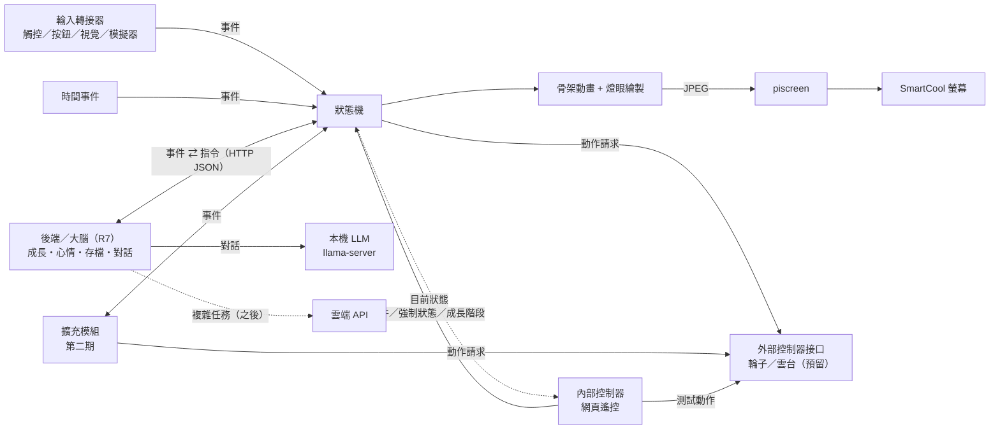
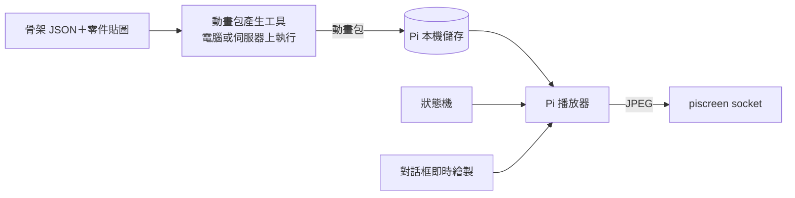

# 桌寵專案 項目書 v2.3

> 最後更新：2026-10-28　｜　狀態：第一期規劃定稿，細節持續補充
>
> v1.1：新增「外部控制器接口」（輪子、雲台，只預留）與「內部控制器：網頁遙控」；架構圖、MVP 清單同步更新。無聊狀態的表現改為左右滾動。
> v1.2：新增「後端（大腦）」章節：API、LLM 路由（本機小模型／雲端處理複雜任務）、目前測試模型 qwen3-14b（R7）；裝置可在螢幕上用對話框說話。
> v1.3：新增「裝置端效能與多核心」：Pi 3B 實測 fps 與瓶頸，繪圖／編碼拆成多行程流水線的規格與驗收標準。
> v1.4：裝置端改成「預錄動畫為主」：骨架改當離線產生動畫包的工具，Pi 只播事先算好的 JPEG 幀，對話框即時疊上去；多核心流水線降為備案。
> v1.5：預錄動畫播放實作完成並在 Pi 3B 實測（見「裝置端：預錄動畫播放」的「實作結果」）；補上表情片段、切換點規則、動畫包不進 git 等實作細節。
> v1.6：補齊「目前進度」「部署與維運」「安全」「測試與驗收」「風險」章節；MVP 勾選實際完成項；狀態清單定稿為第一期四個；待決定事項更新。
> v1.7：網頁遙控新增「Wi‑Fi 設定」：掃描與連線、自動記錄連過的網路、斷線自動依序重試、都連不上時開設定熱點。
> v1.8：Wi‑Fi 設定已實作並部署（見該節「實作備註」）：在桌寵程式內跑、polkit 規則開權限、熱點需關 PMF、多一個手動開關熱點的 API。
> v1.9：新增第一個能力模組「拍照傳給後端」（camera.snapshot），觸發方式只留接口、之後再決定。
> v2.0：後端設好 `api_token`（裝置用 token 檔帶上，`/health` 對外只回基本資訊）；拍照模組實作完成並在 Pi 實測（見該節「實作備註」）。
> v2.1：新增「週邊常駐服務原則」：每個週邊由一個專門的常駐程式獨占、負責對接；新增相機常駐服務 picam，拍照改成多個觸發共用同一張照片、分送給每個請求者（取代冷卻與「相機忙碌」）。
> v2.2：網頁遙控新增「螢幕畫面同步」：送到螢幕的每張畫面同步一份到網頁，方便遠端調整。
> v2.3：picam 相機常駐服務、camera.snapshot 改成 picam client、camcast 改成訂閱 client、螢幕畫面同步都已實作並在 Pi 實測（見各節「實作備註」）。

## 1. 專案目標
做一隻放在桌上的實體桌寵：有小螢幕顯示表情動畫，能跟人互動。先在樹莓派上做出原型（之後也會試 ESP32），再比較哪個平台比較適合承載。

### 分期範圍
- **第一期（現在做）**：純桌面電子寵物，有表情、心情、互動、成長／照顧這類養寵物的玩法。
- **第二期（之後做）**：幫忙做事的能力（提醒、通知、查資訊、連 AI 助理等）。**這期不做，只預留接口。**

## 2. 角色設定

> 本章的圖片都只是**錨定／參考圖**，用來定外型方向，不是程式實際使用的素材。實際素材之後會另外做成適合 800×480 螢幕的版本。顏色、細節以文字設定為準，圖之間的差異（例如眼睛顏色）不代表設定。

- **初始形態**：圓球狀的「種子」，金屬感的淡藍色球體，球身有分割線
- **頭頂**：兩根呆毛天線（將來第二期可以用來表示「收到訊號／有事要說」）
- **眼睛**：兩顆會發光的黃色燈眼，是主要的表情來源（亮度、大小、形狀、眨眼）
- **臉部**：額頭一顆小菱形、下方一個小三角形嘴巴
- **成長設定**：「種子」是初始形態，會有成長線。靠什麼成長（時間、互動、餵食或其他）之後再決定，程式先預留「成長值／階段」的資料結構和切換形態的接口。

### 成長階段
| 階段 | 圖 | 外型變化 |
|---|---|---|
| 1. 種子 |  | 圓球、兩根呆毛天線、黃色燈眼、小三角嘴 |
| 2. 長腳 |   | 主要變化：**長出兩隻短腳**。其他細節（側邊模組、眼睛紋路、底座等）參考圖之間不一致，以後再定 |
| 3. 長耳朵（兔耳路線） | 見下方「第三階段兔耳路線」 | 長出兔耳，分初期、中期、末期；目前有 A、B、C 三個版本的參考圖 |
| 4+ | 待定 | |

#### 第三階段兔耳路線（參考圖）
共同變化：長出兔耳，越後期耳朵越大，末期長出白色圓尾巴、四肢伸出、更像兔子。頭頂上的小東西（粉紅小兔、小球、橘色小傢伙、粉紅果子）**先忽略，尚未設定**。版本歸類依使用者給圖時的標註，空格代表還沒有圖。

| 版本 | 初期 | 中期 | 末期 |
|---|---|---|---|
| 未分版 |  | | |
| A | |  |  |
| B | |  |  |
| C |  | |   |

- **A 版**：中期側邊有星星圓形模組；末期內耳是黃色、額頭有白色十字
- **B 版**：中期身體扁圓、白色臉部、額頭有黃色標誌；末期頭上有粉紅小球
- **C 版**：白色臉部、扁圓身體；初期內耳是白色雲朵形，眼睛大圓、有睫毛；末期是趴姿，耳朵長到垂在地上、額頭有三角形標誌、表情慵懶

> 註：這些只是給美術的參考圖，版本與期別的歸類不必精確，之後由美術統整。

#### 其他耳朵系列（未來，先忽略）
- 貓耳系列：可能會有，目前不規劃

### 在螢幕上的表現重點
- 表情主要靠燈眼：眨眼、瞇眼、睜大、閉眼睡覺、眼神左右看
- 天線可以搖擺、彈動，表示開心或驚訝
- 球體可以輕微上下浮動，看起來像在呼吸
- 無聊時會在螢幕上左右**滾動**：球身（分割線）、天線、燈眼、嘴巴、額頭菱形一起跟著轉，像真的在地上滾（不打滑），滾到邊邊晃一晃、停一下再滾回來；光影與地面陰影不轉、陰影跟著球移動

## 3. 硬體與平台

### 目前手邊的硬體
- **樹莓派 3B**（PiOS，內網 IP 192.0.2.43）：第一個原型平台
- **SmartCool 5 吋 USB 螢幕**（800×480，USB ID 2A55:9990）：接在 Pi 上，接口已測好

### 螢幕接口（已測試完成）
Pi 上已經有常駐服務 `piscreend`（systemd `piscreen.service`），它會一直抓住螢幕、自動保活和救援。桌寵程式**不直接碰 USB**，只把畫面丟給它：
- 透過 Unix socket `/run/piscreen/piscreen.sock` 重複送 `[4 byte big-endian 長度][圖片 bytes]`
- 800×480 baseline JPEG 直接轉送，其他尺寸會自動縮放
- Python：`from piscreen_client import Client; Client().send(jpeg_bytes)`
- 實測螢幕可到 60 fps；Pi 3B 上即時繪圖版實測只有 10~14 fps，因此改成播放預錄動畫（見「裝置端：預錄動畫播放」）
- 禁止：USB reset、clear_halt、GETLCD、INQUIRY；也不要頻繁重啟 piscreen 服務

畫面流程：桌寵程式繪出每一格 → 編成 JPEG → 送給 piscreen。

### 候選平台比較
| 項目 | 樹莓派 | ESP32（如 ESP32-S3） |
|---|---|---|
| 運算能力 | 高，可跑 Python、Linux、AI 功能 | 低到中，適合簡單動畫和感測 |
| 開發語言 | Python | C++（Arduino / ESP-IDF）或 MicroPython |
| 耗電 | 較高 | 很低，可用電池 |
| 開機速度 | 慢（數十秒） | 快（約 1 秒） |
| 成本 | 較高 | 較低 |
| 適合 | 語音、聯網服務、較複雜的動畫 | 輕量、省電、反應快 |

## 4. 功能規劃

### MVP（第一版，必做）
- [x] 種子形態的骨架動畫在 SmartCool 螢幕上跑起來（呼吸、天線擺動、眨眼）
- [x] 事件驅動狀態機，至少有待機、開心、無聊、睡覺四個狀態
- [x] 輸入轉接器接口，加上鍵盤／網頁模擬器發事件
- [x] 時間事件（閒置、夜晚）會切換狀態
- [x] 成長值／階段的資料結構與切換外型接口（推進規則先不做）
- [x] 內部控制器：網頁遙控（手機可用，發互動事件、強制切狀態、切成長階段、看目前狀態、測外部控制器）
- [x] 外部控制器接口（輪子、雲台點頭／搖頭）：只定義接口與記錄用的假控制器，不接真的硬體
- [x] 後端（大腦）：成長／心情／存檔 API，本機 LLM 對話（備用台詞保底），裝置以對話框顯示寵物說的話

### 後續（可選）
- [ ] 顯示時間、天氣
- [ ] 聲音／語音互動
- [ ] 動作感測（拿起、搖晃）
- [ ] 手機或網頁設定

### 第二期（只預留接口，不實作）
- [ ] 聯網通知、提醒
- [ ] 查資訊、AI 助理
- [ ] 其他幫忙做事的能力

## 5. 架構構想

- **表現層**：骨架動畫與燈眼繪製
- **狀態機**：桌寵的心情與狀態
- **輸入層**：輸入轉接器
- **平台層**：螢幕輸出與輸入驅動（Pi 用 piscreen；ESP32 之後另做）
- **能力擴充接口（第二期用）**：插件式接口，讓「做事能力」掛上來，不必改寵物本體
- **外部控制器接口（預留）**：輪子、雲台等會動的硬體，透過「動作請求」驅動
- **內部控制器（網頁遙控）**：開發與日常操作用的遙控頁面

狀態機、骨架格式和素材都寫成跟平台無關，方便之後移植和比較。

### 核心：事件驅動的狀態機
桌寵本體就是一台狀態機，拆成四層：
1. **事件**：互動（被摸、按按鈕、拿起……）、時間（閒置 N 分鐘、晚上到了）、伺服器指令、擴充模組發的事件，全部統一成事件。
2. **狀態**：第一期定稿為**待機、開心、無聊（滾動）、睡覺**四個；「說話」不是狀態，是疊在任何狀態上的對話框。之後要加狀態照「動畫包」章節的流程新增。
3. **對應表**：`(目前狀態, 事件) → 下一個狀態`，用設定檔（JSON）描述，不寫死在程式裡。
4. **表現**：每個狀態對應一組骨架動畫和眼睛表情。

範例（僅示意）：
| 目前狀態 | 事件 | 下一個狀態 |
|---|---|---|
| 待機 | 被摸 | 開心 |
| 待機 | 閒置 10 分鐘 | 無聊（左右滾動） |
| 無聊 | 閒置 10 分鐘 | 睡覺 |
| 睡覺 | 被摸 | 待機（醒來） |

好處：新增互動只要加一條對應規則；成長階段只換外型，狀態機共用；第二期的擴充模組也只是發事件、聽事件。

### 輸入接入端口
第一期不綁定任何輸入硬體，只定義**輸入轉接器（Input Adapter）接口**：每種輸入是一個獨立模組，把原始訊號轉成標準事件丟進狀態機。
- 預留類型：**觸控**、**按鈕**、**視覺辨識**（例如 Pi 相機偵測有人靠近、揮手、看著它）
- 標準事件格式範例：`{"type": "touch", "name": "pat", "source": "touch-head", "ts": ...}`
- 開發期用**鍵盤或網頁模擬器**發事件，不需要實體輸入硬體也能測狀態機
- 實際用哪種硬體之後再決定

### 裝置端／伺服器端分工
採**混合架構**：畫面在裝置上算，伺服器當「大腦」。

- **裝置端（Pi 3B）**：播放事先算好的動畫包（JPEG 幀），只即時畫對話框；處理觸摸等即時互動，每一格送給 piscreen。沒網路、伺服器關機時也能獨立運作（待機、眨眼、睡覺）。
- **伺服器端（內網）**：成長值、心情、存檔；第二期的做事能力（AI、提醒）也放這裡。只傳**狀態與指令**給裝置（例如「進入開心狀態」「成長到第三階段」），不傳畫面。
- **備用模式**：若 Pi 3B 畫不動，可改成伺服器渲染、串流 JPEG 給裝置。piscreen 本來就收 JPEG，兩種模式可以並存。
- 內網頻寬沒有限制，不需要為了省頻寬做優化。

### 裝置端：預錄動畫播放
**為什麼改**：Pi 3B 即時繪圖實測只有 10~14 fps（目標 20），而且吃滿 1 顆核心。動畫內容是固定的，沒必要每一格都在 Pi 上重算；儲存空間足夠，所以改成**事先算好、Pi 只負責播放**。

**動畫包（離線產生）**
- 骨架系統改當「動畫包產生工具」，在電腦或伺服器上跑（`tools/bake.py`），不在 Pi 上即時跑。
- 一個動畫包對應一個外觀（成長階段＋版本，例如「種子」「兔耳 C 末期」），裡面每個狀態一段或多段片段，每段是一串 800×480 baseline JPEG 幀，可以直接送給 piscreen。
- 每段片段附設定：幀率、是否循環、可以在哪幾格切出去（切換點）、對應狀態。
- 隨機感：同一狀態可以有多個變化版（例如有沒有眨眼、看左或看右），播放時隨機挑，避免看起來重複。
- 狀態切換：可以有「A 到 B」的過渡片段；沒有的話就等目前片段播到切換點再切，不硬切。
- 換成長階段或新外觀：在電腦上產生新的動畫包，推到 Pi 就好，Pi 程式不用改。
- 估計大小：一格約 30~50 KB，一段 2 秒循環（40 格）約 2 MB；所有階段加起來在幾百 MB 內，Pi 的儲存空間夠用。

**保留骨架製作流程（方便接手）**
- 骨架 JSON、零件貼圖、狀態表（`config/states.json`）、眼嘴程式、產生工具都留在 repo，是動畫的「原始檔」；動畫包是產物，可以隨時重新產生。
- 新增狀態或新動畫的流程：在骨架 JSON 加動作 → 在狀態表加狀態與對應 → 執行 `tools/bake.py` 產生動畫包 → 推到 Pi。Pi 播放器只認動畫包裡的「狀態 → 片段」對照，不用改程式。
- 產生工具附預覽（GIF／PNG），接手的人不用上 Pi 也能檢查動畫。
- 文件（README）寫清楚格式與步驟，給之後接手的人或美術使用。

**Pi 播放器**
- 依狀態機目前狀態挑片段，照幀率把 JPEG 直接送給 piscreen，不用繪圖、不用重新編碼。
- **對話框即時疊加**：說話時只在對話框那一塊即時畫字，再和該格合成、編碼後送出；沒說話時完全不重編碼。
- 開機時把目前外觀的動畫包讀進記憶體（或按需讀取），不卡頓。
- 一樣只當 piscreen 的 client，不碰 USB、不重啟 piscreen 服務。
- **退路**：找不到某狀態的片段時，退回即時骨架繪圖（現有程式，較慢但不會沒畫面）。

**實作結果（v1.5，2026-10-28 Pi 3B 實測）**
- 種子動畫包：77 MB、223 段片段、5,534 格（重複的只存一次後 4,696 格，每格約 15 KB，JPEG 品質 80）；在電腦上產生約 30 秒。
  - 待機 64 格（3.2 秒）× 5 個變化版（不眨眼、眨一次、眨兩次、看左、看右）；開心 14 格；無聊（滾動）200 格 × 2；睡覺 90 格。
  - 每個狀態另外有 6~7 段**表情片段**（後端的 emotion：驚訝、難過、害羞…），以及 189 段**過渡片段**（每個切換點 × 每個目標狀態）。
- 實測：所有狀態（含滾動）都是 20.0 fps，桌寵程式 CPU 約佔 1 顆核心的 2.3%；有對話框時 20.0 fps、約 41%（只在對話框出現時）。
  從事件到畫面開始反應 14~238 ms（平均約 110 ms）。連跑 30 分鐘：平均 20.0 fps（每分鐘 19.6~20.3），記憶體（匿名 RSS）維持 21.7~23.3 MB 沒有增加，piscreen 錯誤 0、救援 0。
- 跟上面規格不同或補充的地方：
  - **表情片段**：規格只寫「依狀態挑片段」，但後端每次對話和摸頭都會送暫時表情，所以每個狀態 × 每個表情都預先產生一段；表情來時在同一格換過去，身體動作不跳，但眼睛是直接換（不像即時版會平滑過渡）。沒有對應片段的表情會被忽略。
  - **切換點**：每 4 格一個（無聊 8 格、睡覺 5 格），而且那一格不能在眨眼或看旁邊；換狀態時最多等一個間隔（0.2~0.4 秒）。過渡片段用骨架 runtime 的交叉淡入實際算出來。
  - **動畫包不進 git**（`packs/` 在 .gitignore）：在電腦上執行 `tools/bake.py` 產生，連同程式一起複製到 Pi。
  - **對話框**：整格解碼、畫上對話框、整格重新編碼（JPEG 沒辦法只換一塊），所以說話時 CPU 會升到約 4 成，但仍穩定 20 fps。
  - **讀取方式**：動畫包用 mmap 按需讀取（作業系統快取），不整包讀進 Python 記憶體。
  - **大小**：估計每格 30~50 KB，實際約 15 KB；整包大小主要來自過渡片段（加大切換點間隔就能縮小）。

**備案**：多行程流水線（主行程／繪圖行程／編碼行程）先不做，只在之後真的需要大量即時畫面時再考慮。

**驗收標準**
- Pi 3B 上所有狀態（含滾動）穩定 20 fps，桌寵程式 CPU 使用率明顯低於現在（目標低於 1 顆核心的 30%）。
- 說話（有對話框）時仍 ≥ 18 fps。
- 狀態切換不突兀（播到切換點或走過渡片段），從事件到畫面反應不超過約 0.5 秒。
- 連跑 30 分鐘不掉幀、記憶體不持續增加；piscreen 的錯誤數和救援次數維持 0。
- 產生工具在電腦上能一鍵產生「種子」動畫包；現有測試全過，並新增播放器與動畫包測試。

### 後端（大腦）
目前跑在家裡的 Windows 桌機 **R7**（`192.0.2.100`），只用 Python 標準函式庫（CPython 3.10+），程式在 repo 的 `backend/`。

**負責的事**
- 成長值、心情（開心、親密、精神），存檔（每隻寵物一個 JSON 檔，原子寫入）、最後上線時間、短期記憶（最近互動與對話）。
- 心情規則先用簡單規則：隨時間往中性值衰減、醒著精神下降、睡覺回復、互動加分；精神太低時建議裝置去睡覺。
- 成長值會累積，**升階段規則還沒決定**：門檻可設定，預設關閉。
- 對話：以「種子」的人設（可愛、短句、繁體中文）回一句話，並附帶情緒與意圖。

**API（HTTP JSON，埠 8090）**：目前經 `https://pet.example.com` 對外開放（見「安全」）。
| 方法 | 路徑 | 用途 |
|---|---|---|
| POST | `/v1/pet/event` | 裝置回報事件（被摸、計時、狀態改變、心跳），後端更新心情/成長，可回傳指令 |
| POST | `/v1/pet/talk` | 對寵物說話，回傳 `{say, emotion, intent}` 與指令 |
| GET | `/v1/pet/<id>/state` | 讀存檔 |
| GET | `/health` | 服務與 LLM 是否可用 |

指令（後端 → 裝置）：`set_state`、`set_stage`、`say`（螢幕對話框）、`emotion`（燈眼表情）、`actuator`（點頭、搖頭、輪子）。裝置收到後一樣轉成事件，由寵物本體決定怎麼表現。

**LLM 路由**
- **本機小模型**：日常閒聊、表情反應等簡單任務，走內網的 OpenAI 相容服務（llama.cpp `llama-server`）。模型位址、名稱、逾時都寫在設定檔，之後換成 1～3B 的小模型只改設定。
- **雲端 API**：複雜任務（查資料、長文、工具呼叫等，第二期）才送雲端。目前只有路由與接口，預設關閉、沒有金鑰。
- **目前測試模型**：R7 上的 **qwen3-14b**（Qwen3 14B Q4_K_M，64K context），用 `/no_think` 關閉思考，要求只輸出 JSON，實測一句約 0.6 秒。
- **保底**：模型沒開、逾時或回覆格式不對時重試一次，再不行就用固定的備用台詞，對話一定有回應。

**降級原則**：裝置送事件在背景執行，逾時很短；後端或網路掛掉時，寵物照常待機、眨眼、睡覺，只是不會說話也不會成長。

### 動畫：自訂 2D 骨架
- 第一期**自訂簡單的 2D 骨架格式（JSON）**，自己寫輕量 runtime，不綁 Spine／DragonBones／Live2D。
- 每個零件（身體、天線、耳朵、腳、尾巴）掛一根骨頭，動畫用關鍵幀記錄旋轉、位移、縮放。
- 眼睛、嘴巴是發光燈，用程式直接畫（眨眼、瞇眼、看左右），不做貼圖。
- 成長階段只換零件貼圖和骨架，動畫邏輯共用。
- 之後若要用 Spine／DragonBones 編輯動畫，再寫轉換器匯入。
- 骨架主要用來**離線產生動畫包**（見「裝置端：預錄動畫播放」），Pi 上的即時骨架繪圖只當退路。

### 能力擴充接口（預留設計）
第一期只定義接口、放一個空的範例，不做真正的功能。
- **事件匯流排**：寵物本體發出事件（被摸、醒來、閒置……），擴充模組可以訂閱；擴充模組也能發事件給寵物（例如「有提醒」）。
- **動作請求**：擴充模組可以請寵物做表情、顯示一段文字或播聲音，寵物本體決定怎麼表現。
- **模組註冊**：每個能力是一個獨立模組，有名稱、啟用開關、初始化和停止。
- **通訊方式**：樹莓派可用本機 API（如 HTTP／MQTT），ESP32 可用序列埠或 Wi‑Fi／MQTT，讓兩個平台的接口格式一致。

### 週邊常駐服務原則
螢幕已經是這樣做：piscreen 獨占 USB 螢幕，其他程式只透過 socket 送畫面。**所有週邊都照這個模式**：
- 每個週邊有一個專門的常駐程式（systemd 服務、開機啟動），**只有它打開硬體、長期占用、不放手**，負責初始化、錯誤救援、狀態回報。
- 其他程式（桌寵、camcast、之後的工具）一律當 client，透過 Unix socket 跟它要資料或下指令，不直接碰硬體，也不會互相搶。
- 同時有多個 client 時由常駐程式排隊或合併處理，client 之間不衝突。
- 每個常駐程式提供 `status.json`（狀態、錯誤數、client 數）與日誌，協定寫在各自的 README。
- 目前：螢幕 → piscreen（已完成）；相機 → **picam**（本節新增）；之後的麥克風、觸控、輪子、雲台照同樣方式加。

### 相機常駐服務：picam
**負責**：開機就打開 Pi 相機並一直占著，替所有 client 拍照、提供預覽畫面。

**協定（Unix socket `/run/picam/picam.sock`，群組 pi-user 可讀寫，JSON 一行一個請求）**
- `{"cmd": "snapshot", "width": 1280, "height": 960, "quality": 85, "client": "desktop-pet", "reason": "manual"}` → 回 `{"ok": true, "photo_id": "...", "ts": ..., "size": ...}` 後接 `[4 byte big-endian 長度][JPEG]`。
- `{"cmd": "subscribe", "fps": 15, "width": 800, "height": 480}` → 持續送預覽 JPEG（給 camcast 這類 client），直到斷線。
- `{"cmd": "status"}` → 相機型號、目前模式、client 數、拍照次數、錯誤數。

**多個觸發不衝突：同一張照片分送**
- 多個拍照請求同時或在很短時間內（合併視窗，預設 0.5 秒）到達時，**只拍一次**，同一張照片（同一個 `photo_id`）回給每一個請求者。
- 拍照中又來新請求 → 掛在這次拍照上，一起拿到結果；不再回「忙碌」或「冷卻中」。
- 請求的解析度不同時，以最大的拍，再為較小的請求縮圖。
- 有預覽訂閱時照樣可以拍照：picam 自己在預覽和拍照之間切換，預覽短暫停一下（約 1 秒內），client 不用處理。

**桌寵的 camera.snapshot 模組改成 picam 的 client**
- 觸發接口不變（事件、網頁按鈕、本機 API、後端指令），可以同時來自多個來源。
- 模組把請求交給 picam；同一個 `photo_id` 的照片**只上傳後端一次**，結果事件 `camera.snapshot.done` 分送給每一個觸發來源（每個來源都知道自己拿到哪張照片）。
- 拿掉 5 秒冷卻與「相機忙碌」判斷；為了避免失控連拍，改成 picam 層的頻率上限（預設每秒最多 2 次實際拍照，超過的請求合併到下一張）。
- picam 沒在跑時：回報「相機服務未啟動」，寵物照常運作。
- 待傳資料夾、補傳、縮圖、寵物反應照舊。

**camcast 改成 picam 的訂閱 client**（相機預覽工具不再自己開相機）。

**驗收**
- picam 開機自動啟動、獨占相機；桌寵、camcast 都不再直接開相機。
- 3 個來源在 0.5 秒內同時觸發：只拍一張，3 個來源拿到同一個 `photo_id`，後端只收到一張。
- 預覽訂閱中拍照：照片正常，預覽短暫停頓後恢復。
- 連續狂按：實際拍照不超過每秒 2 次，每個請求都有回應（拿到某一張照片），沒有錯誤。
- picam 重啟或相機出錯時，client 收到清楚的錯誤並自動重連；螢幕 20 fps 不受影響，piscreen 錯誤與救援 0。

**實作備註（2026-10-28）**
- 程式在 repo 的 `services/picam/`：`picamd.py`（daemon）、`picam_client.py`（client 函式庫）、`picam.service`、`install.sh`、`README.md`（協定）。
  Pi 上裝在 `/home/pi-user/picam/`（跟 `~/piscreen` 同樣的放法）。systemd `picam.service` 已 enable（開機啟動、`Restart=always`）。
- **用 Picamera2**（`sudo apt install --no-install-recommends python3-picamera2`，約 170 個套件，大多是 numpy、ffmpeg、mesa 函式庫）。
  原因：一個程式可以長期持有相機，並在同一個程式裡切換「閒置／預覽／拍照」三種設定，還能用硬體 MJPEG 編碼。
  如果用 `rpicam-*` 指令，拍照和預覽要不同的程式，每次切換都要放開再重開相機，等於又回到搶相機。
- **服務身分**：以 pi-user 身分、加 video 群組執行，不需要 root。socket 是 `/run/picam/picam.sock`（pi-user:pi-user 0660），狀態在 `/run/picam/status.json`。
- **閒置**：相機用 640×480、5 fps 低速串流，讓曝光和白平衡一直保持收斂，拍照不用暖機。picam 閒置 CPU 約 1.2%，RSS 約 54 MB。
- **拍照**：切到 still 設定、丟 2 格再拍，然後切回原本的設定。
  - 1280×960 從請求到拿到照片約 1.0 秒（含 0.5 秒合併視窗），2592×1944 約 1.3 秒。
  - 1280×960 會用 sensor 的 1296×972 binning 模式。
- **預覽**：800×480 @15 fps 用硬體 MJPEGEncoder，picam CPU 約 10.5～11.6%。
  - 預覽固定選全視角的 1296×972 sensor 模式，不用中間裁切的 1080p 模式。
  - 會中央裁切成目標長寬比，畫面不變形。
  - 預覽中拍照，預覽停頓約 1.1 秒。
- **和規格不同或補充的地方**：
  - 拍照中到的請求，尺寸不超過這次拍的尺寸才掛上去；比這次大的排到下一張。
  - 多個預覽訂閱者共用一個預覽：用最大的尺寸和 fps 跑，每個訂閱者照自己的 fps 拿，不會個別縮圖。
  - 回應多了 `shared`（這張分給幾個請求）和 `capture`（實際拍的尺寸）。
  - 請求也可以帶 `client` 名稱，寫在日誌與狀態裡。
- **錯誤**：
  - 相機打不開或拍照失敗：回 `camera_error`，然後關掉相機重開（退避 2～60 秒）。
  - 預覽超過 6 秒沒畫面：重開相機。
  - picam 沒在跑：client 丟 `service_down`「相機服務未啟動」。
  - `Subscriber` 斷線後自動重連（退避 0.5～5 秒）。
- **實測（Pi，2026-10-28 21:41 前後，Asia/Taipei）**：
  - 3 個來源（網頁 API web、事件 touch、網頁 API timer）在 0.3 秒內觸發：只拍 1 張，3 個都拿到 `20261028-214132-421`（shared=3），後端只多 1 張。
  - 預覽訂閱中拍照：照片正常，預覽停頓 1.08 秒後恢復。
  - 2 秒內狂按 20 次：實際只拍 3 張（約 1.2 秒一張，低於每秒 2 次的上限），20 個請求都回 200、都拿到某一張照片。
  - `systemctl restart picam`：重啟期間桌寵觸發回 503「相機服務未啟動」，1.8 秒後恢復可拍。camcast 自動重連 1 次（最長停頓 3.8 秒）。
  - 整段測試期間螢幕維持 20 fps，piscreen 錯誤與救援都是 0。
- **模擬測試**（`tests/test_picam.py`）：
  - 假相機的合併、最大解析度、拍照中掛上、頻率上限、預覽中拍照。
  - 重啟後重連、相機打不開、拍照失敗重開、錯誤參數、status.json。

### 能力模組：拍照傳給後端（camera.snapshot）
第一個真正的能力模組。（v2.1 起改為 picam 的 client，冷卻與「相機忙碌」由「同一張照片分送」取代，見「相機常駐服務：picam」。下面「裝置端流程」第 1、2 步與 v2.0 實作備註裡的冷卻、相機忙碌、rpicam-still 已不適用，以本節最後的「v2.3 實作備註」為準。）Pi 用接在上面的相機拍一張照片，傳給後端存起來；**什麼時候觸發先不決定**，只把觸發接口做好。

**觸發接口（都走同一個模組，之後再決定實際用哪個）**
- 事件：任何來源發出 `{"type": "skill", "name": "camera.snapshot"}` 事件就拍（之後可以接按鈕、觸控、定時、狀態變化）。
- 網頁遙控：新增「拍一張」按鈕（測試用），並顯示最後一張的時間與縮圖。
- 本機 API：`POST /skill/camera.snapshot`（同遙控其他接口，標準 JSON）。
- 後端指令：後端可以回傳 `{"type": "skill", "name": "camera.snapshot"}` 指令，請裝置拍照（例如之後由 LLM 決定要看一眼）。
- 參數（可選）：`reason`（為什麼拍，例如 manual、touch、timer）、`width`／`height`（預設 1280×960）、`quality`（預設 85）。

**裝置端流程**
1. 收到觸發 → 檢查冷卻時間（預設 5 秒，避免連拍）與相機是否被占用。
2. 用系統的 `rpicam-still` 拍一張 JPEG（不開預覽，不影響螢幕）；相機同時只能給一個程式用，若 camcast 正在跑就回報「相機忙碌」，不強搶。
3. 上傳到後端，背景執行，不卡動畫；失敗會重試一次，還是失敗就先存在 Pi 本機待傳資料夾（有上限，例如最多 20 張），網路恢復後補傳。
4. 寵物表現：拍照時可以播一個小反應（例如眨眼＋「喀嚓」對話框），透過動作請求交給寵物本體決定。
5. 發出結果事件 `camera.snapshot.done`（成功、檔名）或 `camera.snapshot.failed`（原因），其他模組可以訂閱。

**後端**
- 新 API：`POST /v1/pet/photo`，內容是 JPEG（附 `pet_id`、`reason`、拍攝時間），回傳 `{ok, photo_id}`。
- 存在 `backend/data/photos/<pet_id>/`，檔名用時間；記錄在存檔的「最近照片」清單。保留數量可設定（預設最近 200 張），超過自動刪最舊的。
- `GET /v1/pet/<id>/photos`（列表）、`GET /v1/pet/<id>/photos/<photo_id>`（取圖），給遙控頁或之後的工具看。
- **之後**：接看得懂圖片的模型（本機或雲端）分析照片內容，例如認人、看主人在不在；現在的 qwen3-14b 只看得懂文字，所以這期只存不分析，接口先留。

**隱私與安全**
- 照片只存在後端（R7），不放進 repo、不寫進日誌。
- 照片 API（上傳、列表、取圖）**一定要帶 token**；後端沒設 `api_token` 時照片 API 一律拒絕（403），不會變成公開。
- 拍照不會在沒有觸發的情況下自己發生；預設沒有任何自動觸發。

**驗收**
- 網頁按「拍一張」：幾秒內後端收到照片，遙控頁看得到縮圖；動畫維持 20 fps。
- 用事件和本機 API 觸發都能拍；冷卻時間內重複觸發會被擋下並回報。
- 後端關掉時拍照：先存在 Pi 本機，後端恢復後自動補傳。
- 相機被占用或沒接時，回報清楚的錯誤，寵物照常運作。

**實作備註（2026-10-28，和上面規格不同或補充的地方）**
- 程式：裝置端 `pet/extensions/camera.py`（`main.py --camera auto|on|off`，預設 auto＝有 `rpicam-still` 才開）；後端 `backend/photos.py`。
- 相機：Pi 上是 ov5647（Camera v1），用 `rpicam-still -n -t 1000`（不開預覽，拍照時降低優先權），一張 1280×960 約 110 KB，從按下到後端收到約 2 秒。
- 相機忙碌：掃描執行中的程式，有 camcast／rpicam／libcamera／raspivid／raspistill 就回「相機忙碌」，不搶、不殺。
- 擋連拍有兩種回報：拍照中再按回 `in_progress`，拍完 5 秒內再按回 `cooldown`（附剩餘秒數），本機 API 都是 429。
- 待傳資料夾在 Pi 的 `~/.local/share/desktop-pet/pending-photos/`（只有 pi-user 能讀），最多 20 張，滿了刪最舊的；每 30 秒和每次上傳成功後補傳。
- 縮圖：遙控頁的縮圖由 Pi 本機提供（`GET /skill/camera.snapshot/last.jpg`，320×240，只在記憶體），不用跟後端要圖，所以遙控頁不需要知道 token。
- `photo_id` 用拍攝時間（`年月日-時分秒-毫秒`），裝置端檔名和後端一致。
- 寵物反應：瞇眼（squint）0.6 秒＋「喀嚓！」對話框，走動作請求，寵物在睡覺等狀態時由本體決定怎麼表現。
- 結果事件：`{"type":"skill","name":"camera.snapshot.done"}`／`camera.snapshot.failed`（附 `error`、`kind`）。skill 事件不會進狀態機。
- 分析接口：`PhotoStore.register_hook(fn)`，收到照片後呼叫；目前沒有掛任何分析。
- 後端存檔的「最近照片」清單只記最近 20 筆（`photos.recent_in_record`），照片本身保留 200 張（`photos.retention`）。
- 實測：按鈕／本機 API／事件觸發、相機忙碌、後端連不上→存本機→恢復後自動補傳、冷卻與拍照中阻擋都在 Pi 上實測通過，動畫維持 20 fps，piscreen 錯誤與救援 0。重試一次、20 張上限、沒接相機、後端指令觸發只用模擬測試。

**v2.3 實作備註（picam client 版）**
- 每個觸發各自用 `picam_client.snapshot()` 跟 picam 要照片，由 picam 合併。`--camera auto` 的條件是有 picam socket 或 `rpicam-still`，`--camera-socket` 預設 `/run/picam/picam.sock`。`--camera-cooldown` 已拿掉。
- 同一個 `photo_id` 由第一個拿到的觸發負責處理：存待傳檔、縮圖、上傳（重試一次）。其他觸發等它的結果。
  - 同一張有不同尺寸時，等 0.15 秒，挑最大的那份上傳。
  - 上傳時的 `taken` 用 picam 的拍攝時間，所以後端的 photo_id 跟 picam 的一樣。
- 每個觸發都有 `request_id`。`camera.snapshot.done`／`failed` 事件帶 `request_id`、`trigger`（來源）、`photo_id`、`shared`，分送給每一個觸發。
- 本機 API 的回應：
  - `POST /skill/camera.snapshot`：202，回 `request_id`。
  - 帶 `{"wait": true}`：等結果再回，成功 200、失敗 502。
  - 可以帶 `source`。
  - picam 沒在跑：503「相機服務未啟動」。
  - 參數錯誤：400。
  - 已經沒有 429。
- 「喀嚓」反應：同一秒內多個觸發只演一次。
- 遙控頁顯示：「相機服務未啟動」、拍照中幾個請求、photo_id。`GET /skill/camera.snapshot` 多了 `recent`（最近每個觸發的結果）、`service`、`in_flight`。
- 模擬測試：
  - 3 個觸發同一個 photo_id 只上傳一次、done 事件分送 3 份。
  - 「相機服務未啟動」、wait API。
  - 真的 picamd（假相機）端到端：3 個觸發 → 拍 1 次、後端收 1 張。
- 待傳資料夾、補傳、重試一次、縮圖都照舊（同一套測試）。
- **camcast** 改成 picam 的預覽訂閱 client。
  - repo 在 `services/camcast/`，Pi 上在 `~/camcast/`，舊版留了 `.bak-20261028-214009`。
  - 不再自己開相機，picam 重啟會自動重連。多了 `--dry-run`（只收預覽、不送螢幕）。
  - 這次只用 `--dry-run` 短測（14 秒、25 秒各一次）就停掉，沒有實際送到螢幕，以免跟桌寵搶畫面。camcast 現在沒在跑。

### 外部控制器接口（預留）
之後桌寵可能裝上會動的硬體，第一期**只定義接口、不接真的硬體**：
- **輪子**：前進、後退、左轉、右轉、停止，可設定速度與持續時間。
- **雲台（兩軸）**：點頭＝上下（tilt）、搖頭＝左右（pan）、設定角度、轉動速度、回正。
- **怎麼觸發**：狀態或擴充模組不直接控制硬體，而是發「動作請求」事件（例如 `{"type":"action","name":"motion","params":{"motion":"nod"}}`），由控制器分派給對應硬體。例如進入「開心」時請雲台輕輕點一下頭。
- **目前實作**：只有記錄用的假控制器（LoggingActuator，把動作寫進 log 並顯示在網頁遙控上）和什麼都不做的 NullActuator；真的馬達／伺服機驅動之後再寫。
- **安全**：程式結束時一定呼叫停止（輪子停、雲台回正）。

### 內部控制器：網頁遙控
在還沒有實體輸入硬體之前，「內部控制器」先做成一個網頁遙控：
- 由桌寵主程式一起開（Python 內建 HTTP 伺服器，不用另外裝套件），手機瀏覽器打開 Pi 的網址就能用，介面是繁體中文。
- 功能：送互動事件（摸頭、戳、按按鈕、有人靠近、叫醒、睡覺……）、強制切換狀態、切換成長階段、測試外部控制器（點頭、搖頭、輪子前後左右停）。
- 會每秒更新顯示目前狀態、成長階段、表情、畫面 fps、最後事件、外部控制器紀錄。
- 同一組 HTTP 接口（`POST /event`、`/control`、`/actuator`，`GET /status`）也給開發時用指令測試。
- 只在家裡內網使用，沒有密碼，不對外開放。

### 網頁遙控：螢幕畫面同步
讓使用者在網頁上看到螢幕現在顯示的畫面，方便遠端調整動畫、對話框、Wi‑Fi 提示等。
- **來源**：桌寵送給 piscreen 的同一張 JPEG（已經編好，不用重畫、不用重編碼），同步一份給網頁。網頁看到的就是送到螢幕的那一張。
- **網頁**：遙控頁上方新增「螢幕畫面」區塊，以 MJPEG 串流（`GET /screen.mjpg`）即時顯示；另有 `GET /screen.jpg` 取最新一張（可存檔）。可選更新率（預設 10 fps，可調 1～20）與暫停。
- **省資源**：沒有人在看時不送；有人看時只是轉送現成的 JPEG，對 20 fps 動畫沒有影響。同時看的人數上限（預設 3），太慢的網頁會丟舊畫面、只送最新一張，不拖慢桌寵。
- **顯示資訊**：畫面下方顯示畫面來源（動畫包／即時繪圖）、目前 fps、目前狀態與片段名稱，方便對照。
- **限制**：只同步桌寵送出的畫面；桌寵沒在跑時螢幕上的 piscreen 待機畫面（時鐘＋IP）不會出現在這裡。之後若要完全一致，可在 piscreen 加「最新畫面」訂閱接口（需要重啟一次 piscreen，屆時再決定）。
- **驗收**：網頁看到的畫面和實體螢幕一致、延遲約 0.5 秒內；開著網頁時螢幕仍 20 fps，piscreen 錯誤與救援 0。

**實作備註（2026-10-28）**
- 程式：`pet/outputs/mirror.py`（`ScreenMirror`、`ScreenWebAPI`）。
  - `PiscreenSink` 每送成功一格，就把同一份 bytes 交給 mirror（動畫包幀就是包裡的原始 JPEG；有對話框時是實際送出的合成 JPEG）。
  - `PackDriver` 每格附上來源資訊（模式、片段、第幾格）。`main.py --mirror on|off`（預設 on）、`--mirror-viewers 3`。
- 路由：
  - `GET /screen.mjpg?fps=1～20`（預設 10）。
  - `GET /screen.jpg`：標頭 `X-Frame-Seq`、`X-Frame-Ts`、`X-Frame-Mode`、`X-Frame-Clip`、`X-Frame-Index`。
  - `GET /screen.info`：JSON，含 sha1、來源、狀態、片段、fps、觀看人數。這是規格外多加的，方便工具比對。
- 遙控頁最上方是「螢幕畫面」區塊：
  - 有暫停（停掉串流、釋放名額、留一張靜止畫面）、更新率 1／2／5／10／15／20 fps。
  - 「存這一張」連到 `/screen.jpg`。下方資訊列每秒更新。
  - 分頁切到背景時自動停串流。
- 每個觀看者一條執行緒。沒有新畫面就等。太慢的網頁睡完直接拿最新一張，舊的丟掉。寫入卡住 10 秒就放掉。
- 實測（Pi）：
  - `/screen.jpg` 的 bytes 和動畫包裡同一格（`idle/blink` 第 58 格）完全相同（sha1 一致，沒有重新編碼）。
  - 有對話框時拿到的是 800×480 合成畫面，跟原始幀只差在對話框區域。
  - 本機串流延遲平均 1～50 ms，最大 52 ms。
  - 3 個觀看者（Pi 本機 2×20 fps＋Windows 1×10 fps）時第 4 個回 503，螢幕維持 20.0 fps。桌寵 CPU 從約 1.6% 增加到約 4.2%。piscreen 錯誤與救援 0。

### 網頁遙控：Wi‑Fi 設定
讓使用者不用接螢幕鍵盤或 SSH，就能用手機替桌寵換 Wi‑Fi。

**頁面功能**
- 顯示目前連線：Wi‑Fi 名稱、訊號強度、IP 位址（有線網路也一起顯示）。
- **掃描附近 Wi‑Fi**：列出名稱、訊號、是否需要密碼；點選後輸入密碼即可連線。也可以手動輸入名稱（隱藏的網路）。
- **已記錄的網路**：連線成功過的 Wi‑Fi 會自動記下來，列表可看到名稱、上次連線時間，可以刪除、調整優先順序。
- 連線過程顯示進度與結果（成功、密碼錯誤、找不到網路、逾時）。

**自動記錄、自動嘗試**
- 每次連線成功就把該網路存起來，並設成優先（最近成功的排最前面，可手動調整）。
- 斷線或開機時，依優先順序自動嘗試附近有的已記錄網路，每個約 20 秒，失敗就換下一個；全部失敗則每隔一段時間（例如 1 分鐘）再掃一次。
- **換網路的保險**：從網頁切換到新 Wi‑Fi 時，如果新網路 30 秒內連不上，自動切回原本的網路，避免手機和桌寵從此失聯。
- **設定熱點（救援模式）**：開機後若 2 分鐘內所有已記錄網路都連不上，Pi 開一個設定用熱點 **`PetRescue-AP`**（有密碼，密碼存在 Pi 的設定檔，不進 repo），手機連上後打開固定網址就能設定 Wi‑Fi；連上正式網路後自動關閉熱點。
- 寵物螢幕在沒網路、正在連線、熱點模式時，於對話框或角落顯示狀態與熱點名稱，方便知道發生什麼事。

**Pi 既有設定**：原本的 `wifi-watchdog.timer`（每分鐘強制連 HomeAP）會跟自動重試／熱點衝突，2026-10-28 已停用（`systemctl disable --now`，腳本 `/usr/local/sbin/wifi-watchdog.sh` 保留，要恢復可再 enable）。

**實作方式**
- 透過 Pi 系統的網路管理程式（PiOS 內建的 NetworkManager，`nmcli` 指令）操作，不自己寫底層網路程式；已記錄網路就是 NetworkManager 的連線設定，系統本來就會自動重連。實作前先在 Pi 上確認版本與現有設定。
- 桌寵程式以一般使用者執行，只開放「掃描、連線、刪除、調整優先」這幾個網路操作的權限，不給完整 root。
- 只動 Wi‑Fi，不動有線網路（eth0）；也不碰螢幕與 piscreen。
- API：`GET /wifi/status`、`GET /wifi/scan`、`GET /wifi/saved`、`POST /wifi/connect`、`POST /wifi/forget`、`POST /wifi/priority`（標準 JSON，同遙控其他接口）。

**安全**
- Wi‑Fi 密碼只存在系統的網路設定裡（只有 root 能讀），不存進 repo、不寫進日誌，網頁與 API 也不會回傳已存的密碼。
- 遙控頁沒有密碼，內網任何人都能改 Wi‑Fi。**第一期先不加 PIN**（目前只在家裡使用）；之後要帶出門時再加，接口先預留。

**驗收**
- 手機從網頁掃描並連上新 Wi‑Fi，網路自動記錄；重開機後自動連回。
- 關掉目前的 Wi‑Fi 分享器，桌寵自動改連另一個已記錄的網路。
- 輸入錯誤密碼時顯示「密碼錯誤」，並自動切回原本的網路，不失聯。
- 所有已記錄網路都不在時，熱點出現，手機可連上設定；設定完成後熱點關閉。
- 整個過程螢幕畫面不中斷、piscreen 錯誤與救援次數維持 0。

**實作備註（v1.8，2026-10-28 實作）**
- **在桌寵程式裡跑**（`pet/wifi.py` 的背景執行緒，每 5 秒檢查一次），不另開服務；所以**熱點救援只在 desktop-pet 跑的時候有效**。
  之後若要開機就有救援，再把 desktop-pet 做成開機服務（或拆成獨立的小服務），程式不用改。
- **權限**：polkit 規則 `/etc/polkit-1/rules.d/50-desktop-pet-wifi.rules`，只給 pi-user 四個 NetworkManager 動作
  （wifi.scan、network-control、settings.modify.system、wifi.share.protected）；桌寵程式本身不用 sudo。
  polkit 沒辦法限制到「只有 wlan0」，後兩項技術上也能改有線設定，所以「只動 Wi‑Fi」由程式保證（指令只對 wlan0 與 Wi‑Fi 設定下）。
- **熱點**：`PetRescue-AP`（WPA2-PSK、2.4 GHz、NetworkManager 共用模式，網址 `http://192.0.2.1:8080/`）；
  密碼在 Pi 的 `/etc/desktop-pet/wifi-hotspot.conf`（root:pi-user 0640，部署時用 `tools/wifi/install.sh` 隨機產生）。
  Pi 3B 的 Wi‑Fi 晶片實測**必須關閉 PMF** 熱點才開得起來。熱點開著時每 3 分鐘（2 分鐘內沒人用網頁時）關掉熱點重試一輪已記錄網路。
- **判斷「沒網路」只看 Wi‑Fi**（有線網路接著也一樣會開熱點），照規格字面。
- 多一個 `POST /wifi/hotspot {"on": true|false}`：手動開關熱點（測試與救援用）。
- 從網頁連「已記錄」的網路只會在必要時調高它的優先值，不改其他設定；用新密碼連同一個 SSID 成功才取代舊設定，失敗不動原本的。
- 連線中的網路不能從網頁刪除（避免把自己斷線）。
- 驗收狀況：密碼錯誤→切回、斷線自動重連、熱點開關與熱點網址的遙控頁已在 Pi 實測；
  「連上新網路並記錄」「關掉分享器改連另一個網路」「沒有已記錄網路 2 分鐘後自動開熱點」「手機連熱點」因為手邊只有一個 Wi‑Fi，只有用假的 nmcli 測。
- 注意：Pi 上原本有 `wifi-watchdog.timer`（每分鐘，wlan0 沒連上就去連 HomeAP），會跟救援熱點搶網卡；程式會重試一次，建議之後停用它。

## 6. 目前進度（2026-10-28）
| 項目 | 狀態 | 備註 |
|---|---|---|
| 裝置端（Pi 3B） | 運作中 | 播放「種子」動畫包，所有狀態 20 fps，CPU 約 2%（說話時約 41%）；30 分鐘連跑通過 |
| 後端（R7） | 運作中 | qwen3-14b 對話約 0.5～1 秒；心情、成長、存檔正常 |
| 網頁遙控 | 運作中 | `http://192.0.2.43:8080/`，內網使用；含 Wi‑Fi 設定（救援熱點 `PetRescue-AP`） |
| 外部控制器 | 只有接口 | 記錄用假控制器 |
| 拍照能力 | 運作中 | 遙控頁「📷 拍一張」；改成 picam 的 client（多個觸發共用同一張）；照片存在 R7 `backend/data/photos/<pet_id>/` |
| 相機常駐服務 picam | 運作中 | `picam.service`（開機啟動）；閒置 CPU 約 1.2%，預覽 800×480@15 約 11% |
| 螢幕畫面同步 | 運作中 | 遙控頁最上方；`/screen.mjpg`、`/screen.jpg`；開著時仍 20 fps |
| 後端 token | 已設定 | 裝置用 token 檔；`/health` 對外只回基本資訊 |
| 測試 | 142 個全過 | 含動畫包、播放器、Wi‑Fi（假 nmcli）、picam（假相機）、拍照（假 picam、假上傳）、照片 API、螢幕畫面同步測試 |
| 尚未做 | — | 開機自動啟動、成長推進規則、小模型替換、ESP32 原型、外殼 |

## 7. 部署與維運
**裝置端（Pi 3B，`/home/pi-user/desktop-pet`）**
- 目前以臨時 systemd 服務 `desktop-pet` 執行（重開機不會自動啟動），只當 piscreen 的 client，不碰 USB、不重啟 piscreen 服務。
- 停止：`sudo systemctl stop desktop-pet`；日誌：`journalctl -u desktop-pet -f`；螢幕狀態：`cat /run/piscreen/status.json`。
- 更新流程：在電腦上改程式或骨架 → 跑測試 → `python3 tools/bake.py` 產生動畫包 → 連同程式複製到 Pi → 重啟 `desktop-pet`。
- 目前啟動參數：`--sink piscreen --input web --web 0.0.0.0:8080 --backend https://pet.example.com --backend-token-file /home/pi-user/.config/desktop-pet/backend-token --pack /home/pi-user/desktop-pet/packs/seed`。
- 後端 token 放在 `/home/pi-user/.config/desktop-pet/backend-token`（pi-user 擁有、權限 0600），用 `--backend-token-file` 讀，不放在命令列（`ps`、systemd 設定都看不到）。換 token 時改這個檔和 R7 的設定，再重啟 `desktop-pet`。
- 之後改成正式的開機自動啟動服務（排在 piscreen 之後啟動）。

**相機常駐服務 picam（Pi，`/home/pi-user/picam`）**
- 正式 systemd 服務 `picam.service`（已 enable，開機啟動、`Restart=always`），以 pi-user 身分執行。需要 `python3-picamera2`（已裝）。
- 更新：把 repo 的 `services/picam/` 複製到 Pi，執行 `sh services/picam/install.sh`（複製到 `~/picam`、裝 unit、enable、restart）。可以隨時重啟，client 會自動重連。
- 狀態：`cat /run/picam/status.json`；日誌：`journalctl -u picam -f`。相機預覽到螢幕（測試用）：`~/camcast/start.sh`／`~/camcast/stop.sh`（會跟桌寵搶螢幕畫面）。

**後端（R7，`C:\Users\<user>\desktop-pet`）**
- 用 ComfyUI 內附的 Python 3.13 執行，埠 8090，日誌 `backend_out.log`／`backend_err.log`；目前重開機不會自動啟動。
- 啟動：`backend\start_hidden.cmd`（背景執行、輸出寫進日誌；遠端時用 WMI 建立程序啟動，不影響 ComfyUI 和 llama-server）。
- token 在 R7 的 `backend\config.json` 的 `server.api_token`（repo 裡的版本是空的）。**更新程式時不要覆蓋 R7 的 `config.json`**。
- 照片存在 `backend\data\photos\<pet_id>\`（每張一個 .jpg＋.json），不進 repo。
- LLM 由 llama-server 提供（埠 8080），需另外手動開；沒開時後端用備用台詞，寵物照常運作。
- R7 沒有 GitHub 登入，程式用打包檔傳過去更新。
- 存檔在 `backend/data/`（每隻寵物一個 JSON 檔），建議定期備份。

## 8. 安全
- 後端經 DDNS 對外公開，**已設定 `api_token`**：所有 `/v1/*` API 都要帶 `X-Pet-Token`，沒帶或錯的回 401；照片 API 在後端沒設 token 時也拒絕（403）。
- token 只存在兩個地方：R7 的 `backend\config.json` 與 Pi 的 `~/.config/desktop-pet/backend-token`（0600）。不進 repo、不寫進日誌、不放命令列。
- `/health` 不帶 token 只回 `{ok, service, version}`；帶 token 才回 LLM 狀態等細節。
- 照片只存在 R7，不進 repo，日誌只記檔名與大小。
- 網頁遙控沒有密碼，只適合內網使用，不要對外轉發。
- 雲端 API 金鑰（第二期）只放在後端設定，不放在裝置端或 repo。

## 9. 測試與驗收
- **自動測試**：每次改動在電腦上跑 `python -m pytest -q`（目前 142 個）。
- **效能量測**：`tools/bench.py` 與逐階段量測；每次大改在 Pi 上量各狀態 fps、CPU。
- **實機驗收**：所有狀態 20 fps、說話 ≥ 18 fps、事件到畫面 ≤ 0.5 秒、連跑 30 分鐘不掉幀不漏記憶體、piscreen 錯誤與救援次數為 0。
- **降級測試**：後端關掉、LLM 關掉、網路斷線時，寵物仍正常待機與睡覺。

## 10. 風險
| 風險 | 影響 | 對策 |
|---|---|---|
| Pi 3B 效能不足 | 即時繪圖只有 10～14 fps | 已改預錄動畫；多核心流水線當備案 |
| 螢幕卡死 | 沒畫面 | 交給 piscreen 自動救援；桌寵只當 client |
| R7 關機或 LLM 沒開 | 不會說話、不會成長 | 備用台詞；裝置可獨立運作 |
| 後端對外公開 | 被陌生人操作 | 已設 `api_token`；token 外洩時兩邊一起換 |
| 動畫包變大 | 佔空間、更新慢 | 減少過渡片段、拉長切換點間隔 |
| 小模型太笨 | 對話品質差 | 複雜任務走雲端；保留 14B 當比較基準 |

## 11. 開發階段
1. ~~確認角色方向與硬體~~（已完成：參考圖、Pi 3B、SmartCool 螢幕接口）
2. ~~骨架格式與 runtime、狀態機、輸入模擬器~~（已完成）
3. ~~樹莓派原型（接 piscreen，量 fps）~~（已完成：改預錄動畫後穩定 20 fps）
4. ESP32 原型
5. 比較兩平台（流暢度、耗電、成本、開發難度），選定平台
6. 外殼與完整版

## 12. 平台評估指標
- 動畫流暢度（FPS）
- 待機與運作耗電
- 開機時間
- 硬體成本
- 開發與維護難度

## 13. 待決定事項
- 階段內的「初期／中期／末期」是不是每個階段都有？
- 什麼條件決定走哪條耳朵系列（兔耳、未來的貓耳……）？
- 成長線的推進方式（時間、互動或其他）和各階段的形態？
- 要不要電池、可攜？
- 裝置端與後端要不要開機自動啟動？
- 要換成哪個 1～3B 小模型？
- 實體輸入用什麼硬體（觸控、按鈕、相機）？
- Wi‑Fi 設定頁的 PIN：等要帶出門時再決定。
- 拍照能力要用什麼觸發（按鈕、觸控、定時、後端決定）？
