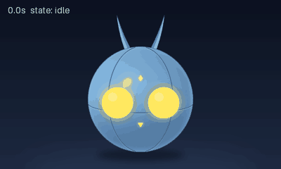
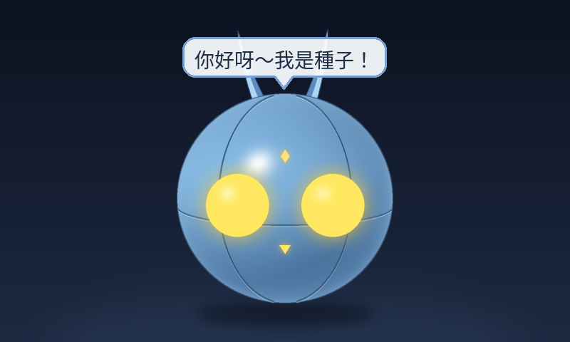

# desktop-pet 桌寵專案

放在桌上的實體電子寵物：圓球種子形態的小機器人，會隨成長長出腳、耳朵。第一期只做電子寵物，第二期才加入幫忙做事的能力（目前只預留接口）。

- 項目書：[PROPOSAL.md](PROPOSAL.md)
- 原型平台：樹莓派 3B + SmartCool 5 吋 USB 螢幕（透過 piscreen 服務顯示）



**部署到自己的裝置**：repo 裡的 service／polkit 檔只有佔位（`@USER@`、`@HOME@`、`@BACKEND_URL@`）。先 `cp deploy.env.example deploy.env`
並填入實際值（`deploy.env` 不進 repo），再跑各自的 `install.sh`。後端的實際設定寫在本機 `backend/config.json`（不進 repo，預設值見
`backend/config.example.json`）。授權：程式碼 MIT、assets/ 為 CC BY-NC 4.0（見下方〈[授權](#授權)〉）。

## 目前進度（第一版程式原型 v0.1）

| 項目 | 狀態 |
|---|---|
| 自訂 2D 骨架格式 + runtime（關鍵幀、linear/ease/step、切換淡入） | ✅ |
| 種子形態零件（程式產生）＋ idle（呼吸）／happy（彈跳）／bored（**滾動**：左右滾來滾去）／sleep（閉眼呼吸＋Z）動畫 | ✅ |
| 燈眼／嘴巴／額頭菱形程式繪製（發光、眨眼、瞇眼笑、半睜、閉眼睡、看左右） | ✅ |
| 事件驅動狀態機（JSON 對應表、閒置計時、晚上／早上時鐘事件） | ✅ |
| 成長值／階段資料結構與 `set_stage()` 換骨架接口 | ✅（推進規則未做；只有種子骨架） |
| 輸入轉接器：鍵盤模擬、網頁遙控／HTTP 模擬；觸控／按鈕／視覺 stub | ✅ |
| 外部控制器接口（輪子、雲台）：LoggingActuator / NullActuator stub | ✅（沒有真的驅動） |
| 擴充模組接口（事件匯流排、模組註冊、動作請求）＋空範例 | ✅（第二期才做功能） |
| 輸出：piscreen（Unix socket + JPEG）、預覽 PNG / GIF | ✅（piscreen 尚未在 Pi 實測） |
| 後端（大腦）：成長／心情／存檔 API、本機 LLM 對話（qwen3-14b）、備用台詞、雲端路由接口 | ✅（見 [backend/README.md](backend/README.md)；還沒在 R7 實跑） |
| 裝置接後端：背景送事件、套用指令、螢幕對話框、網頁遙控「跟寵物說話」 | ✅（`--backend`，預設不接） |
| **網頁 Wi‑Fi 設定**：掃描／連線（含隱藏網路）、自動記錄與優先順序、斷線自動重試、換網路失敗切回、救援熱點 `PetRescue-AP` | ✅（見下方「Wi‑Fi 設定」） |
| **預錄動畫包**：`tools/bake.py` 用骨架系統離線產生 JPEG 片段，Pi 只播放（變化版、過渡、表情、對話框即時疊加、缺片段退回即時繪圖） | ✅（見下方「動畫包」） |

## 安裝

```bash
# 電腦或 Pi 都只需要 Pillow
pip install -r requirements.txt        # 或 Pi 上：sudo apt install python3-pil
```

## 在電腦上預覽

```bash
# 1) 離線算出示範動畫（不需要螢幕）：preview/demo.gif + idle/happy/sleep.png
python3 tools/render_demo.py

# 2) 即時跑：畫面寫到 preview/live/latest.png（用會自動重新載入的圖片檢視器開著）
#    同時開鍵盤模擬器與網頁遙控
python3 main.py --sink preview --input keyboard,web --web 127.0.0.1:8080 --idle-timeout 10
```

鍵盤模擬器（在終端機輸入後按 Enter）：`t 文字` 對寵物說話、`p` 摸頭、`o` 戳、`b` 按鈕、`v` 有人靠近、`w` 叫醒、`s` 睡覺、`1`/`2`/`3` 成長階段、`state sleep` 強制切狀態、`n` 點頭、`h` 搖頭、`q` 結束。

## 在樹莓派上跑（接 piscreen）

前提：Pi 上的 `piscreen.service` 已在跑（`/run/piscreen/piscreen.sock` 存在）。桌寵程式**不直接碰 USB**，也不會重啟 piscreen。

```bash
# 在電腦上先產生動畫包（Pi 也能跑，只是慢很多），再連同程式一起複製到 Pi
python3 tools/bake.py                                  # → packs/seed/（約 77 MB）
# Pi 上：
python3 tools/bench.py --pack packs/seed               # 量播放成本
python3 main.py --sink piscreen --input web --web 0.0.0.0:8080 --pack packs/seed
```

- `--pack auto`（預設）：`packs/<骨架名稱>/` 存在就播動畫包，沒有就即時繪圖；`--pack none` 強制即時繪圖。
- fps 預設跟動畫包一樣（20）；即時繪圖模式在 Pi 3B 只有 10~14 fps（`python3 tools/bench.py --stages` 可看各段毫秒）。

- 手機或電腦開 `http://192.0.2.43:8080/` 就是網頁遙控。
- 程式每 5 秒在 log 印出實際 fps；piscreen 連不上時會自動重試並丟格，不會當掉。
- 常用參數：`--fps`（預設 20）、`--jpeg-quality`（預設 85）、`--socket`、`--idle-timeout`、`--duration`、`-v`。

## 接後端（大腦）

後端跑在家裡的 Windows 桌機 R7（`192.0.2.100:8090`），負責成長、心情、存檔和對話（本機 LLM）。
怎麼在 R7 上啟動、防火牆設定、API 說明都在 **[backend/README.md](backend/README.md)**。

Pi 端：

```bash
python3 main.py --sink piscreen --input web --backend http://192.0.2.100:8090
# 選用：--pet-id seed-001  --backend-token-file ~/.config/desktop-pet/backend-token（檔案權限 0600，只放 token）  --camera auto|on|off（picam 的 client）  --mirror on|off（網頁 /screen.mjpg）  --font /usr/share/fonts/truetype/wqy/wqy-microhei.ttc
```

- 事件（摸頭、計時、狀態改變…）在背景執行緒送給後端，逾時 2 秒，主迴圈不等網路；每 60 秒送一次心跳。
- 後端回的指令（`say`、`emotion`、`set_state`、`set_stage`、`actuator`）轉成事件丟回事件匯流排照原流程處理。
- `say` 會在螢幕上顯示對話框（圓角白框，跟著球移動）。需要中文字型：`sudo apt install fonts-wqy-microhei` 或 `fonts-noto-cjk`。
- 後端沒開／連不上：寵物照常運作；事件會退避後丟掉，網頁遙控顯示「離線」，說話時寵物回「嗯…？（大腦在休息）」。
- 在電腦上可以一起跑：`python3 -m backend --port 8090` + `python3 main.py --sink preview --input keyboard,web --web 127.0.0.1:8080 --backend http://127.0.0.1:8090`，鍵盤輸入 `t 你好` 跟寵物說話。



## 網頁遙控（內部控制器）

`--input web` 時由 `main.py` 一起開（Python 標準函式庫 `http.server`，不用另外裝東西）。手機友善的單頁，繁體中文介面：

- **目前狀態**：狀態、成長階段、成長值、表情、fps、最後事件、大腦（後端）連線、寵物說的話（每秒輪詢 `GET /status`）
- **跟寵物說話**：輸入框 → `POST /talk` → 裝置轉給後端 `/v1/pet/talk`
- **互動事件**：摸頭、戳一下、按按鈕、有人靠近、叫醒、去睡覺、模擬閒置、模擬晚上
- **強制切換狀態**：待機／開心／無聊／睡覺
- **成長階段**：1 種子／2 長腳／3 長耳朵（目前只有種子骨架，其他階段沿用種子外型）
- **外部控制器測試**：雲台點頭、搖頭、回正；輪子前進、後退、左轉、右轉、停止（目前接 LoggingActuator，只顯示紀錄）

HTTP API（也可以當事件模擬器用）：

```bash
curl -X POST localhost:8080/event    -d '{"type":"touch","name":"pat"}'
curl -X POST localhost:8080/control  -d '{"cmd":"set_state","state":"sleep"}'
curl -X POST localhost:8080/control  -d '{"cmd":"set_stage","stage":2}'
curl -X POST localhost:8080/talk     -d '{"text":"你好"}'
curl -X POST localhost:8080/actuator -d '{"motion":"nod","times":2}'
curl -X POST localhost:8080/actuator -d '{"motion":"wheels","action":"forward","speed":0.5,"duration":1}'
curl localhost:8080/status
```

> ⚠️ 網頁遙控沒有密碼，只適合在家裡內網用；不要把埠號開到外網。

## Wi‑Fi 設定（網頁遙控）

遙控頁最下面的「Wi‑Fi 設定」卡片：目前連線（名稱、訊號、IP、有線網路）、掃描附近網路、手動輸入（隱藏網路）、
已記錄的網路（上次連線時間、⬆️⬇️ 調整優先、刪除）。程式在 `pet/wifi.py`，透過 NetworkManager 的 `nmcli`：

- **已記錄的網路 = NetworkManager 的 Wi‑Fi 連線設定**；優先順序 = `autoconnect-priority`，上次連線 = `connection.timestamp`。
  從網頁連成功的網路自動存起來、排到最前面（目前最高 +10）；手動排序時重寫全部優先值（200、210、220…）。
- **換網路的保險**：從網頁換網路時 `nmcli -w 30 connection up`；30 秒內連不上就刪掉剛建的設定、切回原本的網路。
  結果分「密碼錯誤／找不到網路／逾時／失敗」。同一個 SSID 用新密碼連成功，舊設定才會被取代；失敗不動原本的設定。
- **自動嘗試**：桌寵程式裡的背景執行緒每 5 秒看一次 wlan0；沒連上時依優先順序試「掃描看得到的＋隱藏的」已記錄網路，
  每個 20 秒；全部失敗 60 秒後重掃再試。
- **救援熱點**：連續 120 秒（`--wifi-hotspot-after`）都連不上已記錄的網路，開 `PetRescue-AP`（WPA2，密碼在 Pi 的
  `/etc/desktop-pet/wifi-hotspot.conf`）；手機連上後開熱點閘道的 `:8080`（NetworkManager 共用模式的閘道 IP；螢幕和網頁會顯示實際網址）設定，連上正式網路熱點就關。
  熱點開著時每 3 分鐘（2 分鐘內沒人用網頁時）關掉熱點重試一輪已記錄網路，連不上再開回來。
  **熱點救援只在桌寵程式（desktop-pet）跑的時候有效**。
- **螢幕提示**：沒網路、正在連、連上、熱點模式時寵物用對話框說（熱點模式每 30 秒提醒一次熱點名稱與網址）。
- **只動 Wi‑Fi**：指令只針對 `--wifi-iface`（預設 wlan0）和 802-11-wireless 設定；有線網路只讀取顯示。
- **密碼**：只經由 stdin 交給 `nmcli connection edit`（不出現在指令列、日誌、API 回應）。
- **權限**：桌寵以一般使用者跑，不用 sudo；部署時裝一次 polkit 規則（只開放 wifi.scan、network-control、
  settings.modify.system、wifi.share.protected 給該使用者）與熱點密碼檔：`sudo sh tools/wifi/install.sh`。
- **PIN**：先不用（`WifiManager.pin` 預留，設了之後 `/wifi/*` 要帶 `X-Pet-PIN` 標頭）。
- 參數：`--wifi auto|on|off`（auto = 有 nmcli 和 wlan0 才開）、`--wifi-iface`、`--wifi-hotspot on|off`、
  `--wifi-hotspot-ssid`、`--wifi-hotspot-conf`、`--wifi-hotspot-after`。

```bash
curl localhost:8080/wifi/status
curl localhost:8080/wifi/scan
curl localhost:8080/wifi/saved
curl -X POST localhost:8080/wifi/connect  -d '{"ssid":"MyWifi","password":"........"}'   # 回 202 + op，進度看 /wifi/status 的 op
curl -X POST localhost:8080/wifi/connect  -d '{"ssid":"Hidden","password":"........","hidden":true}'
curl -X POST localhost:8080/wifi/connect  -d '{"uuid":"<已記錄的 uuid>"}'
curl -X POST localhost:8080/wifi/forget   -d '{"uuid":"<uuid>"}'                 # 連線中的不能刪
curl -X POST localhost:8080/wifi/priority -d '{"uuid":"<uuid>","direction":"up"}'  # 或 {"order":[uuid,...]}
curl -X POST localhost:8080/wifi/hotspot  -d '{"on":true}'                          # 手動開關熱點（測試／救援）
```

## 動畫包（預錄動畫）

Pi 3B 即時繪圖只有 10~14 fps，所以改成**在電腦上把動畫先算好、Pi 只播放**（項目書「裝置端：預錄動畫播放」）。
骨架、零件、狀態表、眼嘴程式都還在，它們是動畫的「原始檔」；動畫包是產物，隨時可以重新產生，**不進 git**（`packs/` 在 `.gitignore`）。

### 產生與檢查

```bash
python3 tools/bake.py                         # 依 config/bake.json 產生 packs/seed/，最後自動檢查
python3 tools/bake.py --states idle,happy --no-transitions --out /tmp/test-pack   # 只做一部分（快速試）
python3 tools/bake.py --check packs/seed      # 檢查既有動畫包（每格都是完整 JPEG）
```

產生後先看 `packs/seed/preview/`：每個狀態一個 GIF（半尺寸）和 `states.png`（各狀態第一格），不用上 Pi 也能檢查動畫。

### 動畫包裡有什麼

| 片段 | 說明 |
|---|---|
| 狀態片段（loop） | 每個狀態一輪動畫，可以有多個**變化版**（`base`、`blink`、`blink2`、`look_l`、`look_r`…），每播完一輪隨機挑一個（`weight` 越大越常出現）。所有變化版姿勢逐格相同，只有眼睛不同。 |
| 表情片段（expr） | 每個狀態 × 每個暫時表情（後端 `emotion`：surprised、sad…）。表情來時在**同一格**換過去（身體動作不跳），時間到換回來。 |
| 過渡片段（transition） | 從 A 的每個**切換點**到 B，用骨架 runtime 的交叉淡入＋眼睛平滑實際算出來，播完接到 B 的對應格。 |

- 切換點：每 `cut_every` 格一個（預設 4 格 = 0.2 秒；無聊 8 格、睡覺 5 格），而且那一格眼睛必須是基本表情（不在眨眼中）。換狀態時播放器等到下一個切換點才走，所以反應最慢約 `cut_every` 格。
- 對話框：沒說話時直接轉送 JPEG（不解碼、不重編碼）；說話時把該格解碼、畫上對話框（位置跟著球，每格的錨點存在動畫包裡）、再編碼。
- 退路：動畫包裡沒有的狀態、或換了成長階段但沒有對應外觀的動畫包，就自動退回即時骨架繪圖（較慢但一定有畫面）。
- 格式：`manifest.json`（片段、狀態對照、過渡、每格在 `frames.bin` 的位置與對話框錨點）＋ `frames.bin`（所有 JPEG 串在一起，相同的幀只存一次）。細節見 `pet/pack.py` 開頭的說明。

### 新增動作或狀態（給接手的人／美術）

1. **骨架 JSON 加動作**：在 `assets/skeletons/seed.json` 的 `animations` 加一段（格式見下方「骨架格式」）。長度最好是 1/fps 的整數倍（20 fps → 0.05 秒的倍數），循環才不會跳。
2. **狀態表加狀態**：在 `config/states.json` 的 `states` 加狀態（`animation`、`eyes`、`effects`、`timers`），在 `transitions` 加 `(狀態, 事件) → 下一個狀態`。
3. **（選用）設定變化版**：在 `config/bake.json` 的 `states` 加這個狀態的 `variants`（`blinks: [秒]`、`looks: [[秒, x, y], …]`）和 `cut_every`。沒寫的話自動產生 `base`（圓眼的再加一個 `blink`）。眨眼／看的時間不要放在片段頭尾。
4. **先在電腦上預覽**：`python3 main.py --sink preview --pack none --input keyboard,web` 看即時版；`python3 tools/bake.py` 後看 `packs/seed/preview/*.gif`。
5. **產生並推到 Pi**：`python3 tools/bake.py`，把 `packs/seed/`（`manifest.json`＋`frames.bin`）連同程式複製到 Pi，重啟桌寵。Pi 播放器只看動畫包裡的「狀態 → 片段」對照，**不用改程式**。還沒重新產生動畫包之前，新狀態會自動用即時繪圖顯示。
6. 新的成長外觀（例如兔耳）：做新的骨架 JSON 與零件、另寫一份 bake 設定（`look`、`skeleton`），`python3 tools/bake.py --config config/bake-ears.json` 產生 `packs/<骨架名稱>/`。

> 動畫包大小：種子約 77 MB（5 千多格，每格約 15 KB；過渡片段佔最多）。想縮小可以加大 `cut_every`、減少表情或變化版、或調低 `quality`。

## 專案結構

```
main.py                    主程式（主迴圈、選輸出端與輸入）
config/states.json         狀態機設定：狀態 → 動畫/表情/計時，(狀態, 事件) → 下一狀態，成長階段 → 骨架
assets/skeletons/seed.json 種子骨架 + 動畫
assets/parts/seed/*.png    種子零件圖：body（球體光影，不轉）、seams（分割線，滾動時轉）、天線（由 tools/gen_seed_parts.py 產生）
pet/skeleton.py            骨架格式、插值、動畫播放器、零件合成（含快取）
pet/eyes.py                EyeController（表情、眨眼、眼神）+ FaceRenderer（燈眼/嘴/菱形）
pet/renderer.py            背景、陰影、零件、臉、Z 特效 → 800×480 RGB
pet/state_machine.py       StateMachine、Growth、ClockEvents
pet/events.py              標準事件格式
pet/app.py                 PetApp：事件路由、動作請求（ActionRouter）、換骨架、狀態輸出
pet/pack.py                動畫包格式、讀取（mmap）、播放器 PackPlayer（挑片段、切換點、過渡、表情、退路）、PackDriver
pet/baker.py               動畫包產生（用骨架 runtime 算片段、過渡、表情，寫 manifest + frames.bin + 預覽）
config/bake.json           動畫包產生設定（外觀、fps、品質、變化版、切換點）
pet/backend_client.py      後端客戶端（背景執行緒、離線降級、指令 → 事件）
pet/bubble.py              對話框與中文字型尋找
pet/inputs/                InputAdapter、KeyboardInput、WebRemoteInput、Touch/Button/Vision stub
pet/web/remote.html        網頁遙控頁面（含 Wi‑Fi 設定）
pet/wifi.py                Wi‑Fi 設定：nmcli 包裝、WifiManager（自動重試、切回、救援熱點）、/wifi/* 路由
tools/wifi/                Pi 上的 polkit 規則與安裝腳本（熱點密碼檔）
pet/outputs/               OutputSink、PiscreenSink、FileSink、GifSink、NullSink
pet/actuators/             ActuatorController、Wheels、PanTilt、ActuatorHub、LoggingActuator、NullActuator
pet/extensions/            EventBus、Extension、ExtensionManager、ExampleExtension
tools/gen_seed_parts.py    產生零件圖
tools/render_demo.py       產生預覽 GIF / PNG
tools/bake.py              產生／檢查動畫包（packs/<外觀>/，不進 git）
tools/bench.py             量 fps（即時繪圖、分段毫秒 --stages、動畫包播放 --pack）
tests/                     unittest（含假 LLM 伺服器 tests/fake_llm.py）
backend/                   後端（大腦）：server.py（HTTP API）、store.py（存檔）、mood.py（心情/成長）、
                           llm.py（OpenAI 相容客戶端、JSON 抽取驗證）、router.py（本機/雲端路由）、
                           talk.py（人設與對話、備用台詞）、config.example.json（本機 config.json 不進 repo）、run_backend.bat
```

## 骨架格式

```json
{
  "name": "seed",
  "canvas": [800, 480],
  "bones": [
    {"name": "root", "parent": null, "pivot": [400, 440]},
    {"name": "body", "parent": "root", "pivot": [0, -158], "z": 10,
     "part": {"image": "../parts/seed/body.png", "anchor": [156, 156]}},
    {"name": "spin", "parent": "body", "pivot": [0, 0], "z": 11,
     "part": {"image": "../parts/seed/seams.png", "anchor": [156, 156]}},
    {"name": "face", "parent": "spin", "pivot": [0, 0]},
    {"name": "antenna_l", "parent": "spin", "pivot": [-34, -136], "rest": {"rot": -14}, "z": 5,
     "part": {"image": "../parts/seed/antenna_l.png", "anchor": [22, 112]}}
  ],
  "face": {"bone": "face", "eye_radius": 44, "eyes": [[-66, 10], [66, 10]], "diamond": [0, -60], "mouth": [0, 72]},
  "animations": {
    "idle": {"duration": 3.2, "loop": true, "tracks": {
      "body":      {"y":   [[0, 0, "ease"], [1.6, -7, "ease"], [3.2, 0]]},
      "antenna_l": {"rot": [[0, 0, "ease"], [0.8, 6, "ease"], [2.4, -5, "ease"], [3.2, 0]]}
    }}
  }
}
```

- 骨頭依序定義，父骨頭要先出現；`pivot` 是骨頭原點在父骨頭座標中的位置，根骨頭就是螢幕座標。
- `rest`：靜止旋轉（度）與縮放；`z`：繪製順序（小的先畫）。
- `part.anchor`：零件圖中對齊骨頭原點的像素。
- 動畫通道：`x`、`y`、`rot`（加在靜止值上）、`sx`、`sy`（乘在靜止值上）。
- 關鍵幀 `[時間, 數值, 緩動]`，緩動是這一幀到下一幀的插值：`linear`（預設）、`ease`、`step`。
- 切換動畫時自動 0.25 秒交叉淡入。
- 眼睛、嘴巴不是貼圖：`face` 只給位置，由 `pet/eyes.py` 依表情畫出來。
- 動畫可加 `fade_in` / `fade_out`（秒）覆寫切換淡入時間；例如 bored 的 `fade_out: 1.0` 讓球離開無聊時慢慢滾回中間。
- 種子的骨頭：`root`（地面點，整顆球左右移動）→ `body`（球心，上下浮動，掛球體光影，光影不跟著轉）→ `spin`（滾動旋轉，掛分割線）→ `face`、天線。臉部燈眼的位置與小圖都會跟著 `face` 的旋轉一起轉。
- **bored＝滾動**：`root.x` 在 ±130 px 間來回（球和天線都留在 800×480 內），`spin.rot = x ÷ 150（半徑）× 180/π`，不打滑；兩邊各晃一晃、停一下再滾回來；10 秒一循環，循環起點 x=0、rot=0，接得上。陰影跟著球的 x 走。
- 新的成長階段只要做新的骨架 JSON + 零件圖，動畫名稱照用 idle/happy/bored/sleep，狀態機不用改。

## 狀態機設定

`config/states.json`：

```json
"idle":  {"animation": "idle", "eyes": "normal",
          "timers": [{"after": 600, "event": "idle_timeout", "reset_on_input": true}]},
"happy": {"animation": "happy", "eyes": "happy",
          "timers": [{"after": 3.0, "event": "happy_done"}],
          "on_enter": [{"name": "motion", "params": {"motion": "nod", "times": 1}}]},
...
"transitions": [
  {"from": "idle",  "event": "pat",          "to": "happy"},
  {"from": "idle",  "event": "idle_timeout", "to": "bored"},
  {"from": "bored", "event": "idle_timeout", "to": "sleep"},
  {"from": "sleep", "event": "pat",          "to": "idle"},
  {"from": "*",     "event": "wake",         "to": "idle"}
]
```

- 互動事件（touch/button/vision/sim）會重置 `reset_on_input` 的計時。
- `on_enter` 是進入狀態時發出的動作請求，例如開心時請外部控制器點一下頭。
- 23:00～07:00 跨越時發 `night` / `morning` 事件（`clock` 設定）。

## 測試

```bash
python3 -m unittest discover -s tests -v     # 不需要額外套件（pytest 也能跑）；後端測試用假 LLM，不需要真的模型
```

## 效能

`python3 tools/bench.py` 量純繪圖與「繪圖 + JPEG 編碼」的 fps。開發機（Intel Xeon 雲端主機，Python 3.13、Pillow 13）上：idle／happy／sleep 約 370–390 fps（純繪圖）、280–300 fps（含 JPEG，每格約 18 KB）；bored（滾動，每格都要轉分割線和燈眼）約 220 fps／190 fps，是最吃效能的狀態。

**Pi 3B 實測（2026-10-28）**
- 即時骨架繪圖（`tools/bench.py --stages`）：每格繪圖 40~47 ms（滾動 77 ms，其中零件變形佔大部分）＋ JPEG 編碼約 11 ms → 待機 13~14 fps、滾動 10~11 fps，吃滿 1 顆核心。
- 動畫包播放（`tools/bench.py --pack packs/seed`）：每格約 0.17 ms；實際跑 20.0 fps、CPU 約 1 核的 2.3%；有對話框時每格約 20 ms（解碼＋畫框＋編碼），20.0 fps、約 41%。
- 連跑 30 分鐘：平均 20.0 fps，記憶體沒有增加，piscreen 錯誤／救援都是 0。

## 授權

- **程式碼、工具與設定**（含 `tools/gen_seed_parts.py`、`config/bake.json`、`config/states.json`）：MIT，見 [LICENSE](LICENSE)。
- **美術素材 `assets/`**（含 `assets/skeletons/`、`assets/parts/`）：[CC BY-NC 4.0](https://creativecommons.org/licenses/by-nc/4.0/)（姓名標示－非商業性），見 [assets/LICENSE](assets/LICENSE)。署名：laiyuehta（https://github.com/laiyuehta/desktop-pet）。
- 由素材烘焙出的動畫包 `packs/`（不進 repo）屬衍生作品，同樣適用 CC BY-NC 4.0。

English: code, tools and `config/` are MIT; everything under `assets/` (and packs baked from it) is CC BY-NC 4.0 — see [assets/LICENSE](assets/LICENSE).
